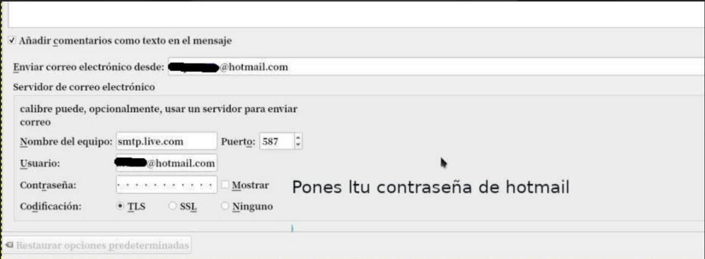
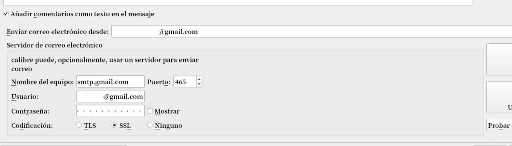
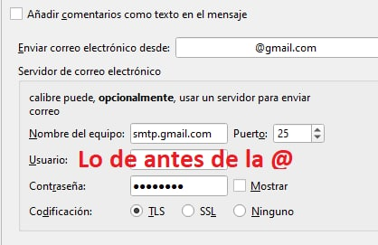
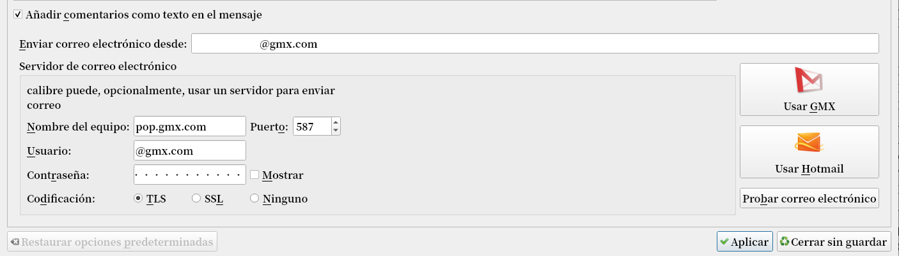
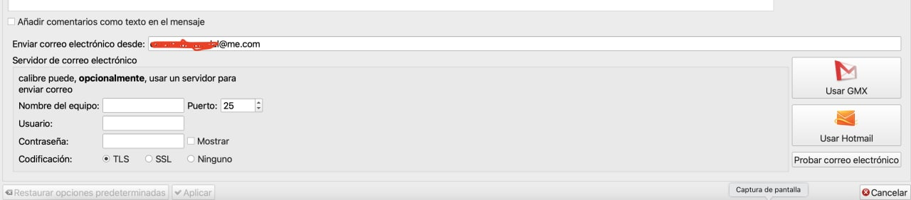

# Envío de correo - configuraciones

:material-account: [Walter](https://t.me/Dunhill69){ target=_blank } · :material-link-variant: [Ver el original en Telegraph](https://telegra.ph/Env%C3%ADo-de-Correo---Configuraciones-10-14){ target=_blank }
{ .tut-datos }

---

Varias configuraciones para el envio de Correo desde Calibre. Nuestra dirección debe estar autorizada en por ejemplo Amazon para poder recibir correos desde ella.

**Hotmail:**

Configuración para correo Hotmail

Para los que usamos Hotmail para enviar correo desde Calibre, habría que probar hacer este cambio:

Preferencias-\> compartir por correo electrónico cambiar de smtp.live.com a smtp-mail.outlook.com y debería funcionar.

**Gmail:**

Configuración para correo gmail ( **Da errores por política de seguridad de gmail**)

**Otra configuración Gmail**

**Gmx**

Configuración para correo gmx

Ir a mensaje: [https://t.me/calibreconfiguraciones/28554](https://t.me/calibreconfiguraciones/28554)

**Desde Mac**

 

## [Volver al inicio](https://telegra.ph/Indice-Calibre-en-Espa%C3%B1ol-10-03)

 

---

[:material-arrow-left: Volver al índice](../../alfabetico.md) · [:fontawesome-brands-telegram: Preguntar en el grupo](https://t.me/calibreconfiguraciones){ target=_blank }
