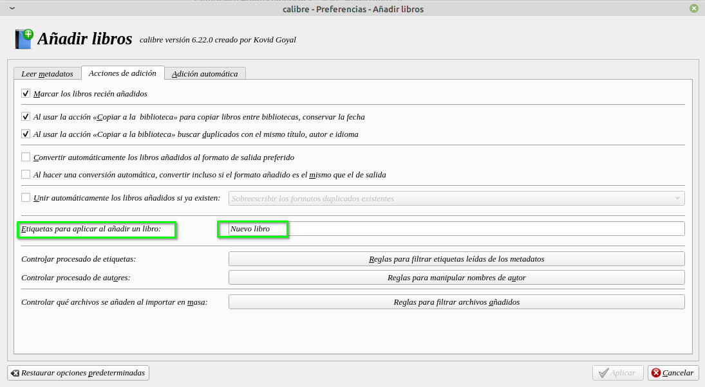
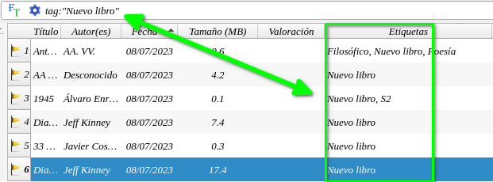

# Etiqueta al agregar libro

:material-account: [Walter](https://t.me/Dunhill69){ target=_blank } · :material-link-variant: [Ver el original en Telegraph](https://telegra.ph/Etiqueta-al-agregar-libros-07-09){ target=_blank }
{ .tut-datos }

---

A los diogenes de libros y a aquellos que ingresan libros nuevos y después le hacen su revisión meticulosa, acá des traigo un truco que les puede resultar interesante.

Sabían que se puede agregar una etiqueta de forma automática en el mismo momento de agregar un libro a Calibre. Si no lo sabían se los muestro:

Si vamos a Preferencia/Añadir libros, en la opción "Etiquetas a aplicar al añadir libros" podemos agregar el nombre que nos guste ejemplo "Nuevo libro", "A Limpiar"

Y si hacemos una búsqueda de etiquetas, como en este caso: tag:"Nuevo Libro" vemos el resultado en la pantalla principal de Calibre. Y si agregamos esta búsqueda a búsquedas guardadas podemos crear una biblioteca virtual.

Ir al mensaje: [https://t.me/calibreconfiguraciones/112333/139604](https://t.me/calibreconfiguraciones/112333/139604)

## [Volver al inicio](https://telegra.ph/Indice-Calibre-en-Espa%C3%B1ol-10-03)

 

---

[:material-arrow-left: Volver al índice](../../alfabetico.md) · [:fontawesome-brands-telegram: Preguntar en el grupo](https://t.me/calibreconfiguraciones){ target=_blank }
