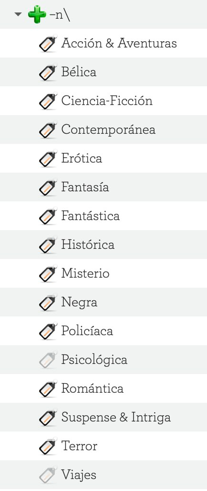
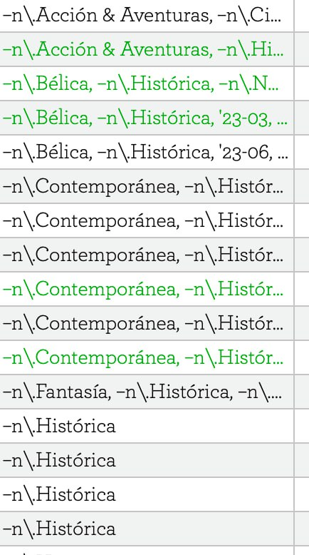
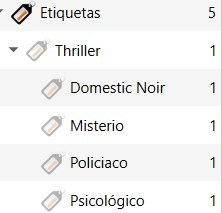
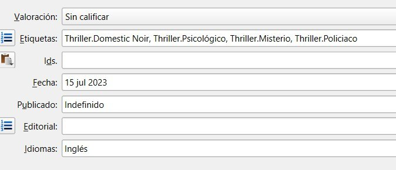
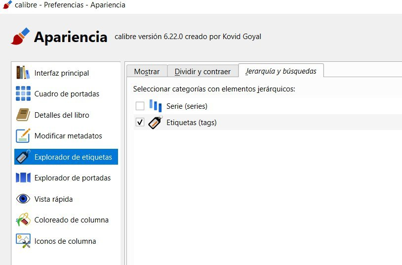

# Etiquetas jerárquicas

:material-account: [Walter](https://t.me/Dunhill69){ target=_blank } · :material-link-variant: [Ver el original en Telegraph](https://telegra.ph/Etiquetas-a%C3%B1adidas-o-Jer%C3%A1rquicas-07-15){ target=_blank }
{ .tut-datos }

---

Explicado por  @Inatxo

Otra opción en relación con la etiquetas, es utilizar las etiquetas anidadas. Es decir. Hay ocasiones en que no basta poner una etiqueta de Historia, y conviene señalar por ejemplo medieval, antigua, moderna, etc.

Al igual puede ocurrir con la etiqueta novela, que yo resuelvo poniendo como aparece en la imagen, poniendo la etiqueta –n\\ seguida de un punto y luego Negra, Bélica, Histórica o lo que sea…

Al haber puesto el punto se convierte en una etiqueta anidada y aparece en el explorador de etiquetas como se ve en la primera imagen.

De este modo, para poner Novela Histórica, utilizo: (esto es una muestra)

–n\\.Histórica

(En la segunda imagen se ve como queda)

Aporte de @wiso\_wolo

Si lo queremos así:

Se debe cargar en etiquetas así:

Y marcar esta opción en preferencia/Apariencia

Explorador de etiquetas, solapa Jerarquía y búsquedas.

Y servirá para las categorías que quisiéramos.

Ir al mensaje: [https://t.me/calibreconfiguraciones/112333/139629](https://t.me/calibreconfiguraciones/112333/139629)

[https://t.me/calibreconfiguraciones/112333/140597](https://t.me/calibreconfiguraciones/112333/140597)

## [Volver al inicio](https://telegra.ph/Indice-Calibre-en-Espa%C3%B1ol-10-03)

 

 

---

[:material-arrow-left: Volver al índice](../../alfabetico.md) · [:fontawesome-brands-telegram: Preguntar en el grupo](https://t.me/calibreconfiguraciones){ target=_blank }
