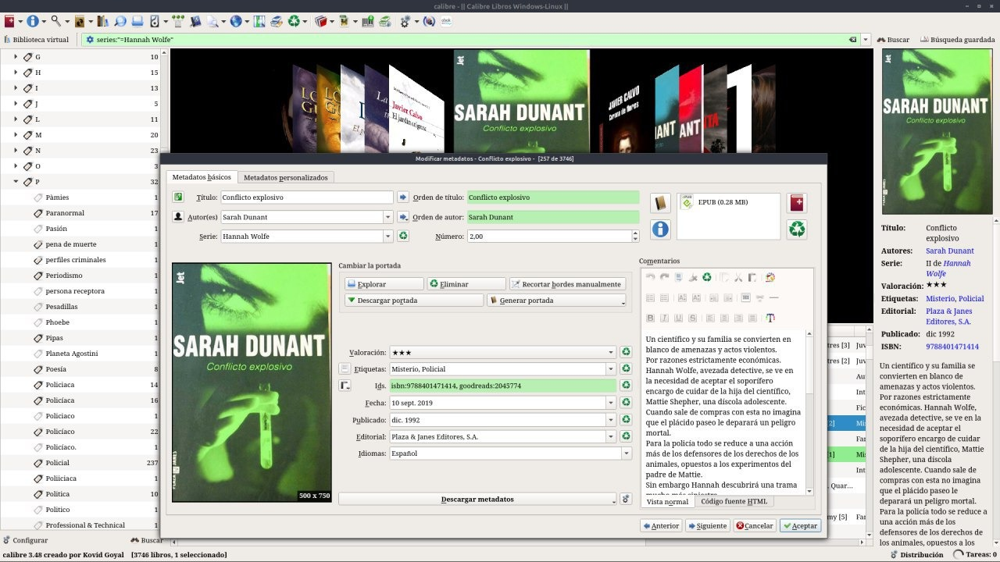

# Etiquetas

:material-link-variant: [Ver el original en Telegraph](https://telegra.ph/Etiquetas-08-22){ target=_blank }
{ .tut-datos }

---

Calibre organiza por Etiquetas, si tambien de la misma forma que las series y Autores. Si nosotros no cargamos esos datos el programa no los va a encontar. Acá vemos las etiquetas cargadas en la ventana central y como las organiza a la izquierda.

 

## [Volver al inicio](https://telegra.ph/Indice-Calibre-en-Espa%C3%B1ol-10-03)

 

 

 

---

[:material-arrow-left: Volver al índice](../../alfabetico.md) · [:fontawesome-brands-telegram: Preguntar en el grupo](https://t.me/calibreconfiguraciones){ target=_blank }
