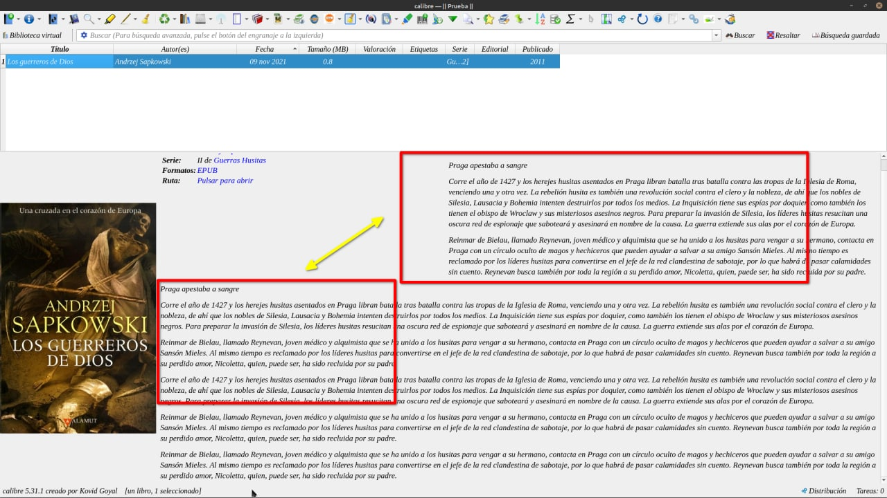
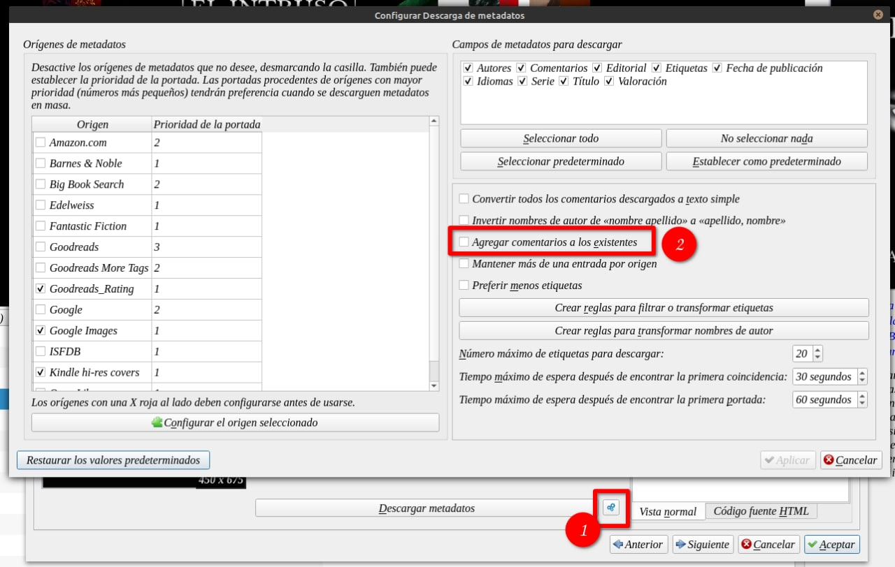
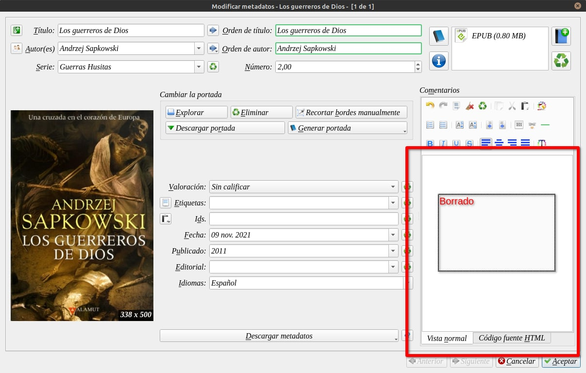
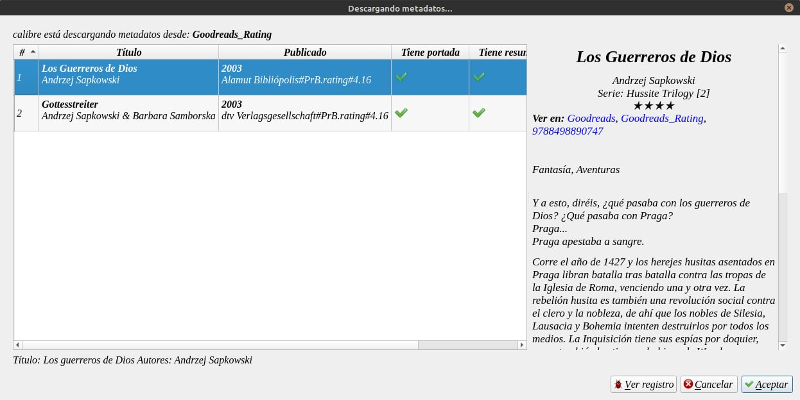
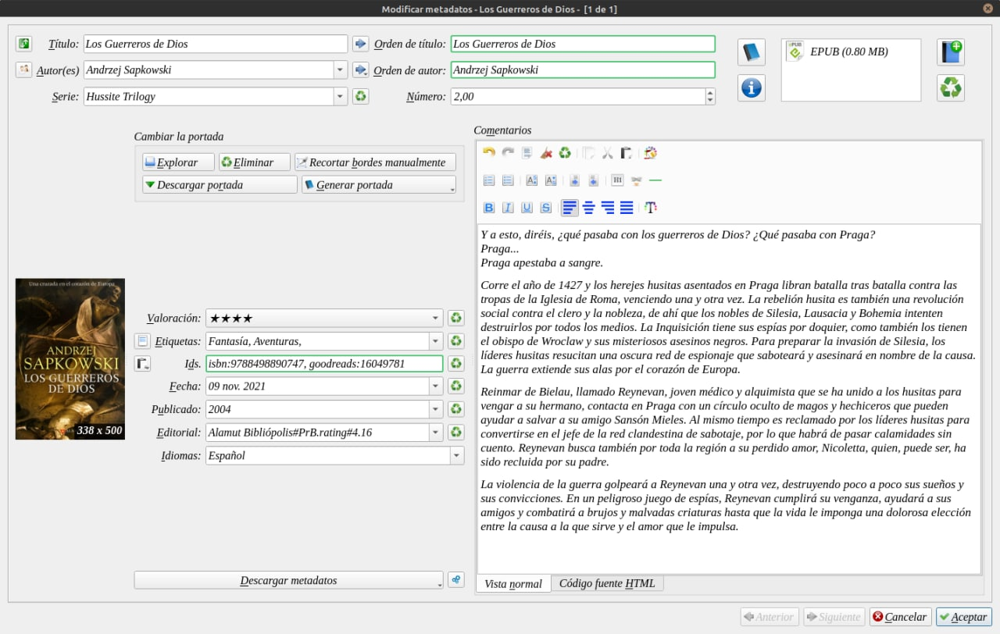

# Evitar la sinopsis duplicada

:material-account: [Walter](https://t.me/Dunhill69){ target=_blank } · :material-link-variant: [Ver el original en Telegraph](https://telegra.ph/Evitar-la-sinopsis-duplicada-11-09){ target=_blank }
{ .tut-datos }

---

Si al cargar un libro o descargar metadatos vemos que se duplica el texto en la sinopsis,

Eso depende como tengamos cargada la configuración al descargar metadatos.

En la pantalla de metadatos, tocamos las rueditas dentadas (1) y desmarcamos, en el caso de tener marcada la casilla "Agregar comentarios a los existentes". Esta opción sirve se queremos tener la sinopsis de los lugares diferentes.

Estos son los pasos que hice para que se pueda apreciar.

1.Borramos la sinopsis

2.Descargamos Metadato

3. Y se puede ver que queda una sola sinopsis cargada.

Ir al mensaje: [https://t.me/calibreconfiguraciones/52723](https://t.me/calibreconfiguraciones/52723)

## [Volver al inicio](https://telegra.ph/Indice-Calibre-en-Espa%C3%B1ol-10-03)

 

---

[:material-arrow-left: Volver al índice](../../alfabetico.md) · [:fontawesome-brands-telegram: Preguntar en el grupo](https://t.me/calibreconfiguraciones){ target=_blank }
