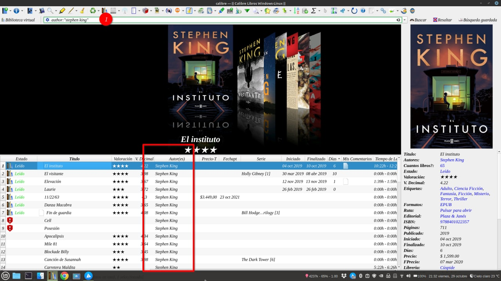
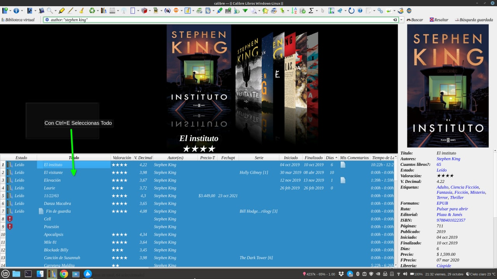
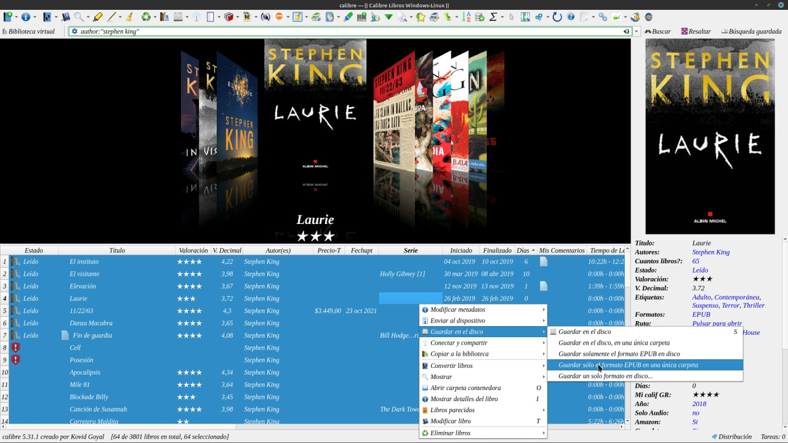
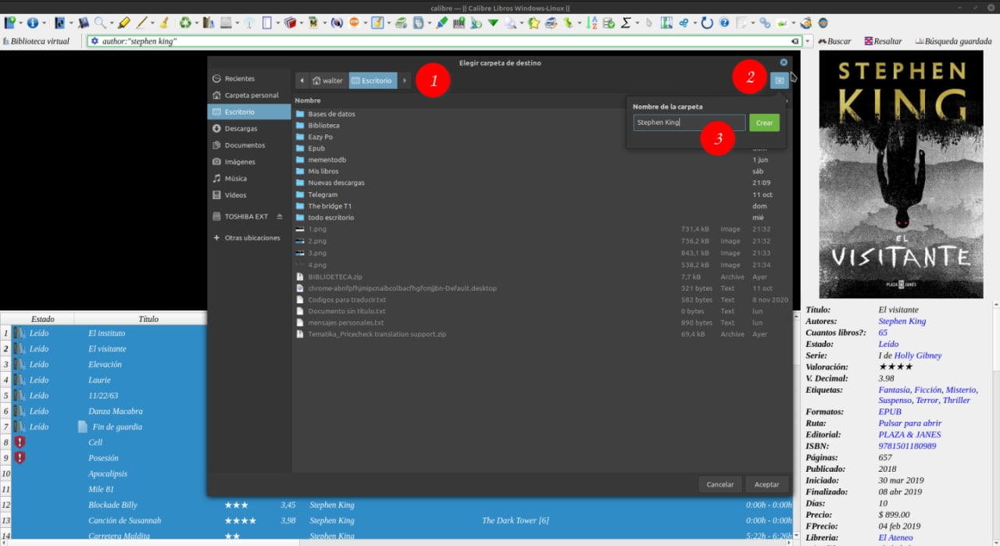
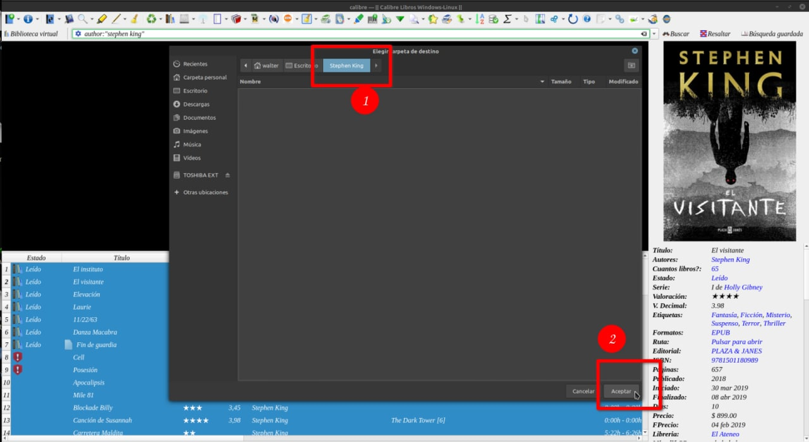
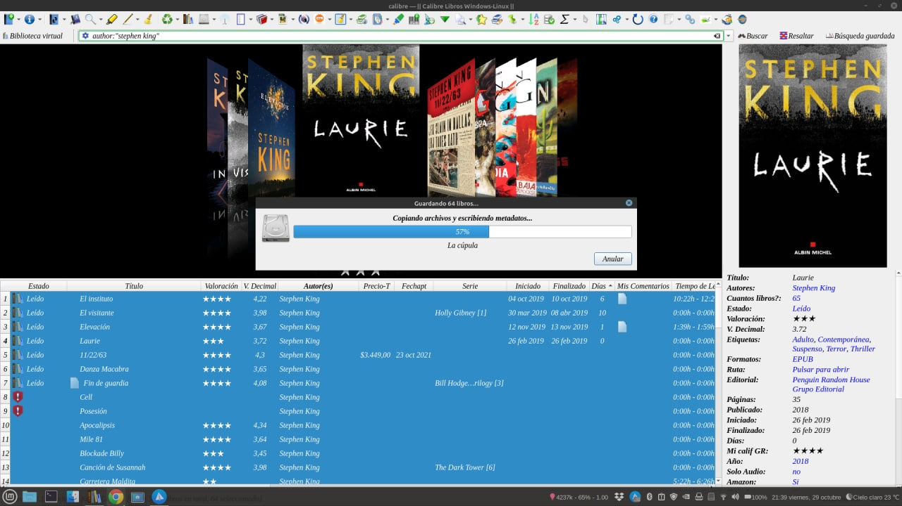
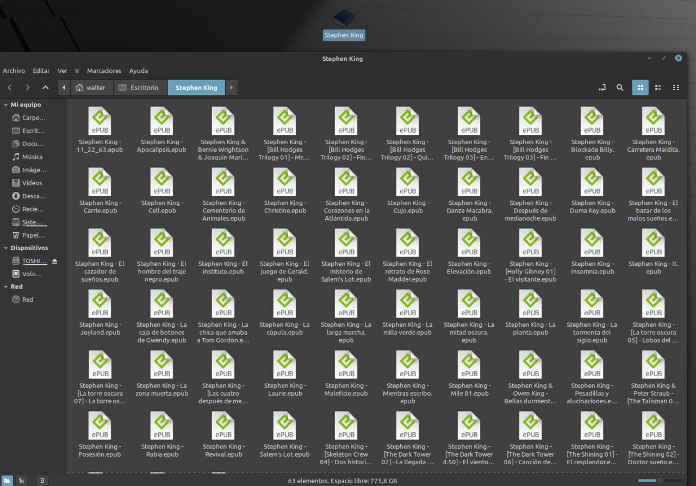
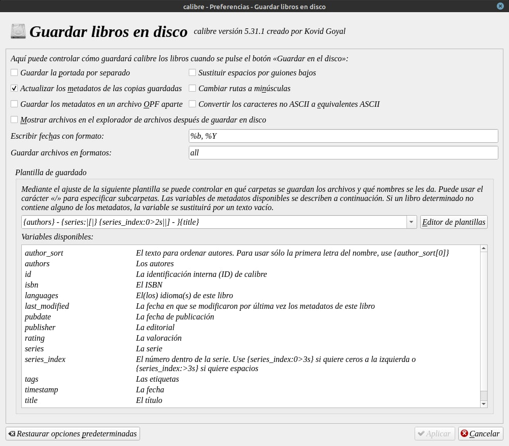

# Exportar todos los libros de un autor a una sola carpeta

:material-account: [Walter](https://t.me/Dunhill69){ target=_blank } · :material-link-variant: [Ver el original en Telegraph](https://telegra.ph/Exportar-todos-los-libros-de-un-autor-a-una-sola-carpeta-10-30){ target=_blank }
{ .tut-datos }

---

Buscas tu autor que quieres exportar en la barra de herramientas, pones author:"Stephen King"

Después con ctrl +E seleccionas todo

Con el botón Derecho del mouse guardar en disco, guardar solo el formato epub en una única carpeta.

Seleccionamos donde guardar en este caso Escritorio (1) botón crear nueva Carpeta (2) y le escribimos el nombre a esa Carpeta se va a llamar Stephen King.

Se abre la carpeta creada y le damos en aceptar.

Empieza la exportación.

Y si abrimos la carpeta esta solo los archivos epub en una sola carpeta.

Revisa antes tu configuración de guardar en disco debe estar así para que no te guarde portada ni archivo opf.

 

Ir al mensaje: [https://t.me/calibreconfiguraciones/51120](https://t.me/calibreconfiguraciones/51120)

 

 

## [Volver al inicio](https://telegra.ph/Indice-Calibre-en-Espa%C3%B1ol-10-03)

 

---

[:material-arrow-left: Volver al índice](../../alfabetico.md) · [:fontawesome-brands-telegram: Preguntar en el grupo](https://t.me/calibreconfiguraciones){ target=_blank }
