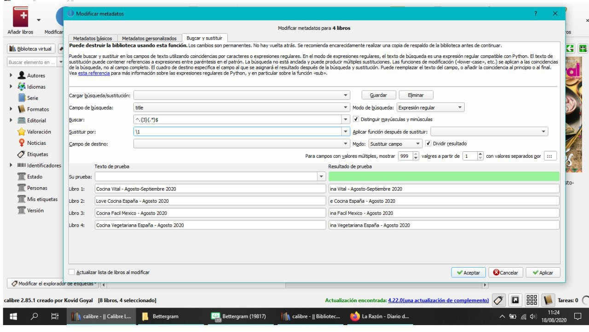
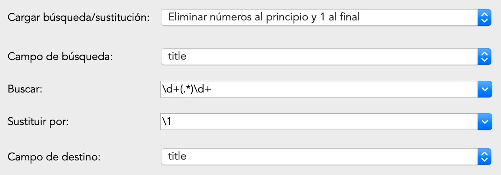
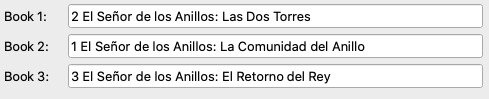
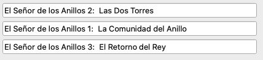
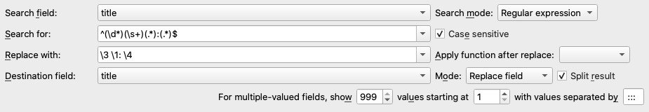
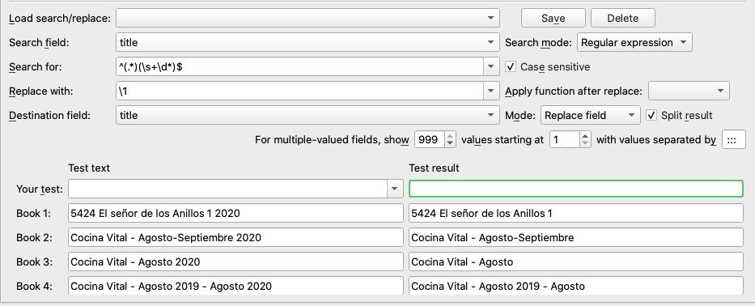
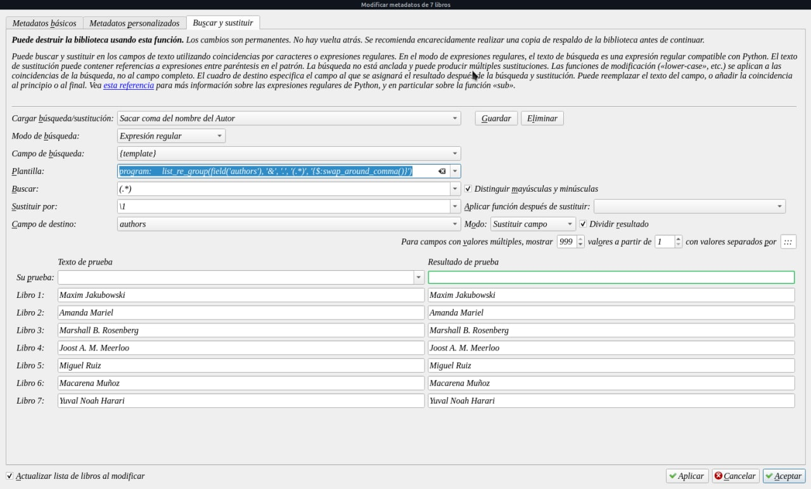
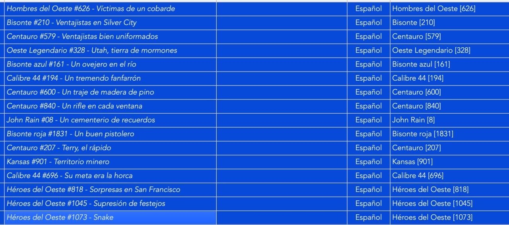
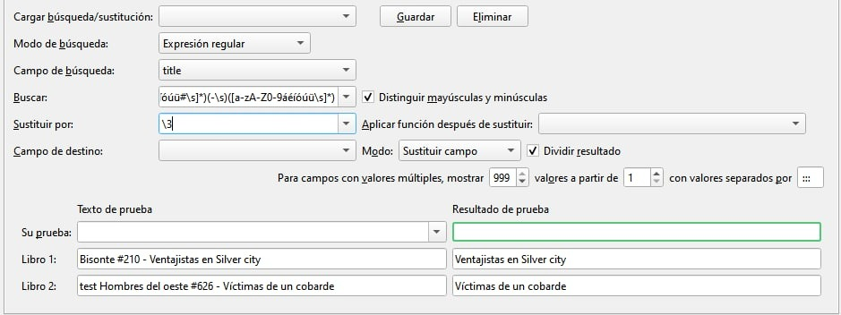

# Expresiones regulares

:material-account: Tutorial de Carla e Iván agregados Walter · :material-link-variant: [Ver el original en Telegraph](https://telegra.ph/Expresiones-regulares-08-18){ target=_blank }
{ .tut-datos }

---

Mira esta es para quitar caracteres de delante del titulo..Yo la uso para quitar numeros sobre todo.

Donde pone el 3 ..puedes poner otro numero y son los caracteres que te quita...lo que no recuerdo es la que se ponia para quitar los caracteres del final del titulo...voy a rebuscar a ver si la encuentro.

^.{3}(.\*)$

Guía para entender expresiones regulares: https[://www.adictosaltrabajo.com/tutoriales/regexsam/](https://www.adictosaltrabajo.com/tutoriales/regexsam/)

Elimina los números que haya al principio y sólo uno del final.

Para eliminar los números al final, debería de funcionarte algo como esto:

^(.\*)(\\s+\\d\*)$

He probado la expresión (no en Calibre) con estos textos:

5424 El señor de los Anillos 1 2020

Cocina Vital - Agosto-Septiembre 2020

Cocina Vital - Agosto 2020

Cocina Vital - Agosto 2019 - Agosto 2020

Y el resultado ha sido:

5424 El señor de los Anillos 1

Cocina Vital - Agosto-Septiembre

Cocina Vital - Agosto

Cocina Vital - Agosto 2019 - Agosto

La explicación de esa expresión es:

Grupo 1 (todo el texto que no sean los digitos al final)

^ En el inicio de la cadena

.\* selecciona cualquier texto

Grupo 2 (los digitos al final)

\\s+ Selecciona al menos un espacio en blanco (si hay más también funciona)

\\d\* y cualquier cantidad de digitos

$ siempre y cuando esten al final de la cadena

Y al sustituir solo uso lo que obtuve del grupo 1, ignorando al grupo 2.

Aprovecho para dejar otra variación que puede hacerse y que complica el asunto.

Supongamos que se quisiera limpiar el título de El señor de los anillos, para que pase de esto:

5424 El señor de los Anillos 1 2020

A esto:

El señor de los Anillos 1

En ese caso, armamos 3 grupos y sustituimos por lo que obtengamos del 2do grupo:

^(\\d{4}\\s?)(.\*)(\\s+\\d\*)$

Grupo 1

^ Al inicio de la cadena

\\d{4} selecciona 4 digitos

\\s y, si existe, al menos un espacio

Grupo 2

Selecciona todo el texto después del grupo 1 pero antes del grupo 3.

Grupo 3

\\s+ Selecciona al menos un espacio en blanco

\\d\* y cualquier cantidad de digitos

$ siempre y cuando esten al final de la cadena

Si probamos eso, entonces funcionará así. Esto:

5424 El señor de los Anillos 1 2020

5424El señor de los Anillos 1 2020

54 El señor de los Anillos 1 2020

Se convertirá en esto:

El señor de los Anillos 1

El señor de los Anillos 1

54 El señor de los Anillos 1 2020

El tercer ejemplo no coincide porque fuimos explicitos en decir que seleccionará los digitos sí y solo sí habían 4. No le importo que no hubiera espacio porque le dejamos eso libre, pero si le importo que no hubieran 4 digitos.

Si se quisiera adaptar para que incluya cualquier número de 1 hasta 4 digitos, entonces solo se cambia en el primer grupo:

\\d{4}

por

\\d{1,4}

En ese caso, se incluiría el tercer ejemplo, quedando así:

El señor de los Anillos 1

El señor de los Anillos 1

El señor de los Anillos 1

CÓMO REORDENAR UN TÍTULO USANDO EXPRESIONES REGULARES.

Supongamos que un ser malvado y terrible hizo que en su biblioteca de Calibre aparezca una cosa como esta.

Ustedes odian ese formato y quieren pasarlo a algo como esto:

La configuración en Calibre sería la siguiente.

^(\\d\*)(\\s+)(.\*):(.\*)$

La explicación de esa expresión sería la siguiente

Recordando lo básico de expresiones regulares:

^ Significa comienzo de la cadena

$ Significa fin de la cadena

() Un grupo es todo lo que esta dentro de paréntesis.

Entonces:

^ Al inicio de la cadena...

Grupo 1: (\\d\*)

\\d\* Selecciona todos los digitos (la cantidad que sea)

Grupo 2: (\\s+)

\\s+ Selecciona un espacio, si existe (que este después del grupo 1)

Grupo 3: (.\*)

.\* Selecciona cualquier texto (entre el grupo 2 y los dos puntos)

Grupo 4: (.\*)

.\* Selecciona cualquier texto (entre los dos puntos y el final de la cadena)

$ Final de la cadena.

Acabo de probarla y si funcionó.

Aunque algo que me ocurrió al copiarla desde Telegram, es que le puso un espacio en blanco al final, y con eso ya no funciona. Pero si le borras ese espacio en blanco, debiera de funcionar bien.

Para sacar la coma en los autores

program:

list\_re\_group(field('authors'), '&', '.', '(.\*)', '{$:swap\_around\_comma()}')

Para sacar la serie del título por wiso

La expresión es la siguiente:

(\[a-zA-Z0-9áéíóúü#\\s\]\*)(-\\s)(\[a-zA-Z0-9áéíóúü\\s\]\*)

Aún mejor:

(\[a-zA-Z0-9áéíóúü\\s\]\*)(\[# 0-9\]\*)(-\\s)(\[a-zA-Z0-9áéíóúü\\s\]\*)

cada grupo entre paréntesis del 1 al 4 (en este caso ignoramos el 2º grupo que sería el de # y la serie numérica)

\\1\\3\\4

Hombres del oeste #626 - Víctimas de un cobarde

\\1 =\> "Hombres del oeste "

\\2 =\> "#626"

\\3 =\> "- "

\\4 =\> "Víctimas de un cobarde"

Gracias wiso!!!

 

## [Volver al inicio](https://telegra.ph/Indice-Calibre-en-Espa%C3%B1ol-10-03)

 

 

 

 

---

[:material-arrow-left: Volver al índice](../../alfabetico.md) · [:fontawesome-brands-telegram: Preguntar en el grupo](https://t.me/calibreconfiguraciones){ target=_blank }
