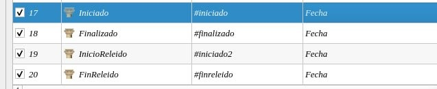
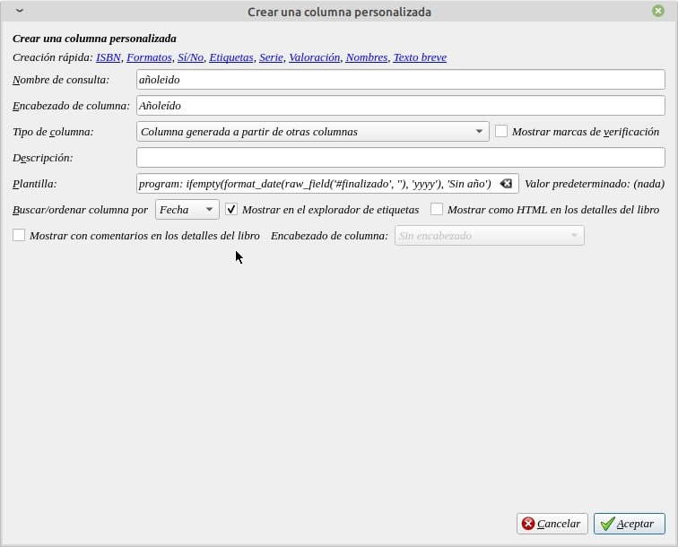
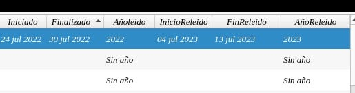
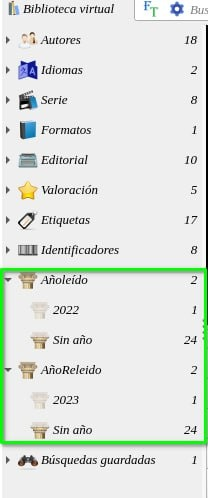

# Fecha para releídos (año)

:material-account: [Walter](https://t.me/Dunhill69){ target=_blank } · :material-link-variant: [Ver el original en Telegraph](https://telegra.ph/Fechas-para-rele%C3%ADdos-07-31){ target=_blank }
{ .tut-datos }

---

A raíz de una pregunta de @altair\_90

Tengo esta columna personalizada que es para que me contabilice los libros leídos en el año. Acabo de releer un libro y quisiera que se me contabilizase en los dos años que lo he leído. He creado otras dos columnas personalizadas en las que he puesto la fecha de inicio y final de la relección. Cómo sería la fórmula?

Respuesta: Deberíamos tener 4 columnas dos para la primera lectura y otras dos para la segunda.

Quedaría así:

Creamos una columna para que calcule el año tanto para leído como para releídos, la de año de esta manera.

Con esta fórmula: program: ifempty(format\_date(raw\_field('#dateendded', ''), 'yyyy'), 'Sin año')   En #dateendded pon tu nombre de columna personalizada. Para el año de primer lectura. Despues debes hacer lo mismo pero para la fecha final de releido y reemplazas #dateendded por el nombre de tu columna fecha final de releido

Se vería así:

Y en etiquetas así:

Ir al mensaje: [https://t.me/calibreconfiguraciones/112333/142204](https://t.me/calibreconfiguraciones/112333/142204)

 

## [Volver al inicio](https://telegra.ph/Indice-Calibre-en-Espa%C3%B1ol-10-03)

 

 

 

---

[:material-arrow-left: Volver al índice](../../alfabetico.md) · [:fontawesome-brands-telegram: Preguntar en el grupo](https://t.me/calibreconfiguraciones){ target=_blank }
