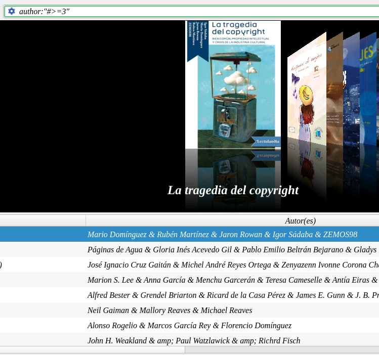
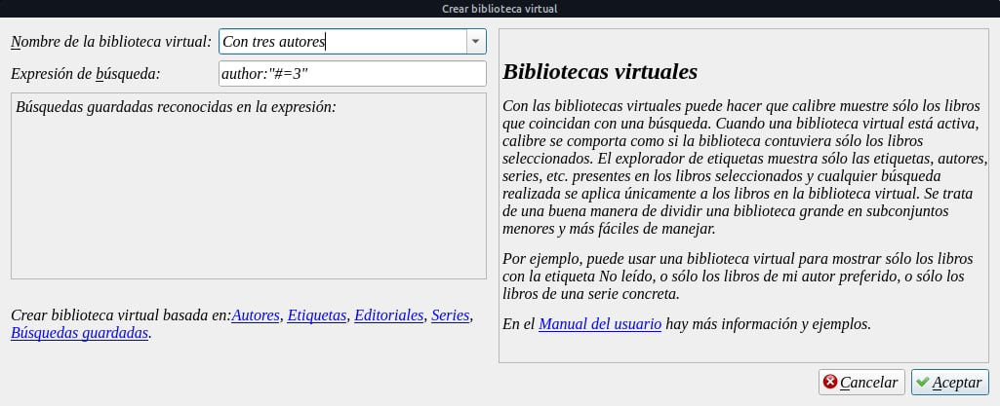
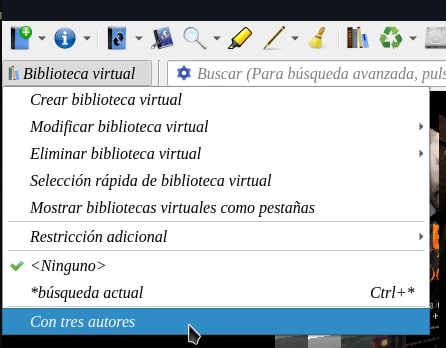
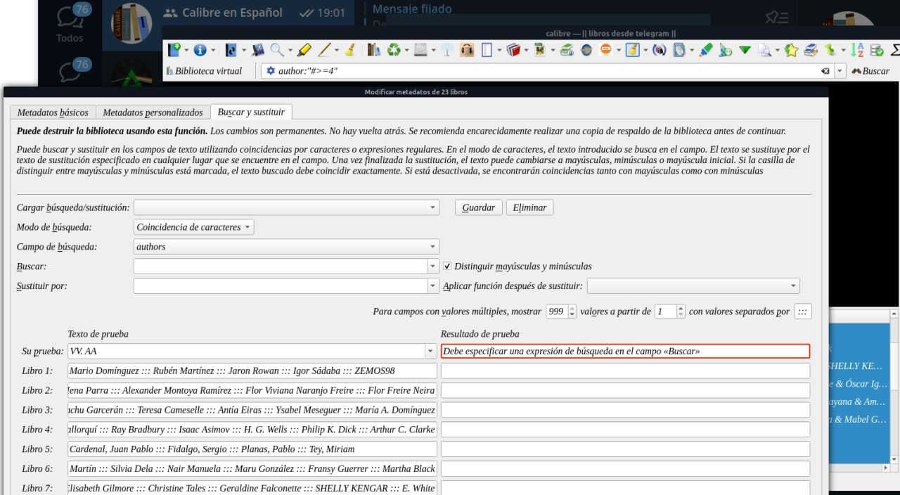

# Filtrar por más de 4 autores

:material-account: [Walter](https://t.me/Dunhill69){ target=_blank } · :material-link-variant: [Ver el original en Telegraph](https://telegra.ph/Filtrar-por-m%C3%A1s-de-4-autores-01-13){ target=_blank }
{ .tut-datos }

---

Fue una pregunta hecha con @juacar

Otra pregunta técnica.

Quiero buscar en mi biblioteca los libros que tengan mas de tres autores.

¿Cómo podría hacerlo?

A la cual @Valtteri007 dio con la respuesta, que seria poner esta formula en la barra de busqueda de Calibre

author:#\>=3

Así se ven los resultados

@Valtteri007 Si señores esto funciona author:#\>=3 de esta manera busca desde tres autores en adelante si en cambio eliminamos el signo = de la formula anterior busca solo los que tengan 3 autores author:#=3 por ende depende de la cantidad de autores que tenga @juancar deberá ir cambiando por el número deseado. Y para no volver a repetir la búsqueda estaría bueno guardar la búsqueda como biblioteca virtual. Por lo que dijo @juacar el a partir de 3 autores lo consideraría VV. AA entonces la formula seria esta author:"#\>=4"

 

O podría seleccionar todos los libros que figuren como resultado y Modificar metadatos en masa y reemplazar el campo título.

 

Ir al mensaje: [https://t.me/calibreconfiguraciones/62433](https://t.me/calibreconfiguraciones/62433)

## [Volver al inicio](https://telegra.ph/Indice-Calibre-en-Espa%C3%B1ol-10-03)

 

---

[:material-arrow-left: Volver al índice](../../alfabetico.md) · [:fontawesome-brands-telegram: Preguntar en el grupo](https://t.me/calibreconfiguraciones){ target=_blank }
