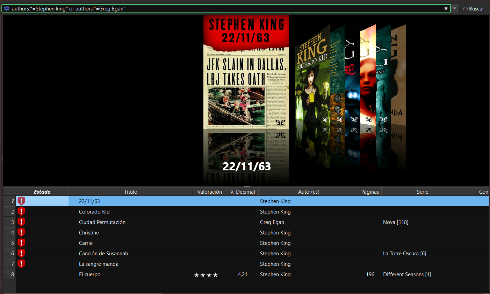
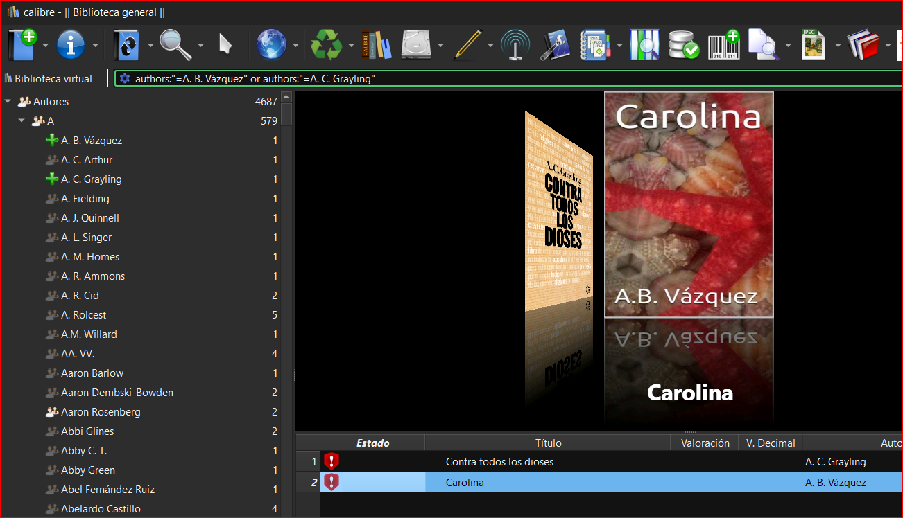

# Filtrar por varios autores

:material-account: [Walter](https://t.me/Dunhill69){ target=_blank } · :material-link-variant: [Ver el original en Telegraph](https://telegra.ph/Filtrar-por-varios-autores-10-25){ target=_blank }
{ .tut-datos }

---

Explicado por @Inatxo

Existen dos maneras:

a) En la barra de búsquedas, siguiendo el esquema que te escribí antes vas poniendo el nombre de los autores… siguiendo esta estructura…

EJEMPLO:

authors:"=Deborah Revilla Abad" or authors:"=Leopoldo Abadía" or authors:"=José Javier Abasolo"

b) En la columna de la izq, bajo «autores» y con ello extendido, vas pinchando con la tecla CRTL presionada, cada uno de los autores que quieras visualizar (y verás que en la barra de búsqueda se van escribiendo simultáneamente la misma expresión anterior). Cuando acaba INTRO

 

ir al mensaje: [https://t.me/calibreconfiguraciones/21940](https://t.me/calibreconfiguraciones/21940)

[https://telegra.ph/Filtrar-por-varios-autores-10-25](https://telegra.ph/Filtrar-por-varios-autores-10-25)

 

## [Volver al inicio](https://telegra.ph/Indice-Calibre-en-Espa%C3%B1ol-10-03)

 

---

[:material-arrow-left: Volver al índice](../../alfabetico.md) · [:fontawesome-brands-telegram: Preguntar en el grupo](https://t.me/calibreconfiguraciones){ target=_blank }
