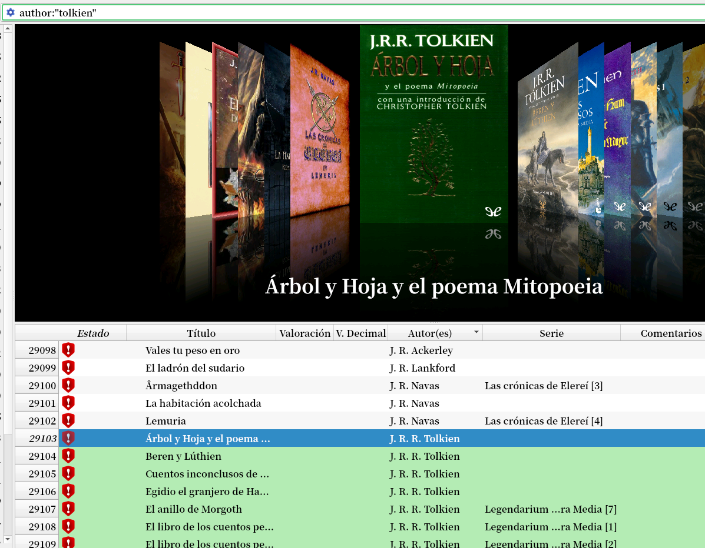
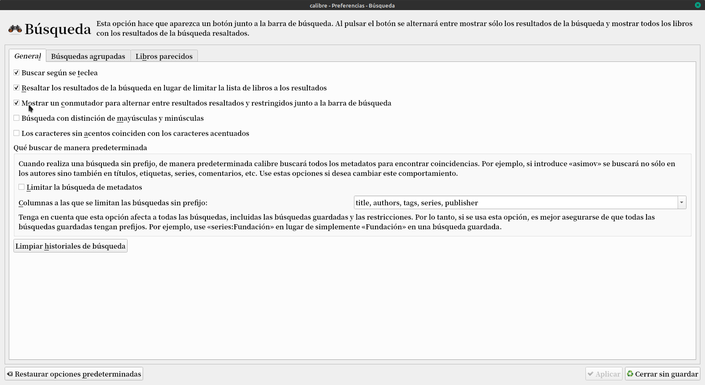
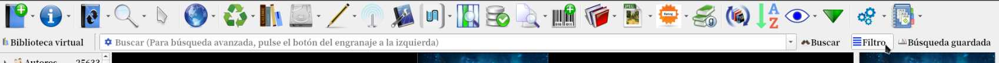
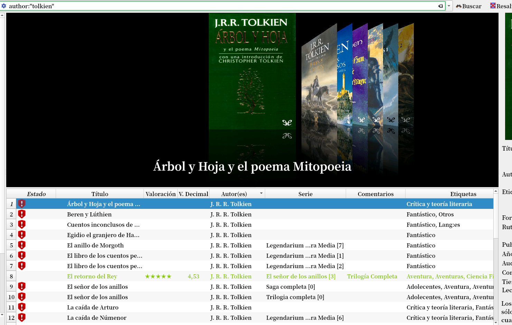

# Filtro de búsqueda

:material-account: [Walter](https://t.me/Dunhill69){ target=_blank } · :material-link-variant: [Ver el original en Telegraph](https://telegra.ph/Filtro-de-b%C3%BAsqueda-09-13){ target=_blank }
{ .tut-datos }

---

Muchas veces cuando hacemos una búsqueda por ejemplo de autor, calibre no nos filtra ese solo autor sino que lo colorea de verde. Acá quiero buscar Tolkien que como se ve esta remarcado en verde, pero también me trae otros autores pero solo queremos ver Tolkien.

Para solucionar esto debemos ir a preferencias/búsqueda y marcar la opción **Mostrar un conmutador para alternar entre resultados resaltados y restringidos junto a la barra de búsqueda.**

Nos aparece este icono de filtro al lago de la barra de búsqueda.

Volvemos a hacer la búsqueda author:"Tolkien"

Y tocamos el icono para que no resalte y ya tenemos filtrado el autor que elegimos.

## [Volver al inicio](https://telegra.ph/Indice-Calibre-en-Espa%C3%B1ol-10-03)

 

 

---

[:material-arrow-left: Volver al índice](../../alfabetico.md) · [:fontawesome-brands-telegram: Preguntar en el grupo](https://t.me/calibreconfiguraciones){ target=_blank }
