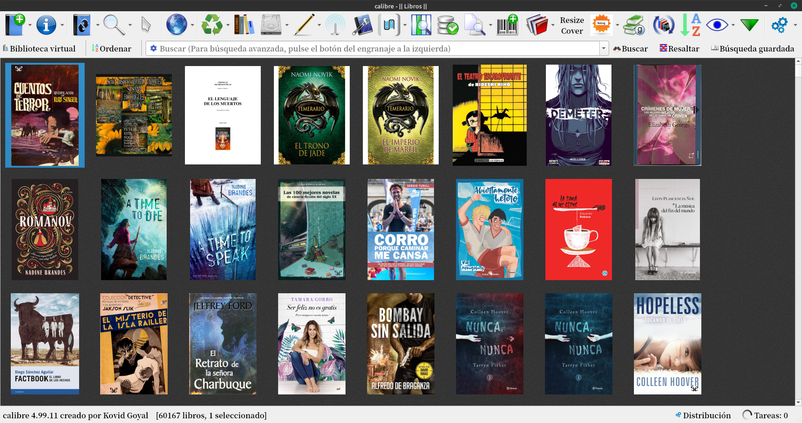
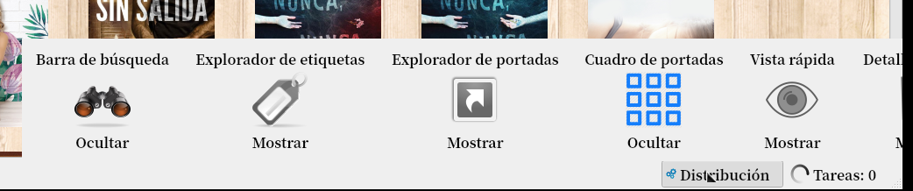
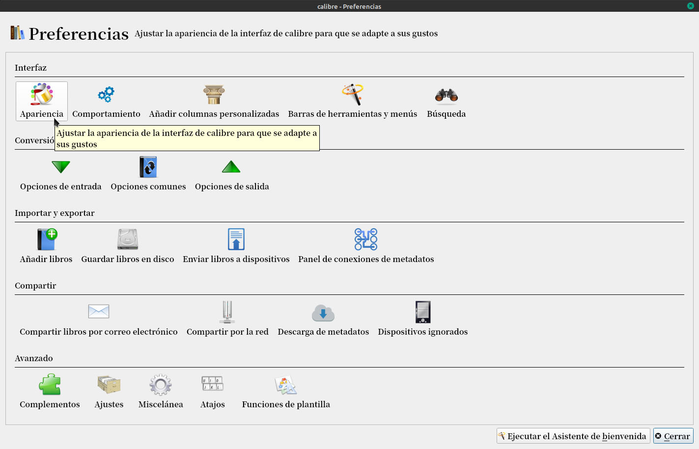
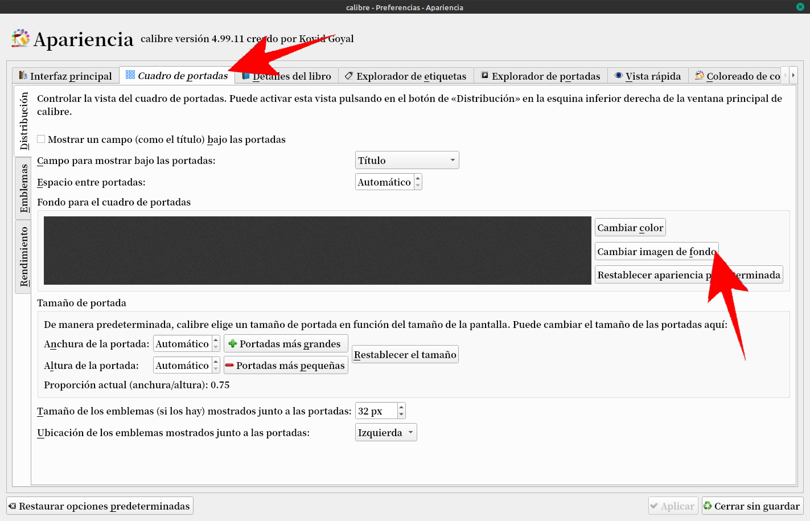
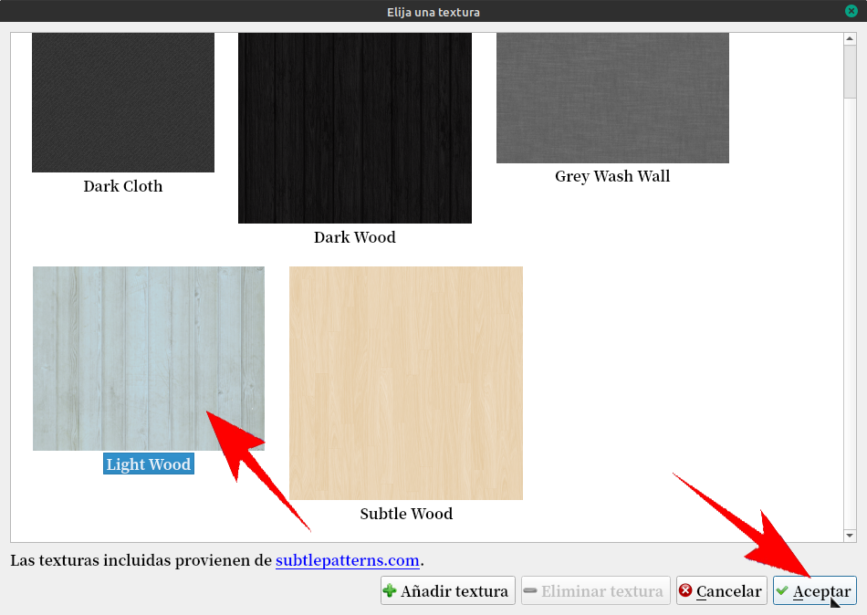
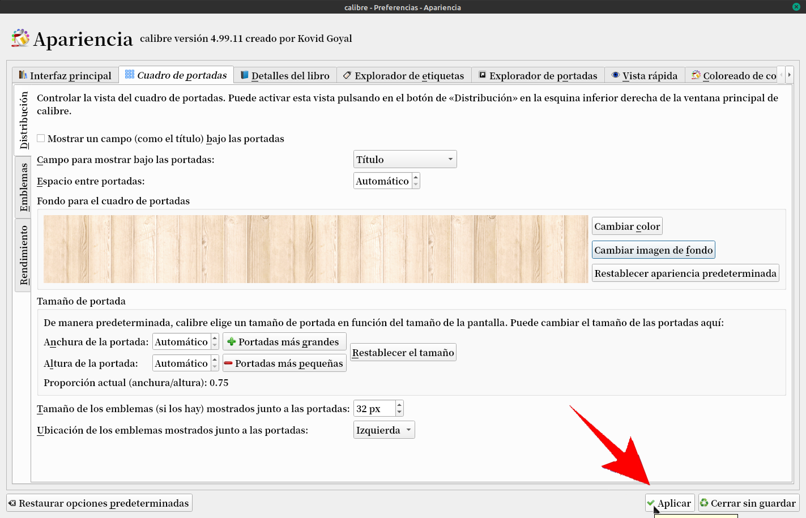
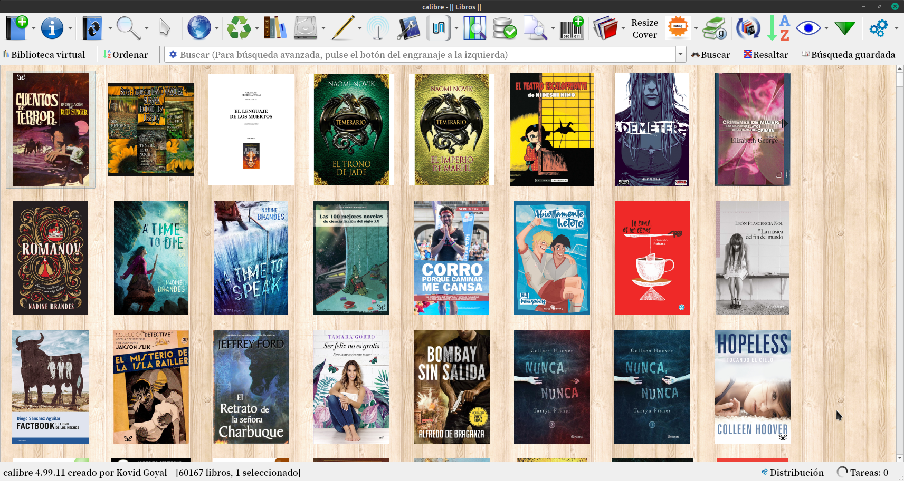
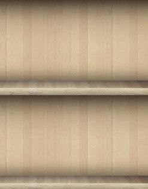
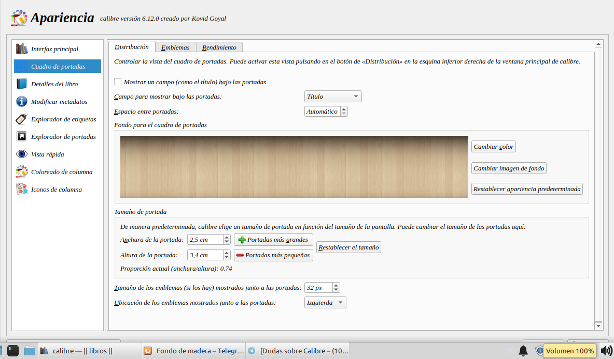

# Fondo de madera

:material-account: [Walter](https://t.me/Dunhill69){ target=_blank } · :material-link-variant: [Ver el original en Telegraph](https://telegra.ph/Fondo-de-madera-08-18){ target=_blank }
{ .tut-datos }

---

Me preguntaron si se podía personalizar el fondo de calibre, donde se ven las portadas, con alguna imagen de maderas.

Para ver así Calibre hay que dejar visible solamente el cuadro de portadas.

Vamos a Preferencias / Apariencias

Vamos a Cuadro de portadas y a cambiar la imagen de fondo

Se nos abre una pantalla con algunas imágenes pre cargadas, seleccionamos la de nuestro agrado o podemos añadir alguna y le damos en **Aceptar.**

Nos devuelve a la pantalla anterior mostrándonos el diseño elegido, le damos en **Aplicar.**

Y así nos queda el fondo de madera en las portadas

Para fondo de estanterias:

 

 

 

## [Volver al inicio](https://telegra.ph/Indice-Calibre-en-Espa%C3%B1ol-10-03)

---

[:material-arrow-left: Volver al índice](../../alfabetico.md) · [:fontawesome-brands-telegram: Preguntar en el grupo](https://t.me/calibreconfiguraciones){ target=_blank }
