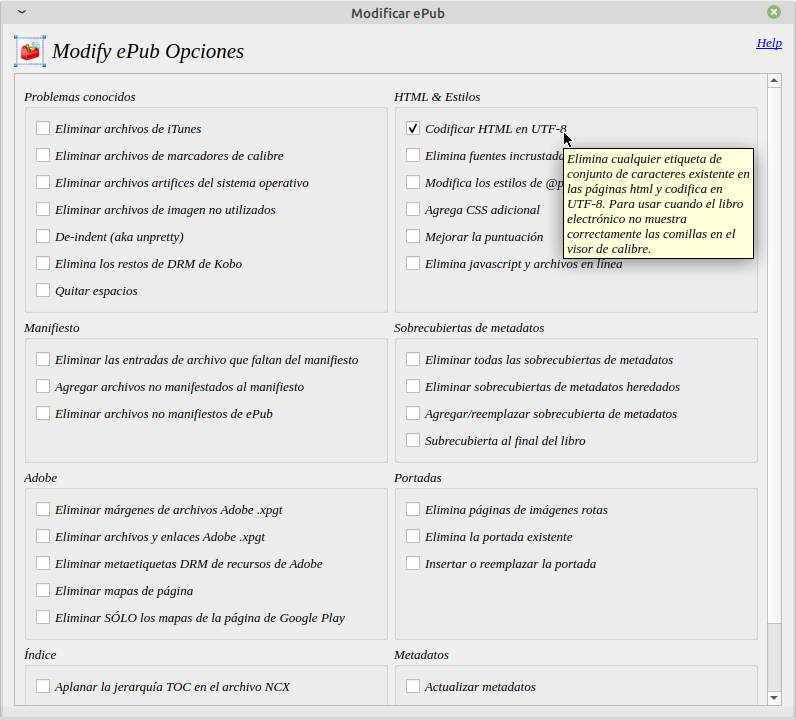

# Formato UTF-8

:material-account: [Walter Paterno](https://t.me/Dunhill69){ target=_blank } · :material-link-variant: [Ver el original en Telegraph](https://telegra.ph/Formato-UTF-8-02-12){ target=_blank }
{ .tut-datos }

---

Cuando envíes el libro electrónico en formato ePub, Amazon lo convertirá el formato EPUB a KF8 (AZW3).

¡Ojo! Amazon va a dejar de dar soporte a los formatos MOBI y AZW (antiguo) en «Send to Kindle».

¡Ojo! Es posible que no todas las conversiones de ePub a Kindle funcionen bien por problemas de codificación. El archivo EPUB estándar tiene un formato Unicode UTF-8 o UTF-16 con la codificación ISO 8859-1. Estos libros funcionan bien con Enviar a Kindle, pero si el eBook en formato ePub tiene otra codificación, las cosas no van a funcionar muy bien. Las cosas irán mejorando con el tiempo.

Con el complemento Modify Epub (Traducido al español por @dunhill69) podemos otorgarle el formato UTF-8 a nuestros archivos epub.

Teniendo el plugin Modify epub seleccionas toda tu biblioteca y marcas esta opción y aceptar y ya están en formato UTF-8.

 

## [Volver al inicio](https://telegra.ph/Indice-Calibre-en-Espa%C3%B1ol-10-03)

 

 

 

 

---

[:material-arrow-left: Volver al índice](../../alfabetico.md) · [:fontawesome-brands-telegram: Preguntar en el grupo](https://t.me/calibreconfiguraciones){ target=_blank }
