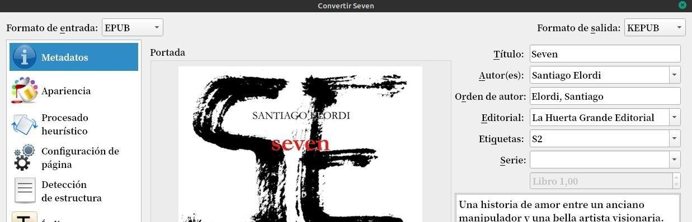
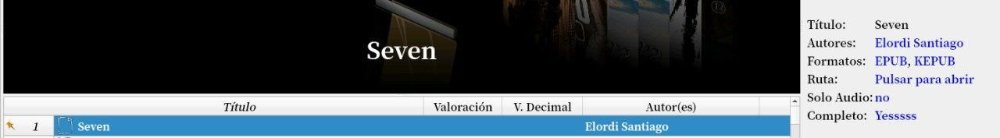

# Formato KEPUB

:material-account: [Walter](https://t.me/Dunhill69){ target=_blank } · :material-link-variant: [Ver el original en Telegraph](https://telegra.ph/Formatos-Kepub-08-23){ target=_blank }
{ .tut-datos }

---

Bueno hemos hecho pruebas con Iori al usar los plugin Kepub que son para dispositivos Kobo y kobo touch, los pasos fueron los siguientes instalamos los plugin de entrada y de salida.

Kepub Input [https://plugins.calibre-ebook.com/263594.zip](https://plugins.calibre-ebook.com/263594.zip)

Kepub Ouput [https://plugins.calibre-ebook.com/220565.zip](https://plugins.calibre-ebook.com/220565.zip)

Reiniciamos Calibre.

Tomamos un archivo epub y le decimos que lo queremos convertir a Kepub que ahora nos aparecerá en la lista por tener el plugin de salida !

Y obtenemos el archivo Kepub. Y para ver que funciona lo volví a cargar en Calibre, porque tenemos el plugin de entrada y ...

Calibre lo ingresó y me lo convierte a mi formato favorito (epub).

## [Volver al inicio](https://telegra.ph/Indice-Calibre-en-Espa%C3%B1ol-10-03)

 

---

[:material-arrow-left: Volver al índice](../../alfabetico.md) · [:fontawesome-brands-telegram: Preguntar en el grupo](https://t.me/calibreconfiguraciones){ target=_blank }
