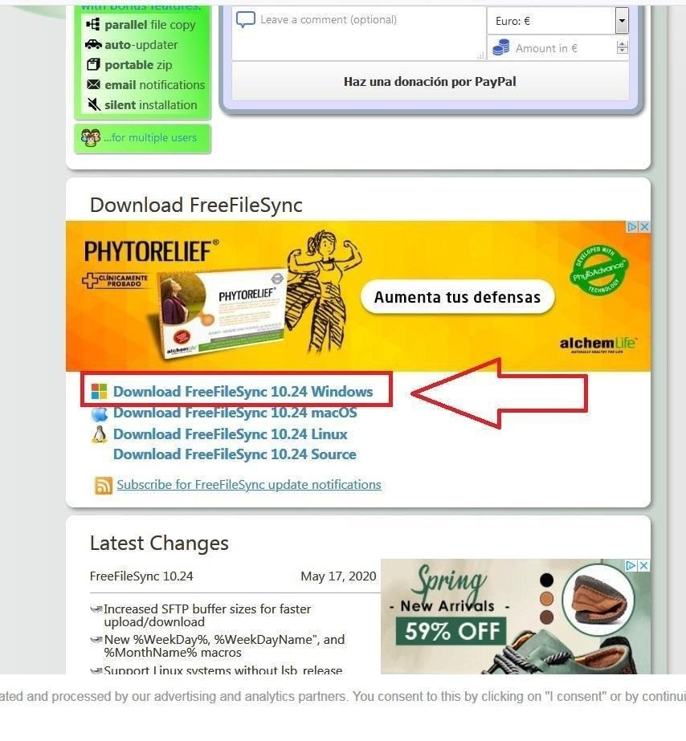
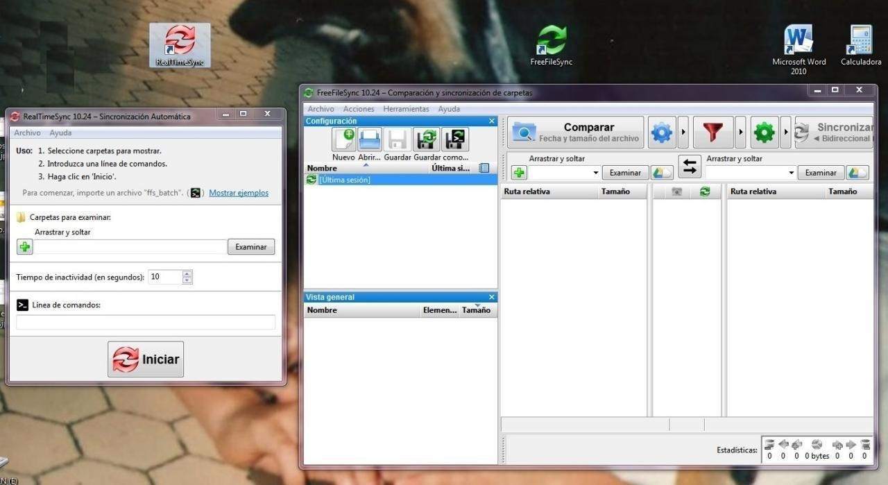
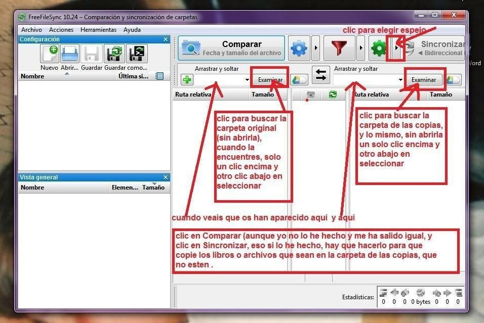

# FreeFileSync - copiar la biblioteca a otro disco externo

:material-account: [Walter](https://t.me/Dunhill69){ target=_blank } · :material-link-variant: [Ver el original en Telegraph](https://telegra.ph/Free-File-Sync---Copiar-biblioteca-calibre-a-otro-disco-externo-09-07){ target=_blank }
{ .tut-datos }

---

Es un programa muy sencillo que sirve para hacer copia de libros, fotos … archivos en general, con la ventaja de que actualizas las copias con solo lo que se ha añadido cada vez.

**1.- Descargarlo en el escritorio** (luego ya se quitará de ahí) descargamos Free file sync desde su página [https://freefilesync.org/download.php](https://freefilesync.org/download.php)

para descargarlo clicar en el que convenga para cada uno, en mi caso, Windows

**2.- Una vez descargado, doble clic encima del icono y ejecutar**, el idioma no hace falta elegirlo porque ya sale en castellano, ir aceptando todo lo que os pida ( cuidado que hay que cambiar la señal en un caso, en que está en NO aceptar y hay que señalar, la de aceptar, y también cuidado de desmarcar los enlaces directos, pero dejando eso sí, el del escritorio.

Una vez acabe os aparecerán en el escritorio, aparte de el del programa que habíais descargado, estos dos iconos :

el redondel rojo y el verde, que abiertos sale lo que hay debajo, el rojo no lo vais a necesitar, el verde es el que hay que dejar, es el acceso directo del programa, que abierto sale la pantallita de justo debajo y que es donde vais a tener que trabajar

Una vez hecho esto, podéis guardar en algún lado (en mi caso en el escritorio tengo una carpeta que se llama “iconos sin usar” y dentro de ella otra que se llama programas, donde voy guardando los programas) lo que os sobra y que molesta en el escritorio, que es el programa que os habéis descargado, y el redondel ese rojo.

De tal forma que en el escritorio os quede solo el icono del redondel verde

**3.- Y ahora ya para usar el programa:**

Primero que nada en el simbolito verde de herramientas, en la flechita elegís: espejo

Ahora hay que traer en la parte de la izqda.., en la primera cruz verde, la carpeta original y en la de la derecha la carpeta que hay que actualizar con la copia.

Para eso , clic en examinar primero en la carpeta de la izqda.., y luego en la de la derecha, ambas te comunican con tu ordenador, buscas primero la carpeta original para ponerla a la izquierda, y luego en el Examinar de la derecha buscas la carpeta donde tienes las copias y que se va a actualizar.

Luego cuando veais que ya las habéis traido al programa, clic en comparar (arriba) y clic en Sincronizar (arriba dcha). A mi se me ha olvidado darle a Comparar y me ha salido igual bien, pero lo suyo es hacerlo también

Pantallazo de todo esto:

Y ya está, dejáis que trabaje, si la carpeta tiene pocos libros nuevos tardará poquísimo, si tiene muchos pues tardará más, cuando termine podéis comparar en propiedades de la carpeta el peso y el numero de archivos y veréis que es idéntico.

**NOTA:** Yo me he descargado el calibre portable en la misma versión que tengo el fijo, y lo he guardado en el disco externo de la copia, así lo tengo todo independiente.

 

ir al mensaje: [https://t.me/calibreconfiguraciones/15133](https://t.me/calibreconfiguraciones/15133)

Ir al documento doc: [https://t.me/calibreconfiguraciones/15136](https://t.me/calibreconfiguraciones/15136)

[https://telegra.ph/Free-File-Sync---Copiar-biblioteca-calibre-a-otro-disco-externo-09-07](https://telegra.ph/Free-File-Sync---Copiar-biblioteca-calibre-a-otro-disco-externo-09-07)

 

## [Volver al inicio](https://telegra.ph/Indice-Calibre-en-Espa%C3%B1ol-10-03)

 

 

---

[:material-arrow-left: Volver al índice](../../alfabetico.md) · [:fontawesome-brands-telegram: Preguntar en el grupo](https://t.me/calibreconfiguraciones){ target=_blank }
