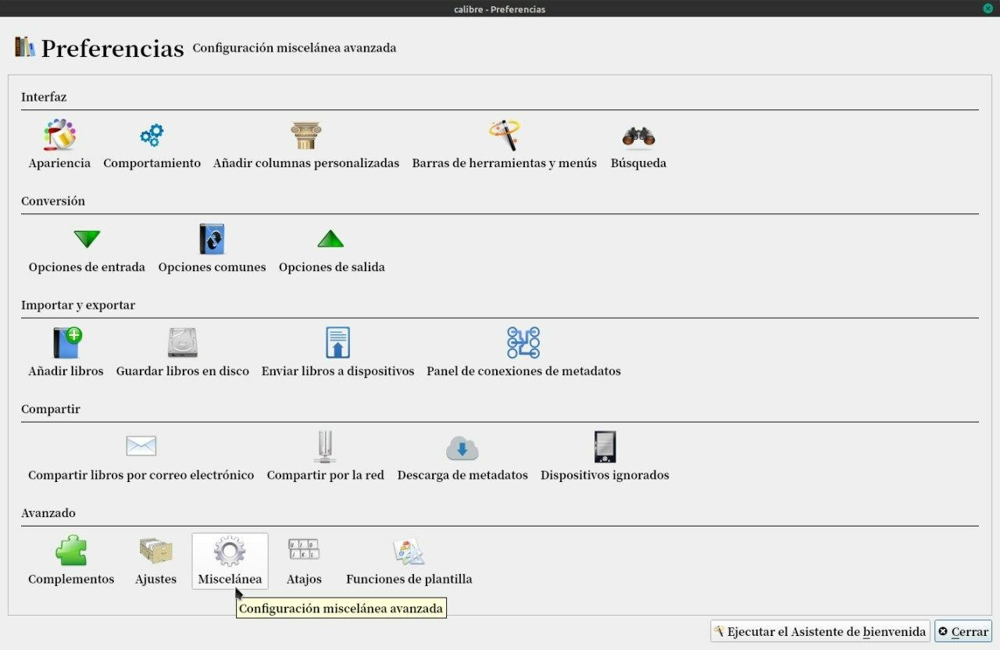
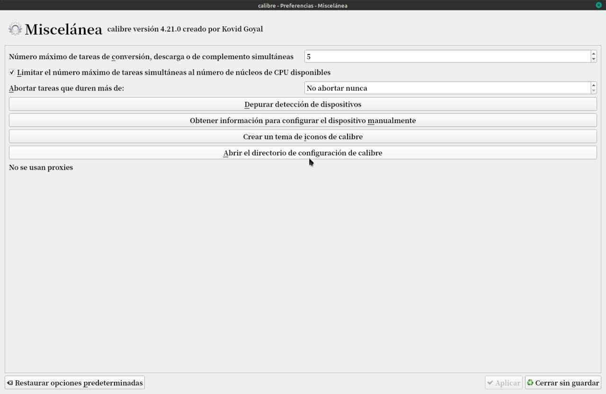

# Guardar configuración

:material-account: [Walter](https://t.me/Dunhill69){ target=_blank } · :material-link-variant: [Ver el original en Telegraph](https://telegra.ph/Guardad-configuraci%C3%B3n-08-16){ target=_blank }
{ .tut-datos }

---

Un amigo me preguntó si hay alguna manera de guardar la configuración de calibre para pasarla a otra Pc. Vas a Preferencia / Miscelaneas

Abrir directorio de configuración de Calibre.

Todo lo que esta ahí dentro se debe copiar en un pendrive o en algún lugar seguro y cuando cambie de Pc se hace el mismo paso pero en esa carpeta copias todo lo que se guardó en el pendrive.

 

## [Volver al inicio](https://telegra.ph/Indice-Calibre-en-Espa%C3%B1ol-10-03)

 

---

[:material-arrow-left: Volver al índice](../../alfabetico.md) · [:fontawesome-brands-telegram: Preguntar en el grupo](https://t.me/calibreconfiguraciones){ target=_blank }
