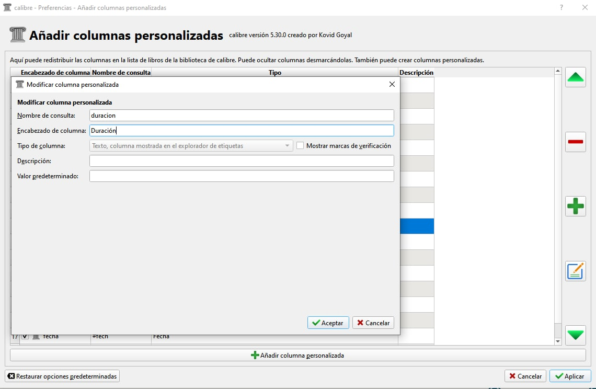
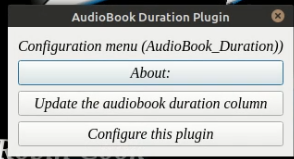
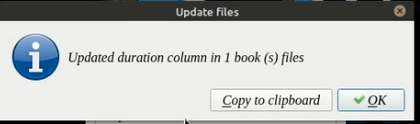
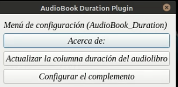
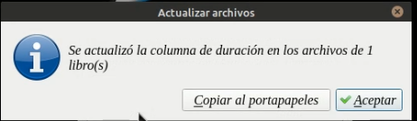
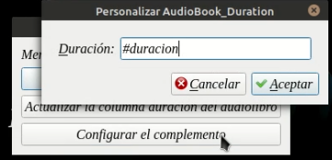

# Complemento - Audiobook Duration

:material-account: [Walter](https://t.me/Dunhill69){ target=_blank } · :material-link-variant: [Ver el original en Telegraph](https://telegra.ph/GUI-Plugin-AudioBook-Duration-11-14-2){ target=_blank }
{ .tut-datos }

---

Este complemento calcula la duración de los audiolibros o archivos de audio asociados a un libro (dentro de su carpeta), y agrega esa duración en una columna personalizada que hemos creado previamente para este propósito. (Será una columna de duración pero podemos llamarla como queramos).

Por el momento no tiene funciones adicionales.

### Principales características

Calcula la duración de los libros de nuestra biblioteca, o de los audios asociados que se incluyen en las carpetas de los libros seleccionados.

Pon ese resultado en una columna personalizada, previamente.

 

### Notas especiales

Requiere calibre 5, xx (python3)

Necesito python3

 

**Notas de instalación**

Descargue el archivo zip adjunto e instale el complemento como se describe en el subproceso Descripción general de complementos.

Puedes agregarlo a la barra de menú para usarlo cómodamente (se agrega por defecto)

1 ° Crear una columna personalizada

2º Pulsa el botón de nuestro plugin "AudioBook\_Duration" sobre el botón de configurar el complemento, y en este campo rellena el nombre de la columna # duración o el nombre que le hayas dado.

3 ° Seleccione un audiolibro de nuestra biblioteca de calibre y presione el botón "actualizar la columna de duración del audiolibro"

 

 

ir al mensaje: [https://t.me/calibreconfiguraciones/53499](https://t.me/calibreconfiguraciones/53499)

ir al pdf armado por @Llogur

[https://t.me/calibreconfiguraciones/53708](https://t.me/calibreconfiguraciones/53708)

 

## [Volver al inicio](https://telegra.ph/Indice-Calibre-en-Espa%C3%B1ol-10-03)

 

---

[:material-arrow-left: Volver al índice](../../alfabetico.md) · [:fontawesome-brands-telegram: Preguntar en el grupo](https://t.me/calibreconfiguraciones){ target=_blank }
