# Sinopsis dentro del libro (hacerla en Calibre)

:material-account: [Walter](https://t.me/Dunhill69){ target=_blank } · :material-link-variant: [Ver el original en Telegraph](https://telegra.ph/Hacer-sinopsis-en-Calibre-10-31){ target=_blank }
{ .tut-datos }

---

Aquí va el tuto, no os asusteis al verlo tan largo, que lo he hecho así precisamente para que cada paso quede reflejado en su correspondiente pantallazo, os teneis que descargar los pantallazos que están numerados, en una carpeta en vuestro ordenador y seguirlos por orden riguroso, si no, no os saldrá, si no sabeis usar photoshop, cualquier otro programa que os ponga los bordes transparentes en una imagen os valdrá, solo es para que quede mona la portadita, y si no sabeis usar ningun programa , pues no hagais los bordes transparente y dejais la portadita en medio que tampoco queda mal

aquí va el tuto de "Hacer sinopsis en calibre"

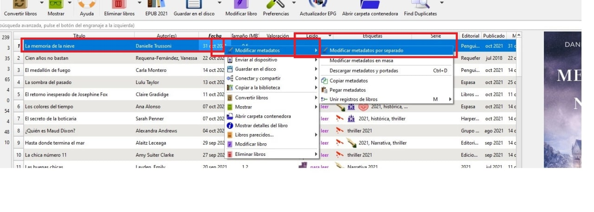

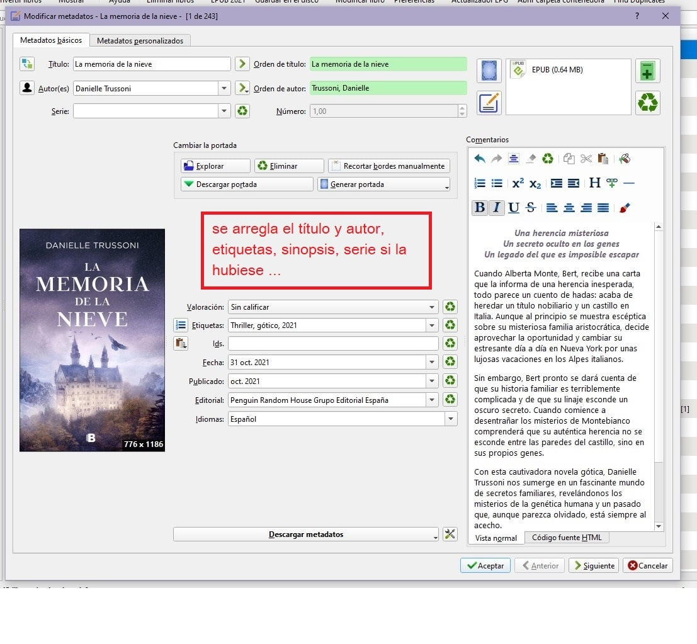

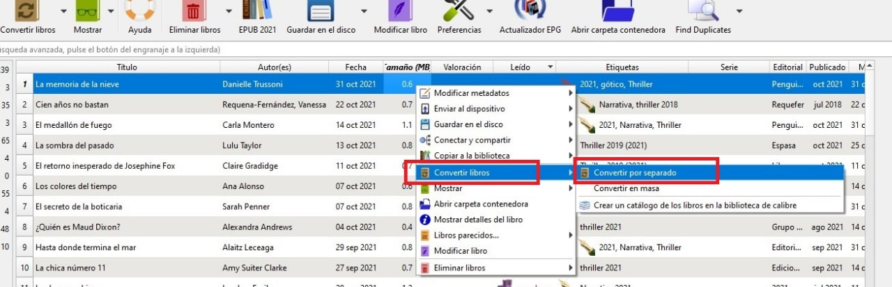

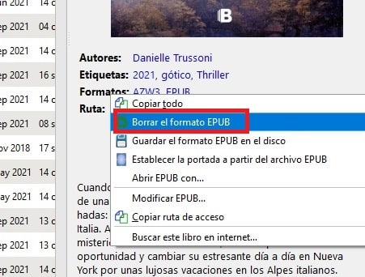

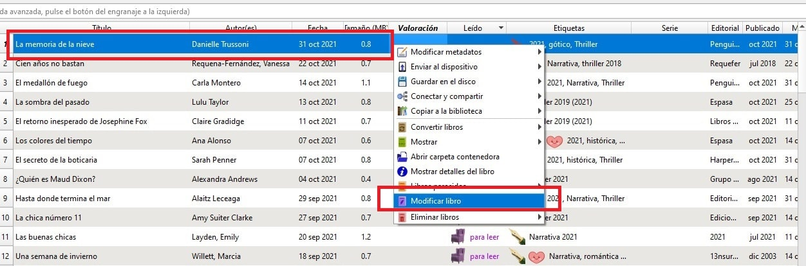

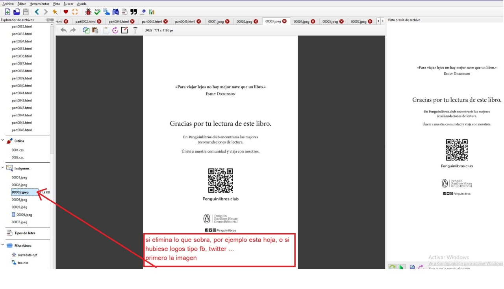

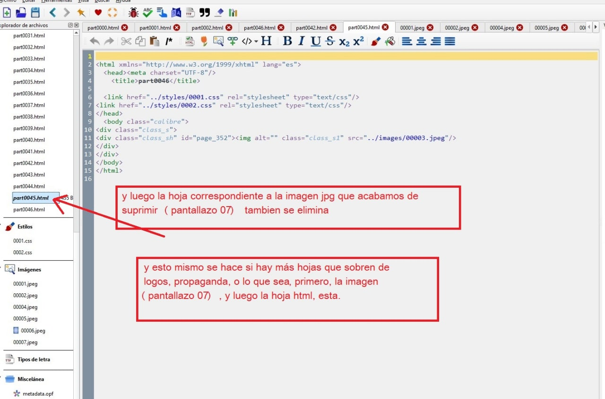

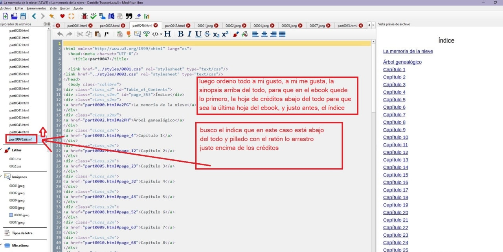

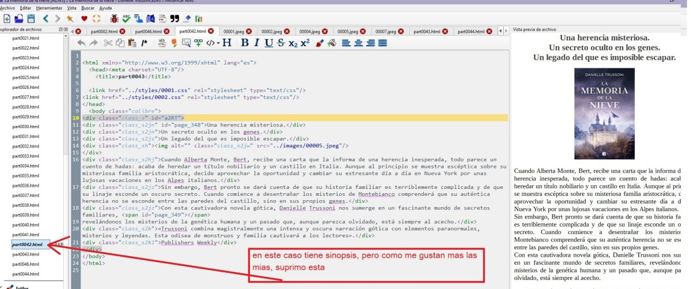

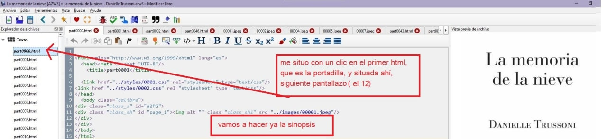

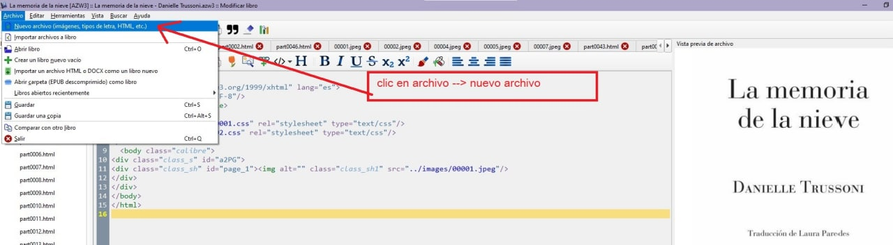

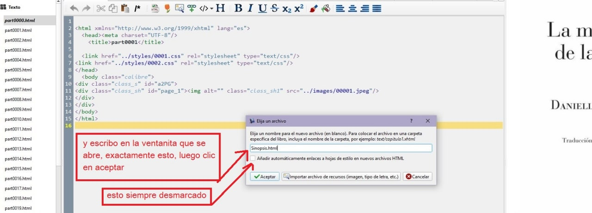

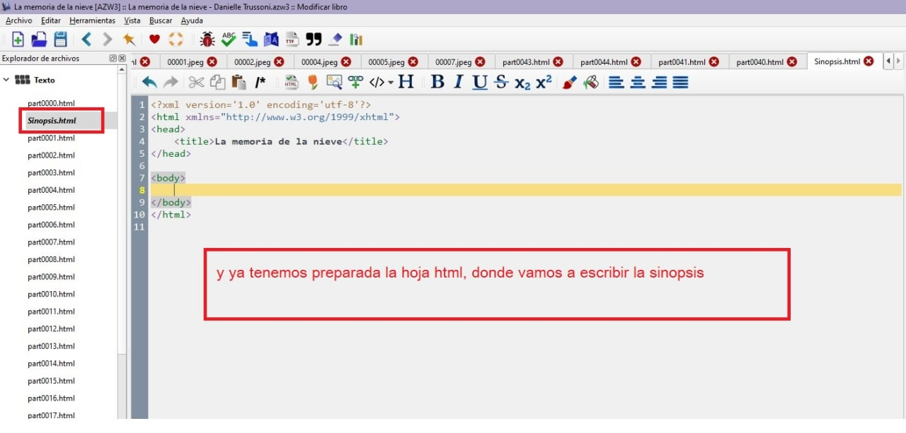

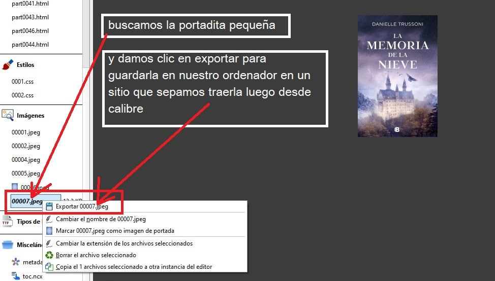

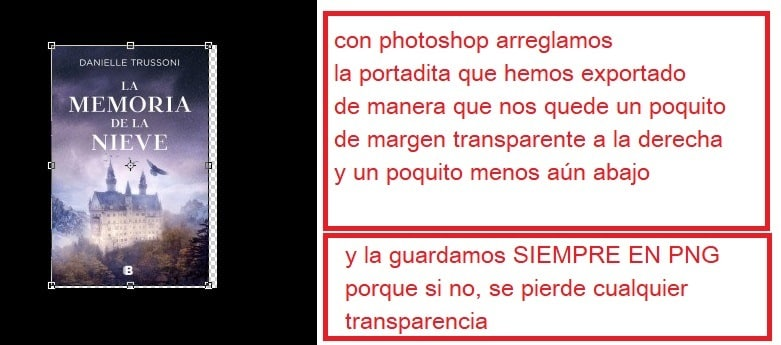

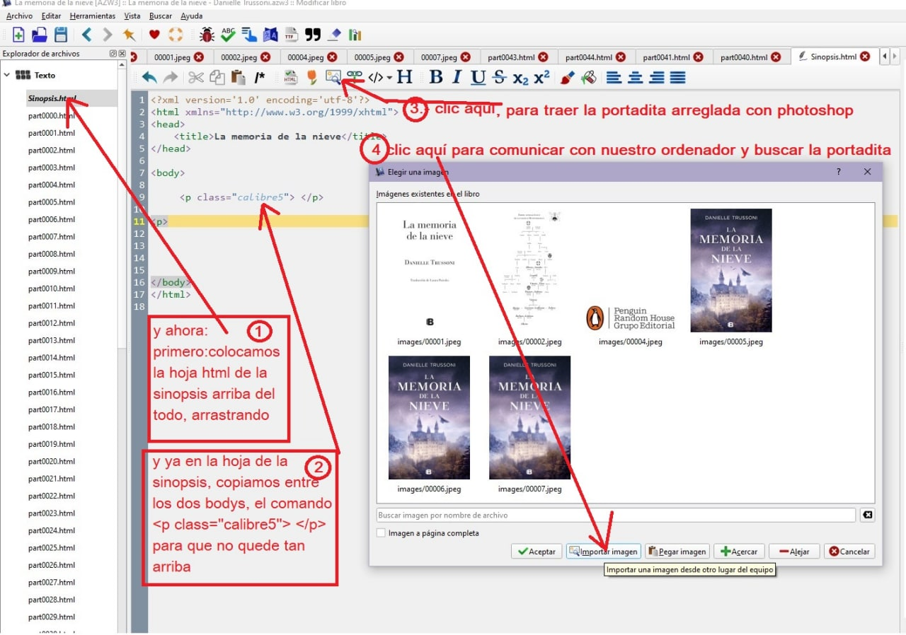

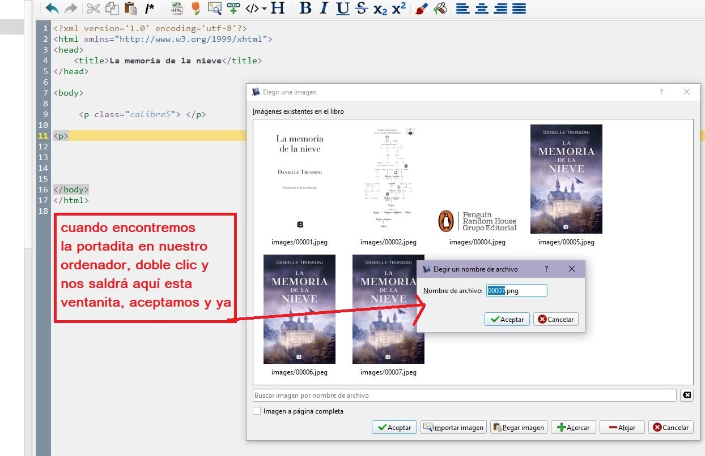

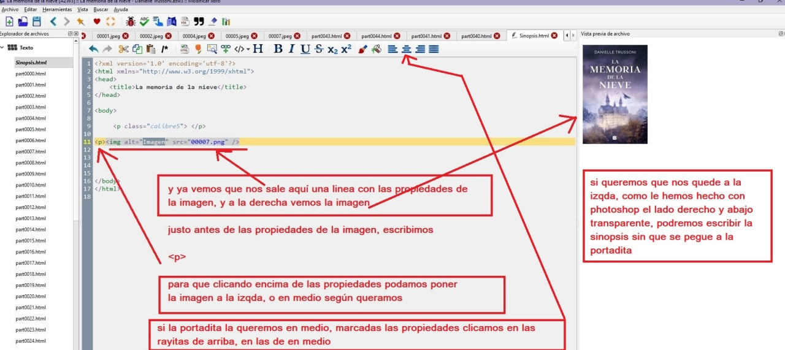

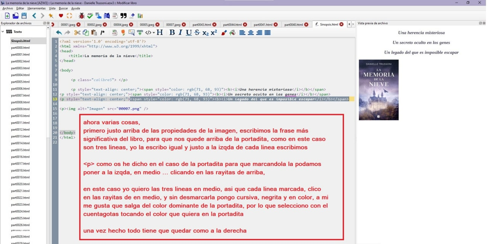

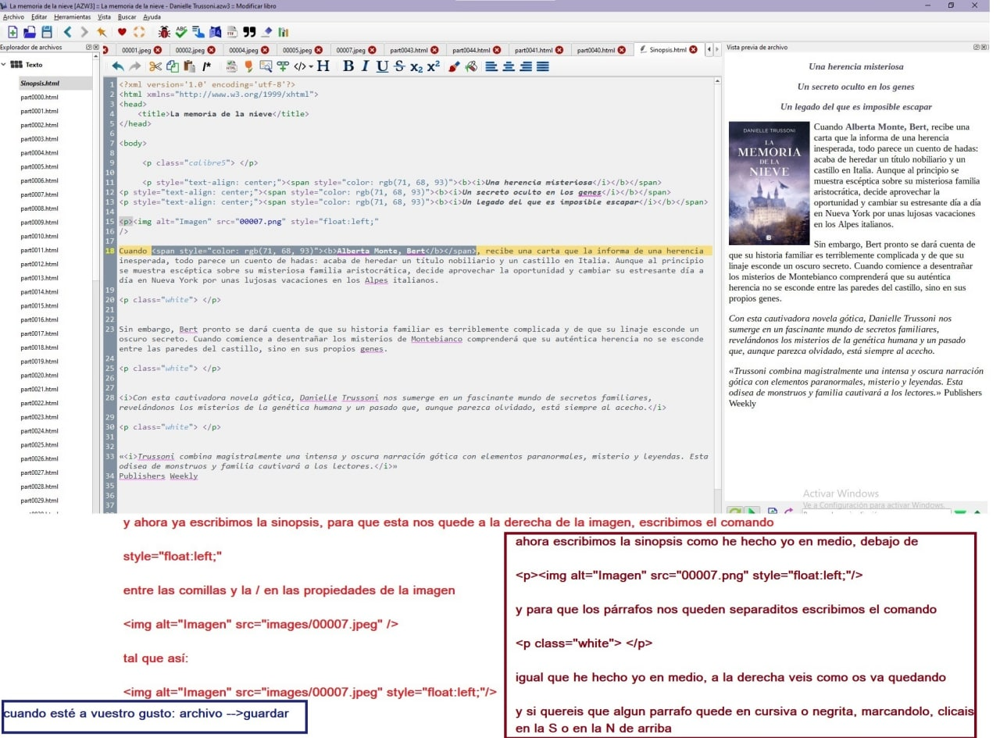

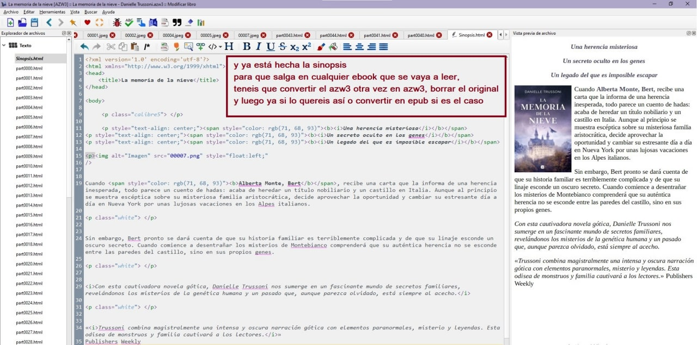

Tener la precaución de descargaros las portadas con el mismo número que os he puesto, sobre todo que os las desargueis ordenadas.

Aunque os parezca complicado, si seguis el orden, no os saltais nada y haceis todo paso a paso, en realidad es muy fácil, pero cualquier duda, por aquí estoy ☺️

ah, bueno, logicamente, que hay gente que no lo sabe, antes de descargaros los pantallazos, clicad en medio para que se hagan grandes, que si no , os los descargareis pequeñitos y no vereis nada de nada 😂

Ir al mensaje: [https://t.me/calibreconfiguraciones/51377](https://t.me/calibreconfiguraciones/51377)

Forma rápida:

Manera rápida de incluir la sinopsis dentro del ebook

- Una vez añadida la sinopsis en los datos externos del calibre  clic con el botón derecho en la línea donde está el libro en cuestión  convertir libro  convertir libros por separado  detección de estructura  marcar "insertar metadatos en una página al principio del libro"  aceptar

- Verás a la derecha debajo de la portada en el calibre que te aparece "epub" y "original epub" , eliminas "original epub" y ya te queda en el nuevo epub fijada la sinopsis para tí y para quien sea  tanto en la parte externa del calibre como dentro del ebook, (la primera hoja después de la portada) si quieres convertirlo a mobi o azw3 lo haces a partir de ese nuevo epub e igualmente aparecerá la sinopsis dentro del libro en esos formatos.

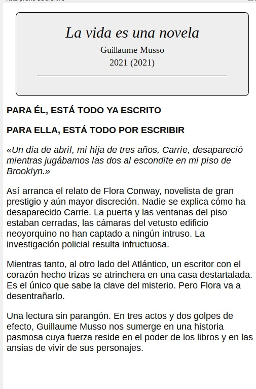

 

 

Ir al mensaje:

[https://t.me/calibreconfiguraciones/144967/145108](https://t.me/calibreconfiguraciones/144967/145108)

## [Volver al inicio](https://telegra.ph/Indice-Calibre-en-Espa%C3%B1ol-10-03)

 

---

[:material-arrow-left: Volver al índice](../../alfabetico.md) · [:fontawesome-brands-telegram: Preguntar en el grupo](https://t.me/calibreconfiguraciones){ target=_blank }
