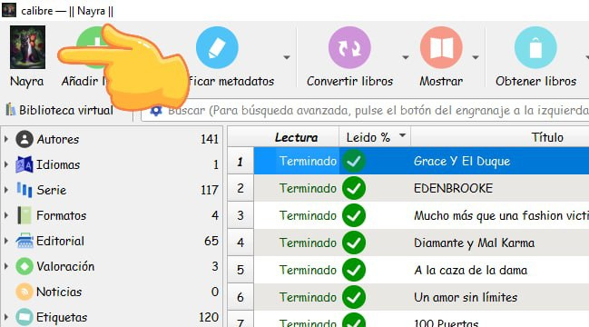
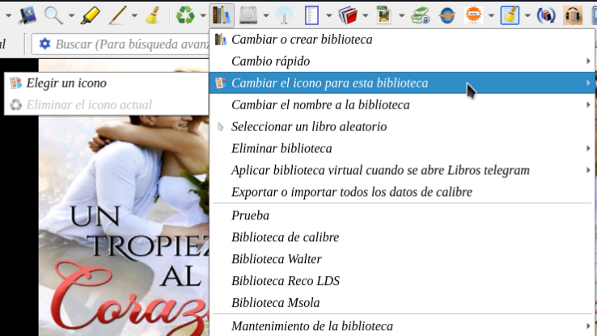
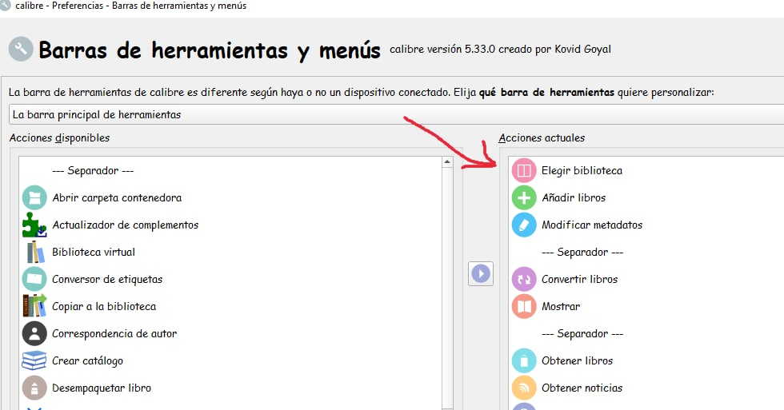

# Ícono de biblioteca - cambiar

:material-account: [@CanariasCraft](https://t.me/Dunhill69){ target=_blank } · :material-link-variant: [Ver el original en Telegraph](https://telegra.ph/Icono-de-Biblioteca---Cambio-12-16){ target=_blank }
{ .tut-datos }

---

Explicado por @CanariasCraft

Para que se vea el icono en nuestra biblioteca así:

Debemos ir al icono de biblioteca de calibre y marcar Cambiar el icono de esta biblioteca y nos da la opción de elegir un icono.

Y para que aparezca en la primer ubicación movemos en barra de  herramienta el icono de elegir biblioteca al primer lugar

## [Volver al inicio](https://telegra.ph/Indice-Calibre-en-Espa%C3%B1ol-10-03)

 

---

[:material-arrow-left: Volver al índice](../../alfabetico.md) · [:fontawesome-brands-telegram: Preguntar en el grupo](https://t.me/calibreconfiguraciones){ target=_blank }
