# Libros sin comentarios

:material-account: [Walter](https://t.me/Dunhill69){ target=_blank } · :material-link-variant: [Ver el original en Telegraph](https://telegra.ph/Icono-de-falta-de-comentarios-en-libros-03-12){ target=_blank }
{ .tut-datos }

---

Con este método es más facil visualizar los libros a los que les falte el comentario.

Gracias al amigo @Llogur por sus capturas de pantallas.

Una de las opciones es poner comments:false en la barra de herramienta, pero con esta explicación lo vemos a simple vista.

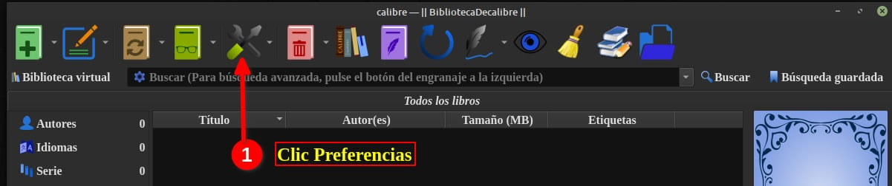

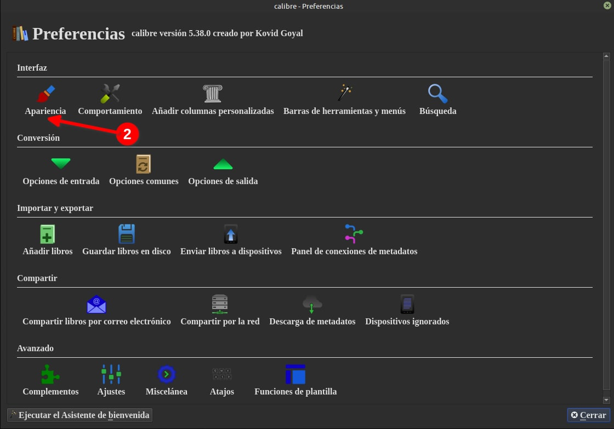

 

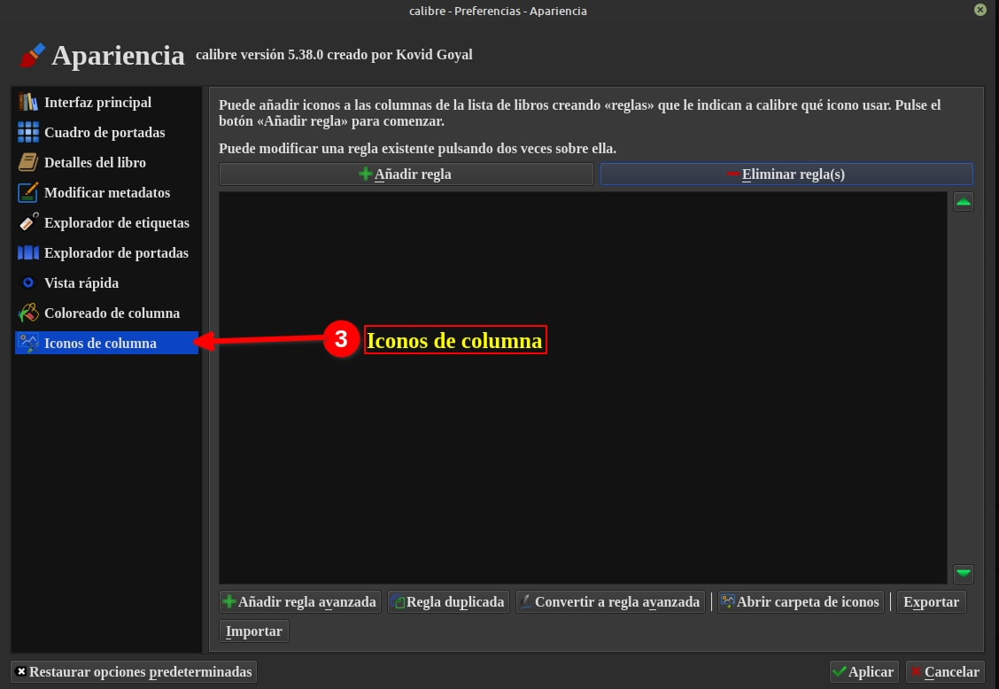

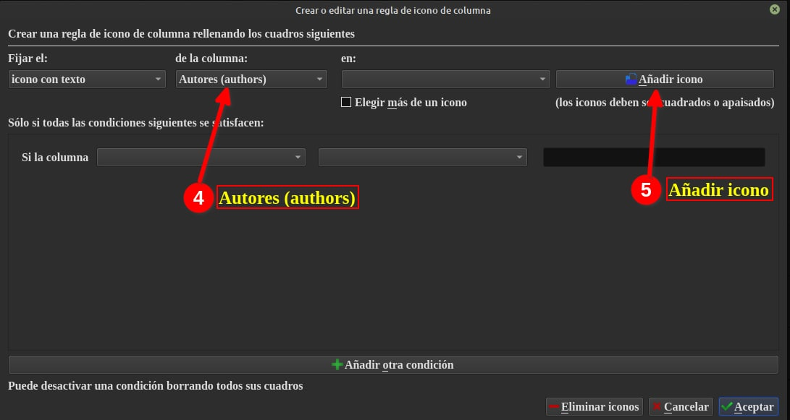

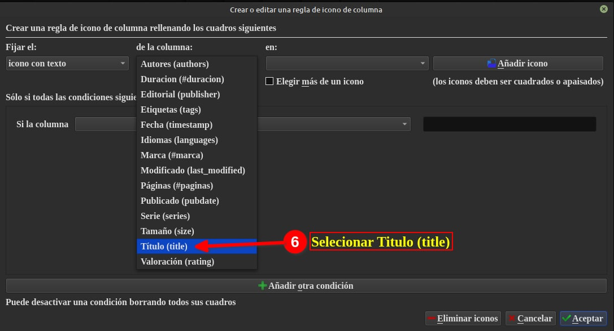

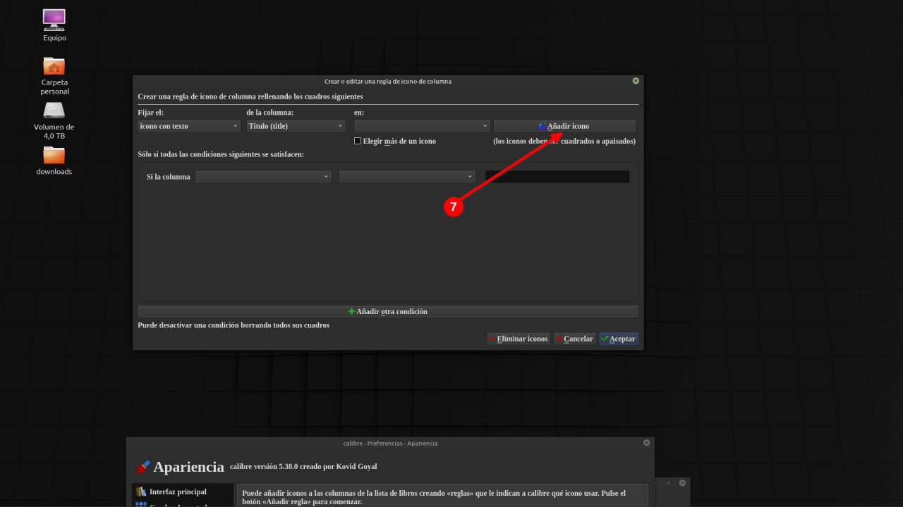

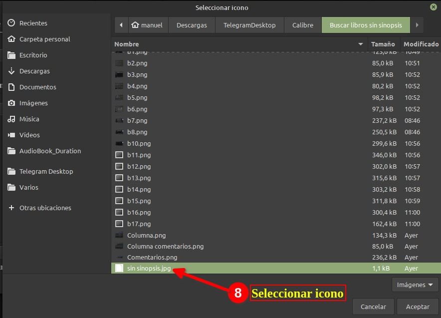

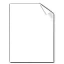

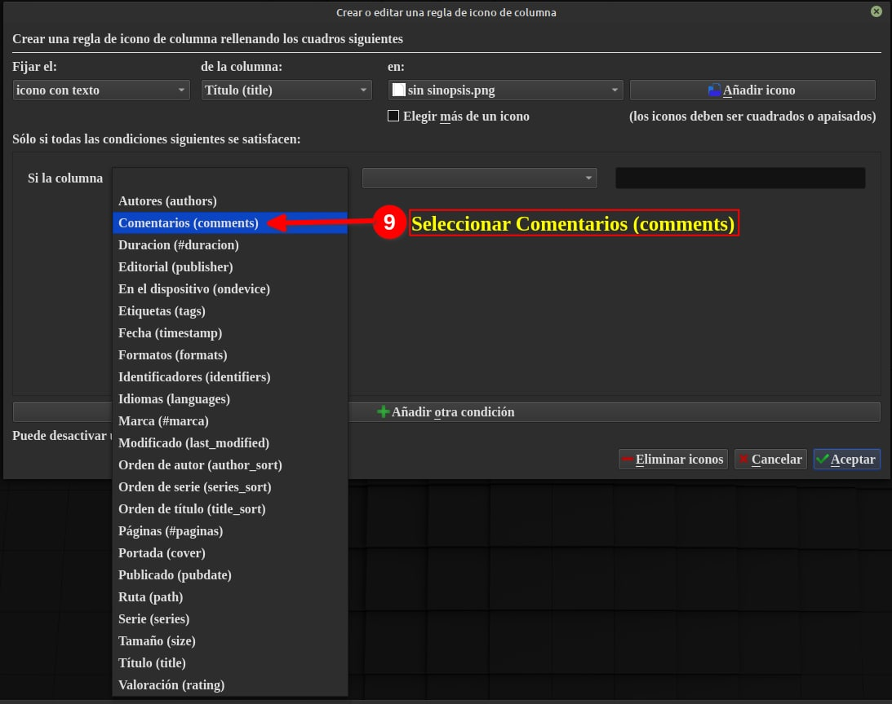

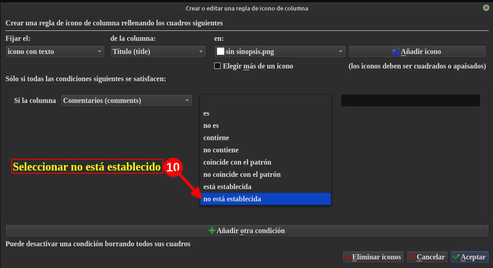

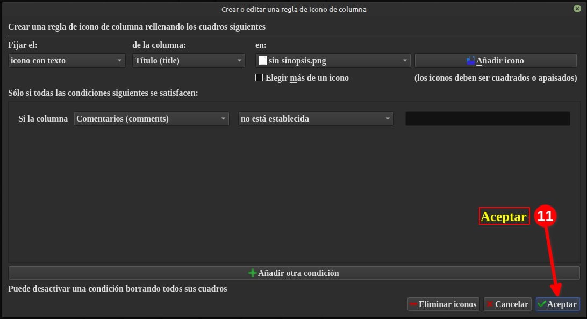

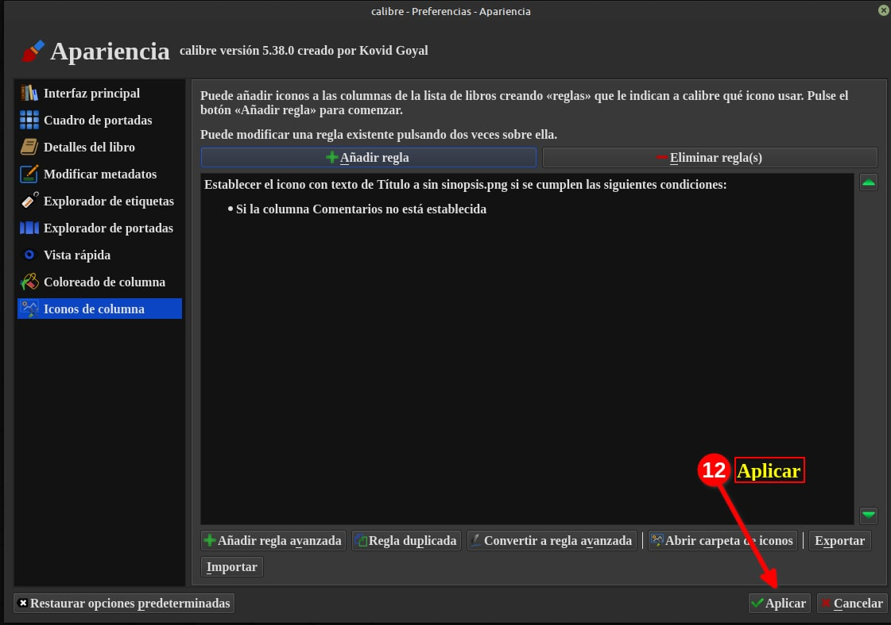

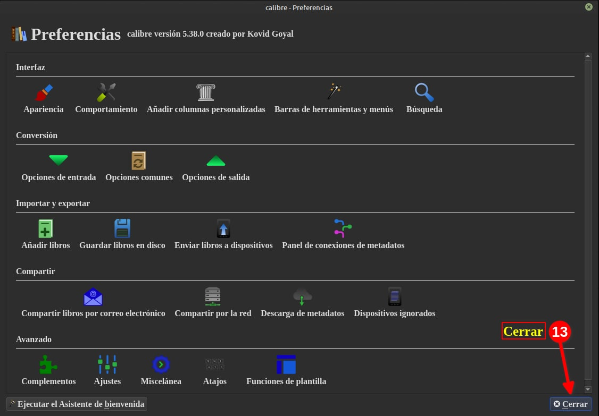

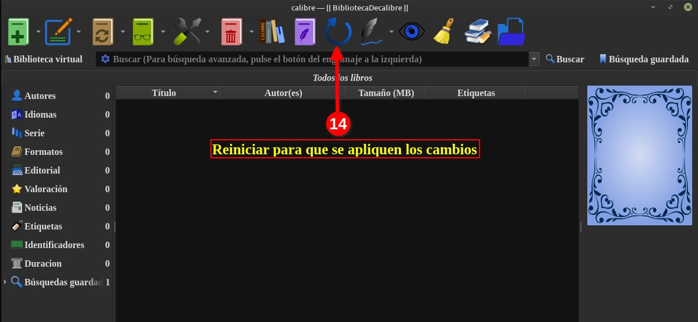

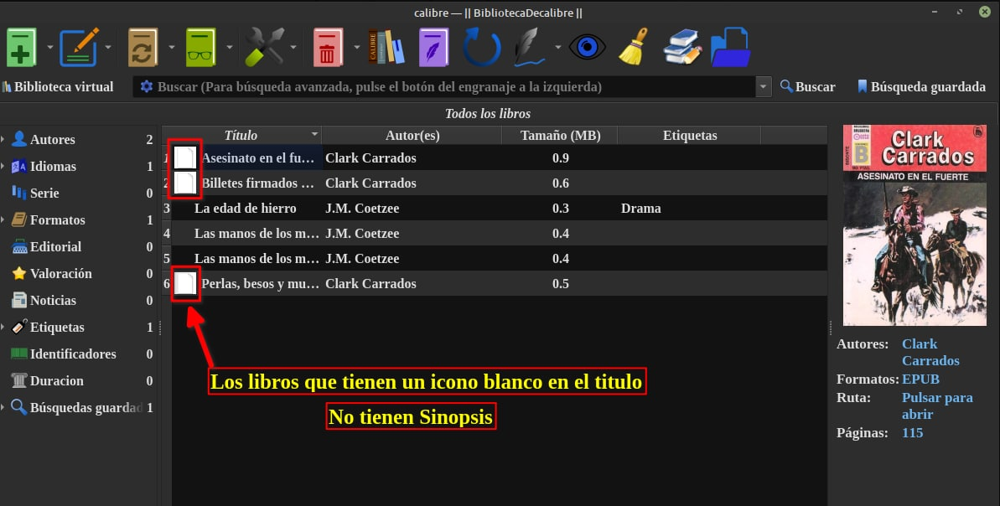

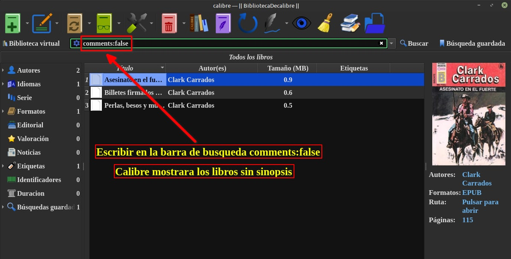

## [Volver al inicio](https://telegra.ph/Indice-Calibre-en-Espa%C3%B1ol-10-03)

 

---

[:material-arrow-left: Volver al índice](../../alfabetico.md) · [:fontawesome-brands-telegram: Preguntar en el grupo](https://t.me/calibreconfiguraciones){ target=_blank }
