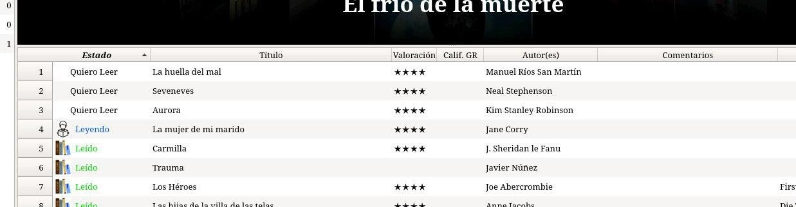
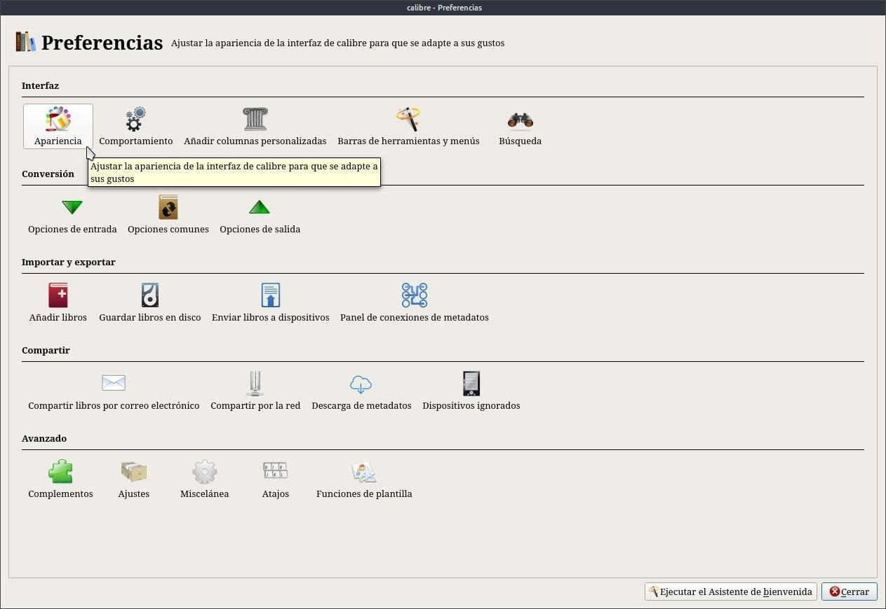
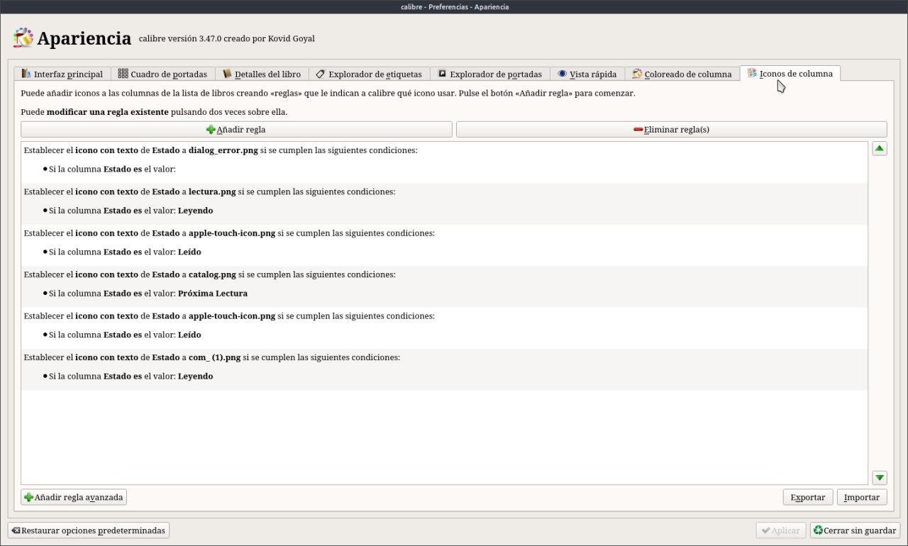
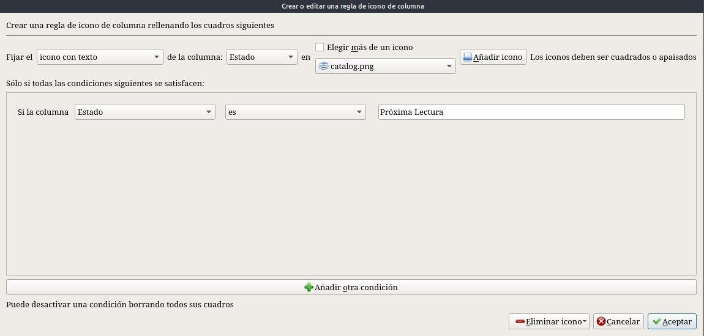

# Íconos en columnas

:material-account: [Walter](https://t.me/Dunhill69){ target=_blank } · :material-link-variant: [Ver el original en Telegraph](https://telegra.ph/Iconos-en-columnas-09-21){ target=_blank }
{ .tut-datos }

---

Muchos me preguntaron como hacia para poner los iconos en la columna de Estado,

Acá se los explico. Vamos a Preferencias/Apariencia

Iconos de columnas, que es la ultima solapa, si no la ven redimensionen la pantalla y ahí añaden regla con la cruz verde

Para Leyendo agregue una imagen al directorio de Calibre. las imágenes se pueden agregar desde el escritorio también.

Y la regla seria así **Fijar** *icono con texto* **en la columna** *estado* **añadir icono**.

*Si la columna* **Estado** *ES* **Leído** y ustedes eligen la imagen que quieran y así con las otras dos categorias de la columna Estado

ir al mensaje: [https://t.me/calibreconfiguraciones/834](https://t.me/calibreconfiguraciones/834)

[https://telegra.ph/Iconos-en-columnas-09-21](https://telegra.ph/Iconos-en-columnas-09-21)

 

## [Volver al inicio](https://telegra.ph/Indice-Calibre-en-Espa%C3%B1ol-10-03)

 

 

---

[:material-arrow-left: Volver al índice](../../alfabetico.md) · [:fontawesome-brands-telegram: Preguntar en el grupo](https://t.me/calibreconfiguraciones){ target=_blank }
