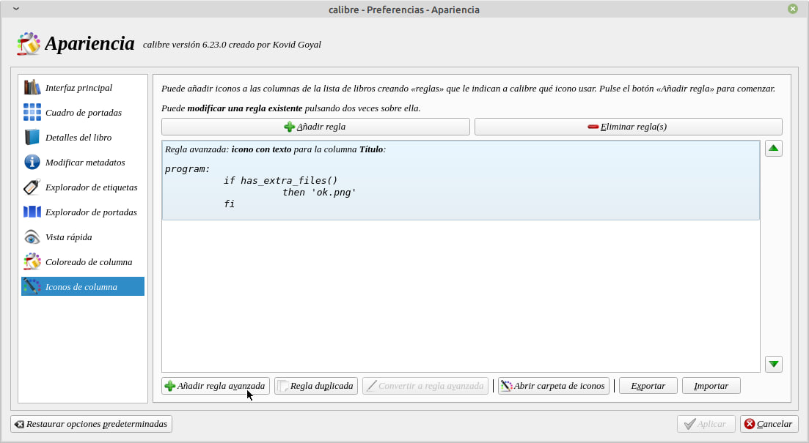
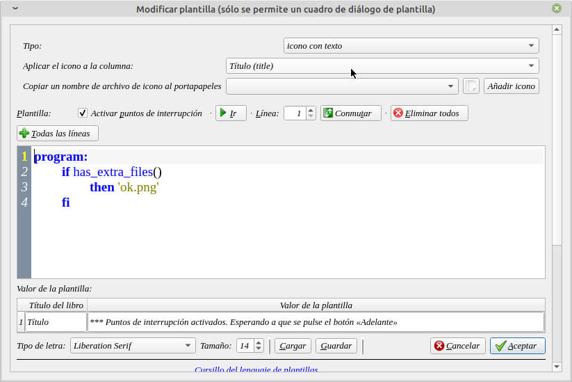
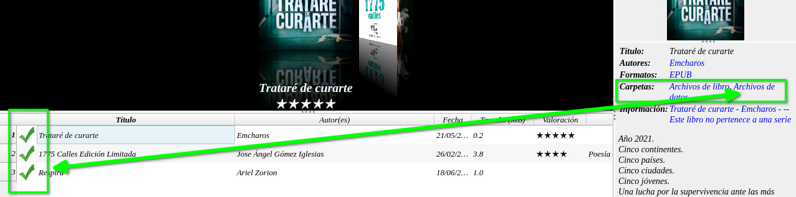

# Íconos para saber datos extra del libro

:material-account: [Walter](https://t.me/Dunhill69){ target=_blank } · :material-link-variant: [Ver el original en Telegraph](https://telegra.ph/Iconos-para-saber-datos-extras-de-libros-08-02){ target=_blank }
{ .tut-datos }

---

Para versión 6.20 de Calibre en adelante. Como saber que libro tiene datos extras. Tenemos que entrar en Preferencias/Apariencia/Iconos de Columnas.

Añadimos una regla avanzada y añadimos esta regla:

program:

if has\_extra\_files()

then 'ok.png'

fi

 

Prestar atención a que columna aplicar el icono, eso es a gusto de cada quien. Le damos Aceptar el icono no lo comparto porque es propio de Calibre o bien cada uno puede elegir el icono que le guste. Damos Aplicar.

Ir a mensajes: [https://t.me/calibreconfiguraciones/112333/142307](https://t.me/calibreconfiguraciones/112333/142307)

## [Volver al inicio](https://telegra.ph/Indice-Calibre-en-Espa%C3%B1ol-10-03)

---

[:material-arrow-left: Volver al índice](../../alfabetico.md) · [:fontawesome-brands-telegram: Preguntar en el grupo](https://t.me/calibreconfiguraciones){ target=_blank }
