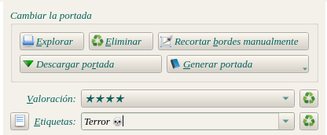
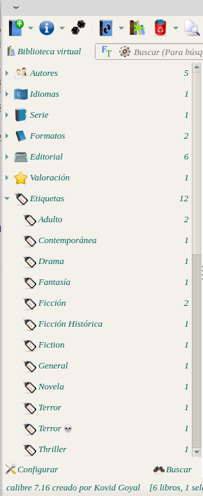
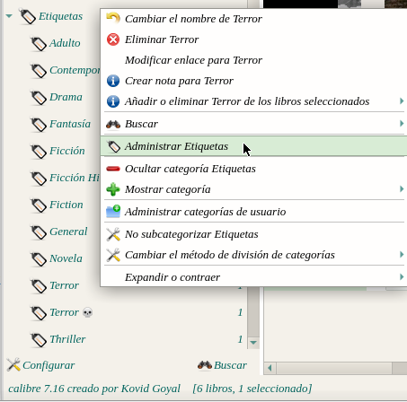
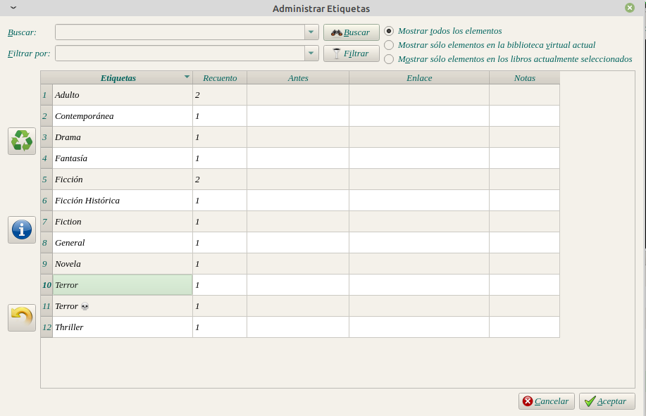
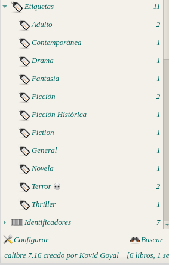
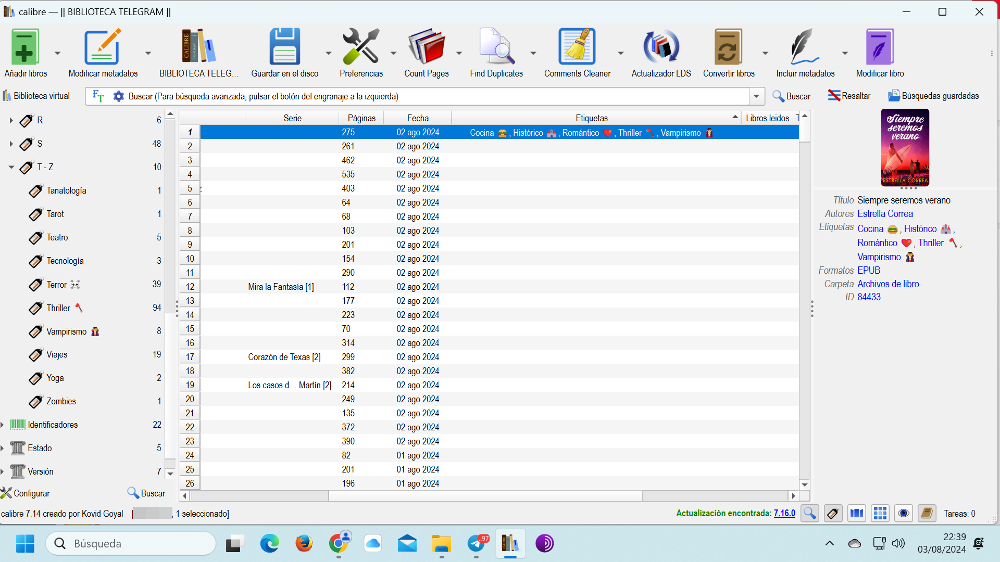

# Imagen en categoría (no ícono)

:material-account: [Walter](https://t.me/Dunhill69){ target=_blank } · :material-link-variant: [Ver el original en Telegraph](https://telegra.ph/Imagen-en-categor%C3%ADa-no-Icono-08-03){ target=_blank }
{ .tut-datos }

---

Más allá de existir la posibilidades de usar reglas a veces queremos lo simple.

Hoy me toco explicar algo simple y como dice el Principito lo esencial es invisible a los ojos.

@MHA1957 quería tener la categoría con una imagen.

La manera que simplemente se lo explique es:

Los que tenemos telegram tenemos nuestra carpeta de mensajes guardados.

En el podemos escribir el texto y agregarle un emoji de telegram ejemplo:

Cocina 🍔

Terror 💀

Este texto con la imagen la pegamos en el campo etiqueta en la edición de metadatos.

En el explorador de etiquetas se ve así:

Ahora la pregunta es como mantengo mis etiquetas con la imagen-

En este caso etiqueta de Terror, seleccionamos terror, botón derecho Administrar Etiquetas

Como vemos tenemos terror y terror con la imagen

El terror con imagen tocamos botón derecho y ponemos copiar y lo pegamos en terror solo y le damos aceptar.

Y cada cierto tiempo deberemos repetir estos pasos para organizar nuestra biblioteca.

 

## [Volver al inicio](https://telegra.ph/Indice-Calibre-en-Espa%C3%B1ol-10-03)

 

 

 

 

 

 

---

[:material-arrow-left: Volver al índice](../../alfabetico.md) · [:fontawesome-brands-telegram: Preguntar en el grupo](https://t.me/calibreconfiguraciones){ target=_blank }
