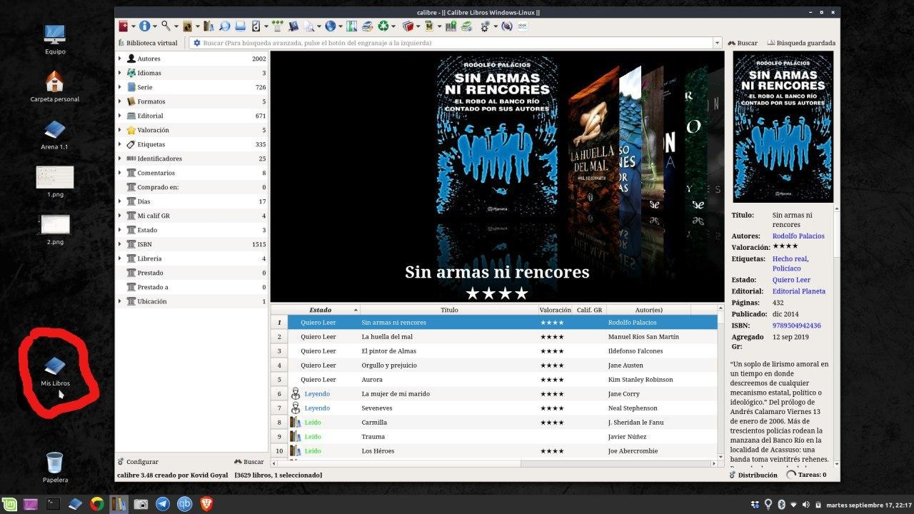
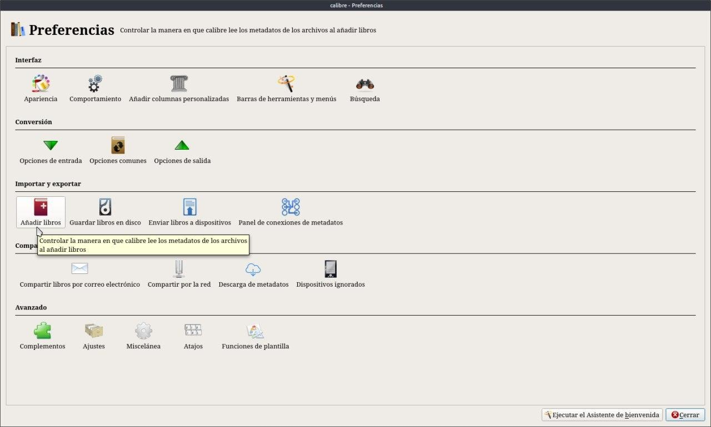
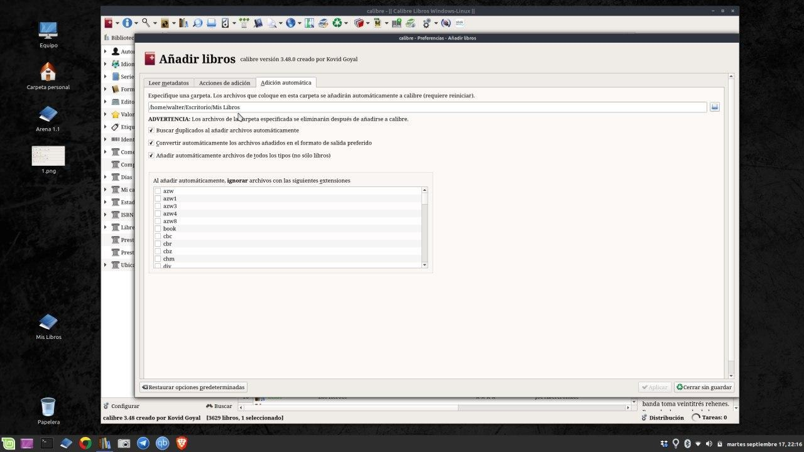
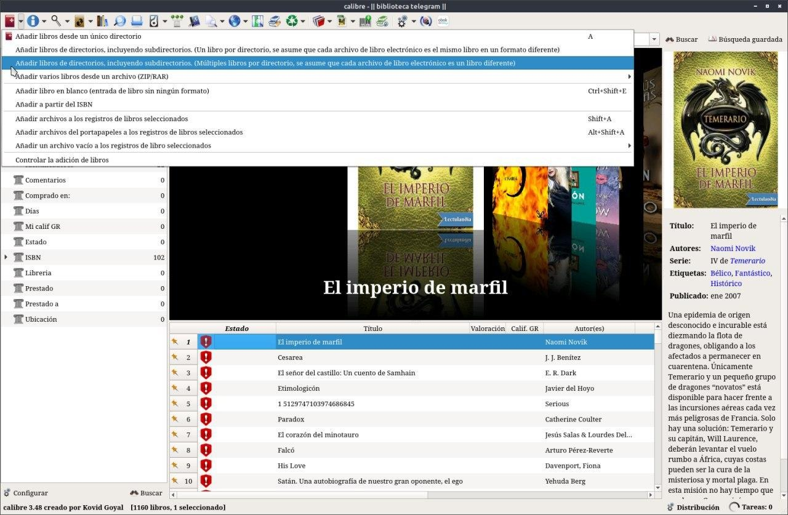
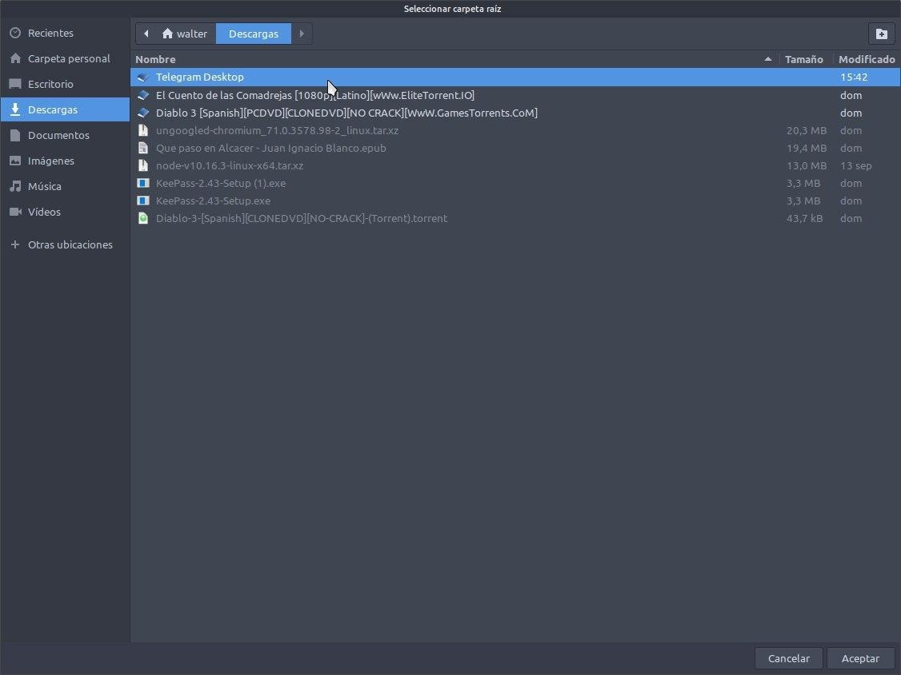
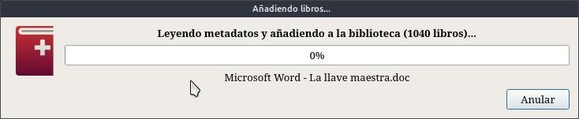

# Importar de forma automática

:material-account: [Walter](https://t.me/Dunhill69){ target=_blank } · :material-link-variant: [Ver el original en Telegraph](https://telegra.ph/Importar-de-forma-autom%C3%A1tica-08-27){ target=_blank }
{ .tut-datos }

---

Por ejemplo yo lo tengo así : Cree una carpeta en el escritorio que llame Mis Libros, Ahí es donde voy agregando todos los libros que me interesan que formen parte de mi biblioteca.

Nos vamos a Preferencias / Añadir Libros

Y nos vamos a la tercer solapa Adición Automática en el renglón ponemos la ruta de la carpeta de donde Calibre tomará los libros, Marcamos las tres opciones. 1 Nos avisa si tenemos ya el libro cargado, para no cargar duplicados ( muy recomendable ) y las otras dos están claras. También podemos marcar la extensión que deberá ignorar de esta carpeta en la lista de extensiones. Tocamos Aplicar y reiniciamos Calibre.

Ir al mensaje: [https://t.me/calibreconfiguraciones/980](https://t.me/calibreconfiguraciones/980)

Aparte del los pasos anteriores, muy importante, que me olvide es seleccionar en Añadir libros de directorios múltiples libros por directorios.

Seleccionar el directorio de donde tomar los libros (Aceptar)

Y aparece el cartel de que Calibre esta trabajando.

Ir al mensaje [https://t.me/calibreconfiguraciones/1009](https://t.me/calibreconfiguraciones/1009)

 

## [Volver al inicio](https://telegra.ph/Indice-Calibre-en-Espa%C3%B1ol-10-03)

 

---

[:material-arrow-left: Volver al índice](../../alfabetico.md) · [:fontawesome-brands-telegram: Preguntar en el grupo](https://t.me/calibreconfiguraciones){ target=_blank }
