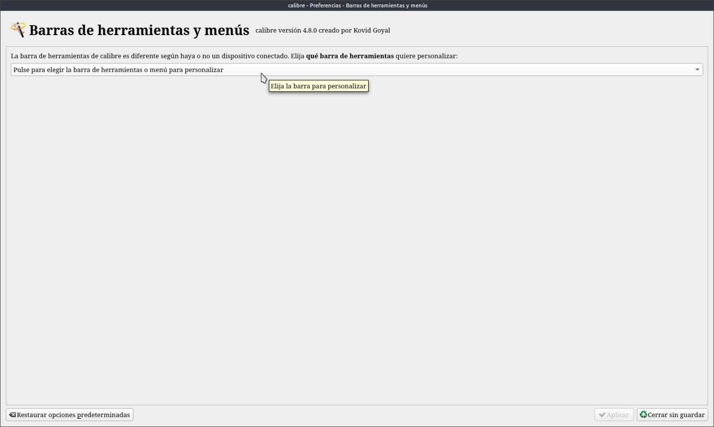
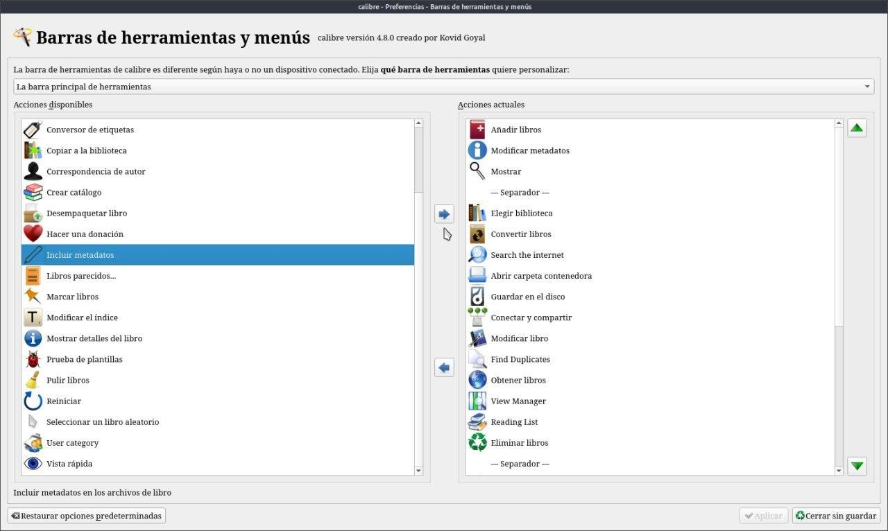
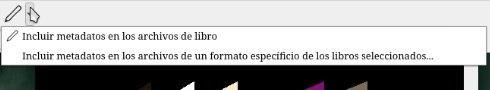

# Incluir metadatos

:material-account: [Walter](https://t.me/Dunhill69){ target=_blank } · :material-link-variant: [Ver el original en Telegraph](https://telegra.ph/Incluir-Metadatos-08-23){ target=_blank }
{ .tut-datos }

---

 

Respecto a cómo fijar los metadatos, ademas de usando Convertir; Calibre tiene una opción llamada Pulir libros. Que permite fijar los metadatos entre otras cosas.

Según la versión de Calibre, el icono es un lápiz, pluma o pincel.

Este icono esta oculto en la barra de herramienta y para agregarlo debemos seguirlos siguientes pasos:

Para agregar el icono de incluir metadatos lo que tenemos que hacer es: Ir a Preferencias/Barra de herramientas y menús y tocamos donde dice Pulse para elegir la barra de herramienta a personalizar

Tocamos barra principal de herramienta marcamos incluir metadatos y con la flecha azul lo pasamos de la columna izquierda a la derecha. Tocamos aplicar y ya tememos es icono en la barra de Calibre.

También esta la opción **Pulir libros**

Pulir libros se trata de poner el brillo de la perfección en sus libros electrónicos cuidadosamente elaborados.

El pulido intenta minimizar los cambios en el código interno de su libro electrónico. A diferencia de la conversión, no aplana CSS, cambia el nombre de los archivos, cambia el tamaño de las fuentes, ajusta los márgenes, etc. Cada acción realiza solo el conjunto mínimo de cambios necesarios para el efecto deseado.

Debe utilizar esta herramienta como último paso en el proceso de creación de su libro electrónico.

Tenga en cuenta que el pulido solo funciona en archivos en los formatos AZW3 o EPUB.

Actualmente las operaciones que puede realizar son:

**Subconjuntos de fuentes incrustadas**

Subconjuntos de fuentes significa reducir una fuente incrustada para contener solo los caracteres utilizados de esa fuente en el libro. Esto reduce en gran medida el tamaño de los archivos de fuentes (es común reducir a la mitad el tamaño de los archivos de fuentes). Por ejemplo, si el libro usa una fuente específica para los encabezados, entonces el subconjunto reducirá esa fuente para contener solo los caracteres presentes en los encabezados reales del libro. O si el libro incorpora las versiones en negrita y cursiva de una fuente, pero el texto en negrita y cursiva es relativamente raro, o está ausente por completo, entonces las fuentes en negrita y cursiva pueden reducirse a solo unos pocos caracteres o eliminarse por completo. La única desventaja de crear subconjuntos de fuentes es que si, en una fecha posterior, decides agregar más texto a tus libros, es posible que el texto recién agregado no esté cubierto por la fuente del subconjunto.

**Actualizar metadatos**

Esto actualizará los metadatos y las cubiertas en los archivos del libro para que coincidan con los metadatos actuales en la biblioteca de calibre.

Al actualizar portadas en archivos epub que no tienen una portada correctamente identificada, se insertará una nueva portada al comienzo del libro.

**Agregar / eliminar cubiertas de metadatos**

Puede agregar o eliminar cubiertas de metadatos de los archivos de libros electrónicos. Una cubierta de metadatos es una página al principio del libro que enumera todos los metadatos del libro: título / autores / series / calificaciones / etiquetas / comentarios, etc.

[https://manual.calibre-ebook.com/es/generated/es/ebook-polish.html](https://manual.calibre-ebook.com/es/generated/es/ebook-polish.html)

 

## [Volver al inicio](https://telegra.ph/Indice-Calibre-en-Espa%C3%B1ol-10-03)

 

 

---

[:material-arrow-left: Volver al índice](../../alfabetico.md) · [:fontawesome-brands-telegram: Preguntar en el grupo](https://t.me/calibreconfiguraciones){ target=_blank }
