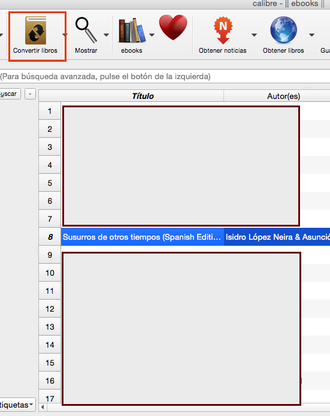
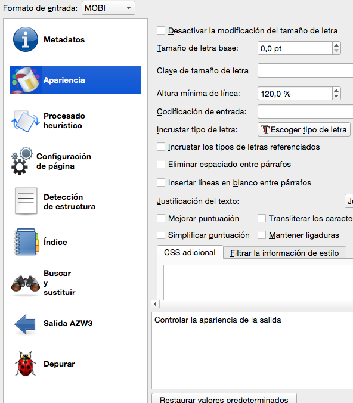
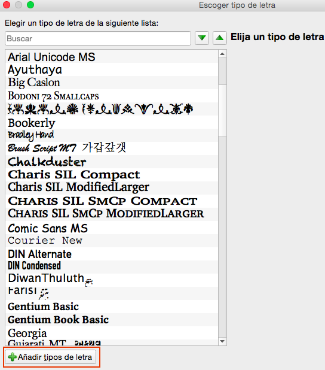
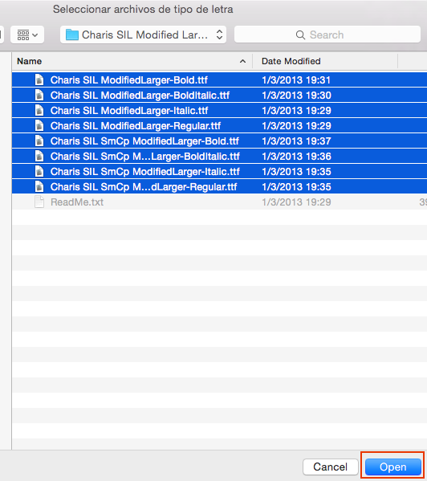
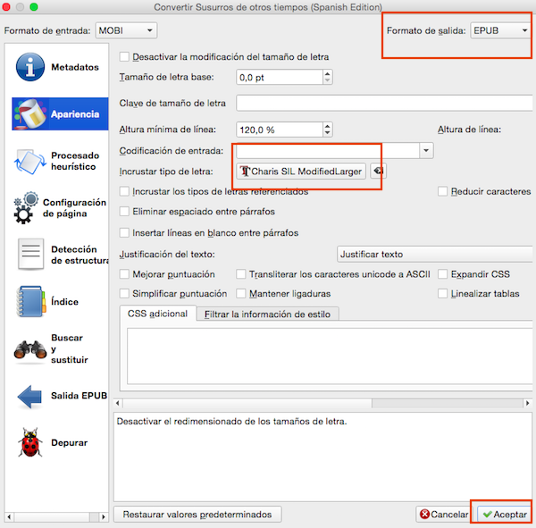

# Incrustar fuentes en tus libros (especial para dislexia)

:material-account: [@Inatxo](https://t.me/Dunhill69){ target=_blank } · :material-link-variant: [Ver el original en Telegraph](https://telegra.ph/Incrusta-fuentes-de-letras-en-tus-libros-Especial-para-problemas-de-dislexia-10-07){ target=_blank }
{ .tut-datos }

---

Fuente: [https://zonaereader.com/articulo/incrusta-fuentes-de-letras-en-tus-libros-especial-para-problemas-de-dislexia](https://zonaereader.com/articulo/incrusta-fuentes-de-letras-en-tus-libros-especial-para-problemas-de-dislexia)

En este tutorial vamos a ver como podemos podemos conseguir que nuestros libros aparezcan en nuestro ereader con el tipo de letra que nosotros elijamos. De esta forma no estaremos limitados a las que vengan instaladas por defecto en nuestro lector.

Aprovecharé para recomendaros algunas fuentes que quedan muy bien en nuestros lectores y una de ellas muy especial para las personas con problemas de dislexia.

Necesitamos usar Calibre. Para ello, te recomiendo que te familiarices con su uso. Puedes consultar la [Guía Calibre de esta misma página](http://zonaereader.com/guia-del-calibre-para-novatos-realizada-por-juan). También podemos aprovechar para añadir distintas fuentes de letras para usarlas en nuestros libros. Las fuentes de letras están en formato true type y tienen la extensión TTF. Hay muchas fuentes gratuitas y libres disponibles en la red. Te recomiendo las siguientes:

[CharisSILCompactModified](http://www.mediafire.com/download/64cse2dshispx08/CharisSILCompactModified.rar).

[CharisSILModifiedLarge](http://www.mobileread.com/forums/attachment.php?attachmentid=102245&d=1362273907)

[OpenDyslexic](https://zonaereader.com/sites/default/files/uploadfiles/OpenDyslexic.zip)

**La fuente Open Dyslexic está especialmente indicada para personas con problemas de dislexia. La recomiendo para usarla con niños que presenten estos problemas. Hay una página creada sobre esta fuente donde se puede descargar desde 0 € o aportar lo que cada cual quiera al proyecto:**

[http://opendyslexic.org](http://opendyslexic.org/)

Cuando hayas descargado las fuentes de letras, descomprímelas en su correspondiente carpeta y tenlas a mano para añadirlas a Calibre cuando llegue el momento.

Estos son los pasos para incrustar fuentes de letras a tus libros.

1.- Abre Calibre y selecciona el libro al que quieras añadirle la fuente de letras que prefieras. Vamos a hacerlo en el ejemplo con el libro Susurros de otros tiempos. Una vez seleccionado el libro, pulsamos en el icono convertir.

2.- En la ventana que nos aparece, elegimos la segunda opción desde arriba: Apariencia y pulsamos sobre el botón **Incrustar tipo de letra.**

**3.- **En la ventana que aparece podemos seleccionar directamente una fuente de letra que aparece en la lista (las que tenemos instaladas en nuestro sistema operativo) o añadir alguna otra. Vamos a añadir las que hemos descargado antes pulsando en el botón correspondiente.

En la ventana que aparece, entra en cada una de las carpetas donde se han descomprimido las fuentes descargadas y selecciona todos los ficheros TTF de cada una de ellas (seleccionalos todos a la vez de cada una de las carpetas) y le das al botón Open, con lo que añadirá a Calibre este nuevo tipo de fuente de letra.

4.- Una vez añadidas estas letras a Calibre, podemos seleccionarlas para incrustarlas en nuestro libro. ¡Solo puedes incrustar una fuente de letra! Si repites el proceso, cambiarás la fuente incrustada anteriormente por la nueva que elijas. Una vez elegida la fuente a incrustar, escoge el formato de Salida para la conversión y dale al botón Aceptar.

Ya tendrás tu libro en el formato elegido con la fuente seleccionada incrustada. Ya solo tienes que pasarlo a tu ereader conectándolo por USB y dándole al botón Enviar al dispositivo de Calibre.

Una vez tengas el libro en tu ereader, en el menú del mismo selecciona la opción cambiar la fuente de letras y elige la que has incrustado. **En el kindle tienes que pulsar sobre la opción marcada con Aa y seleccionar Fuente del editor.**

**Ahora vamos a ver varios ejemplos. El primero usando la fuente Charis SIL ModifiedLarge y el segundo usando la fuente Open Dyslexic en mi kindle.**

 

 

## [Volver al inicio](https://telegra.ph/Indice-Calibre-en-Espa%C3%B1ol-10-03)

 

 

---

[:material-arrow-left: Volver al índice](../../alfabetico.md) · [:fontawesome-brands-telegram: Preguntar en el grupo](https://t.me/calibreconfiguraciones){ target=_blank }
