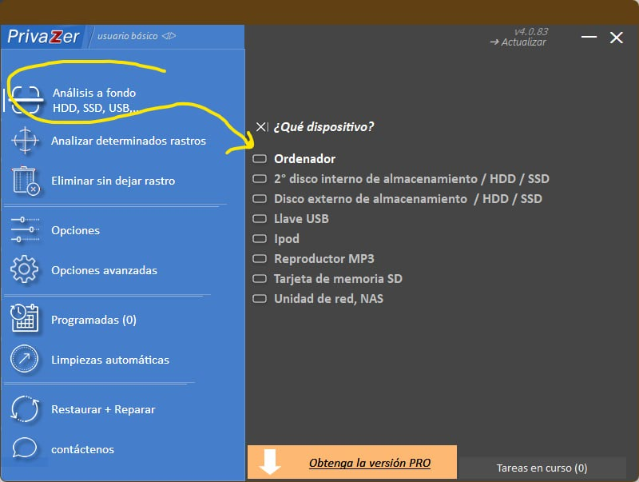
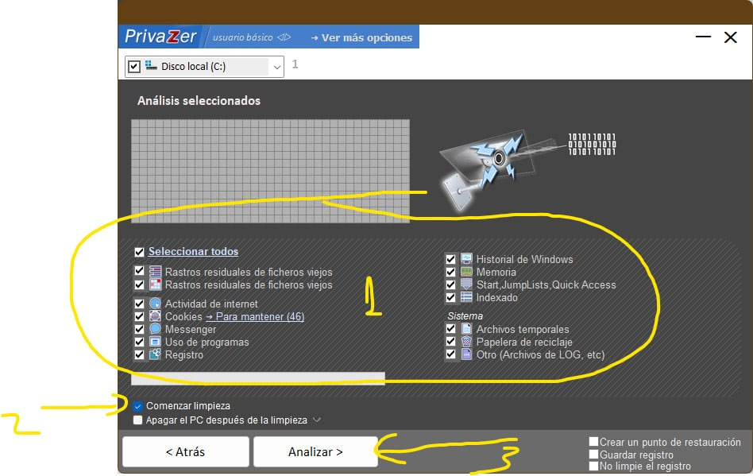
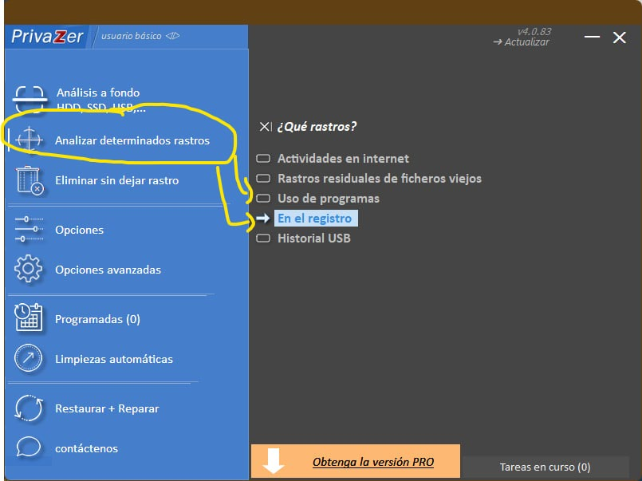
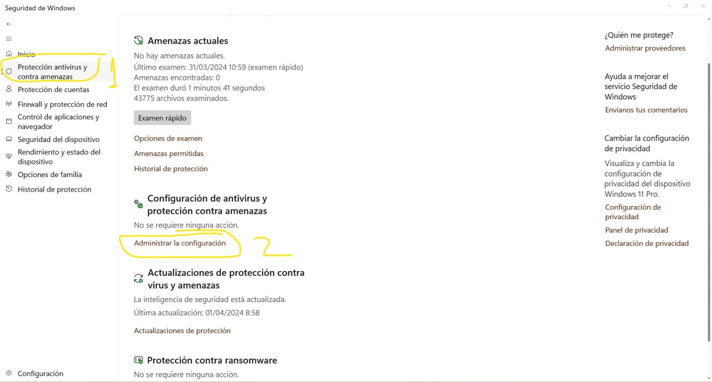
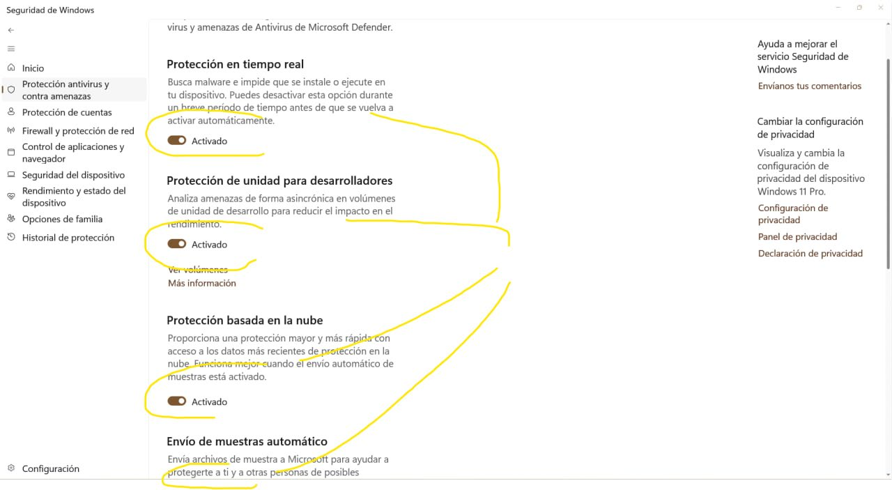

# Instalación de Calibre en Windows 11, cuando da problemas

:material-account: [Walter](https://t.me/Dunhill69){ target=_blank } · :material-link-variant: [Ver el original en Telegraph](https://telegra.ph/Instalaci%C3%B3n-de-Calibre-en-Windows-11-Cuando-da-problemas-04-02){ target=_blank }
{ .tut-datos }

---

Explicado por @Josan63

1. Pulsa Control +Mayúscula + Escape . Se abre el Administrador de Tareas. Buscas en la lista Calibre y finaliza todos los procesos. Asegúrate que estén todos finalizados, se suelen abrir muchos.

2. Desde Configuración de Pc o desde Panel de Control Programas y características desinstalas Calibre.

3. Pulsa Windows + r y escribe: %temp% Selecciona todos los archivos sin miedo y borra. Algunos te dirán que están en uso los omites.

4. Pulsa Windows R y escribe %appdata% Roaming y borra las carpetas de calibre. Suelen ser dos(Calibre-book.com y calibre)

5. Pulsa Windows R y escribe %appdata% Local y borra todas las carpetas de calibre. Suelen ser una(calibre-cache)

6. Desinstala ccleaner (si lo tienes instalado) e instala con confianza Privazer el gratis

htps://privazer.com/es/version-difference.php

Tardará un tiempo.

7. Reiniciar el ordenador.

8. Abrir de nuevo Privazer y hacer lo mismo con “Uso de programas” y en “registro”. Analizar y limpiar. Una vez hecho esto, cerrar el Privazer.9.

Desactivar el antivirus. Si es Windows Defender has lo que marcan las imágenes a continuación.

10. Desactivar: Protección en tiempo real, Protección de unidad para desarrolladores, protección basada en la nube y Envió automático. Cuando la instalación de calibre esté terminada volver activar.

11. Descargar Calibre última versión htps://calibre-ebook.com/es/download\_windows

12. Instalar. En caso que de problemas y aparezca la opción ejecutar como administrador.

 

Ir al mensaje: [https://t.me/calibreconfiguraciones/112333/162407](https://t.me/calibreconfiguraciones/112333/162407)

 

## [Volver al inicio](https://telegra.ph/Indice-Calibre-en-Espa%C3%B1ol-10-03)

 

---

[:material-arrow-left: Volver al índice](../../alfabetico.md) · [:fontawesome-brands-telegram: Preguntar en el grupo](https://t.me/calibreconfiguraciones){ target=_blank }
