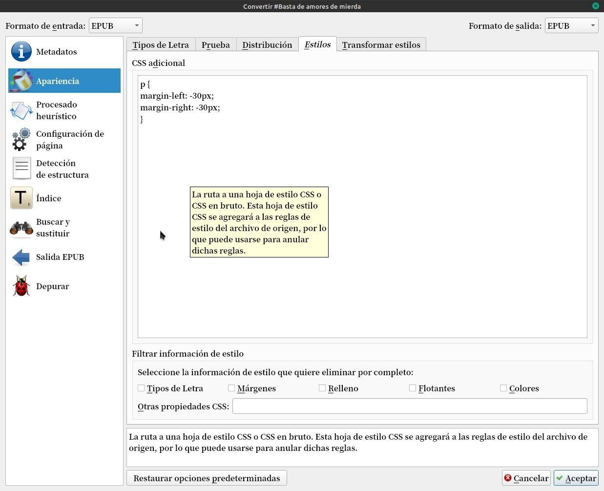

# Kindle - CSS

:material-account: [Walter](https://t.me/Dunhill69){ target=_blank } · :material-link-variant: [Ver el original en Telegraph](https://telegra.ph/Kindle---CSS-08-27){ target=_blank }
{ .tut-datos }

---

Al convertir cualquier libro en AZW3 debemos entrar a apariencia y estilos en este recuadro

Deberemos copiar este código:

-Quitar el "Expandir CSS"

- En el recuadro de CSS adicional poner

 

p {

margin-left: -30px;

margin-right: -30px;

}

 

Aunque también he puesto -40.

 

Convertir libro a AZW3 y pasarlo a kindle

 

## [Volver al inicio](https://telegra.ph/Indice-Calibre-en-Espa%C3%B1ol-10-03)

 

---

[:material-arrow-left: Volver al índice](../../alfabetico.md) · [:fontawesome-brands-telegram: Preguntar en el grupo](https://t.me/calibreconfiguraciones){ target=_blank }
