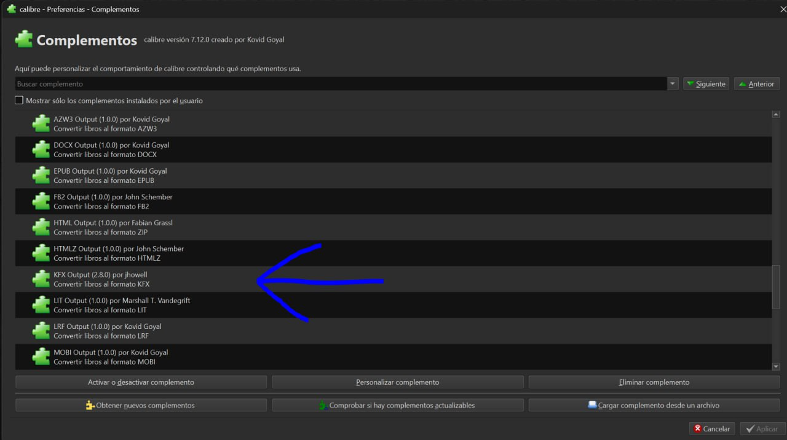
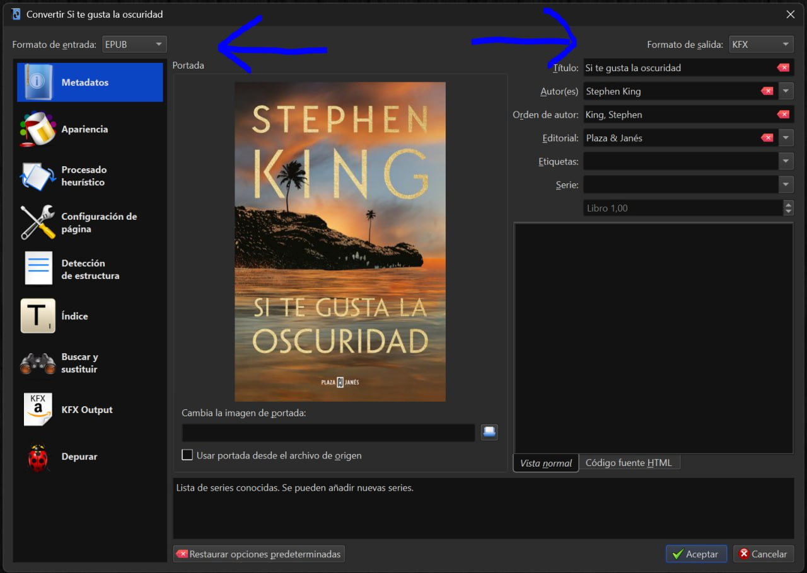

# Kindle - formato KFX

:material-account: [@YeraycitoQnap](https://t.me/Dunhill69){ target=_blank } · :material-link-variant: [Ver el original en Telegraph](https://telegra.ph/Kindle---Formato-Kfx-06-21){ target=_blank }
{ .tut-datos }

---

A raíz de un comentario mio sobre el formato KFX de libro electrónico en los Kindle y su sustitución por el conocido AZW3 la Señora Jane me ha pedido que haga un tutorial sobre este tema que básicamente va a consistir en como convertir cualquier libro electrónico de cualquier formato a KFX con Calibre para su posterior lectura en los Kindle. Antes de empezar explico que es un KFX y sus ventajas respecto a otros formatos como EPUB o AZW3.

Los archivos KFX pertenecen principalmente a Kindle de Amazon. KFX es la extensión de nombre de los libros electrónicos almacenados en formato Kindle Format X (10) para dispositivos Kindle. Un archivo KFX contiene un libro electrónico protegido por DRM compuesto por texto, formato, diseño, imágenes y metadatos. A diferencia de los formatos anteriores de Kindle, como el AZW, el formato KFX admite una composición tipográfica mejorada, ligaduras, interletraje y fuentes adicionales. También es compatible con algunas funciones HTML5 y CSS3 que se utilizan para mejorar el estilo y el diseño de las páginas de un documento.

A tener en cuenta, una vez que tengamos un libro electrónico en formato KFX estamos obligados a conectar el kindle a un ordenador y pasárselo a través del propio Calibre o en su defecto manualmente.

Kindle Previewer es un software para Windows y Mac gratuito y desarrollado por Amazon para que cualquier escritor novel convierta su creación a KFX para posteriórmente publicarlo en la plataforma de Amazon. Lo primero que tenemos que hacer es descargarlo a nuestro ordenador e instalarlo, lo podemos hacer desde aquí: [https://kdp.amazon.com/es\_ES/help/topic/G202131170](https://kdp.amazon.com/es_ES/help/topic/G202131170)

Una vez instalado ***NOS OLVIDAMOS DE EL***.

A continuación tenemos que instalar el plugin KFX Output en Calibre, lo podemos hacer desde el propio Calibre o descargarlo a nuestro ordenador y a continuación instalarlo manualmente en Calibre, esto último desde aquí:

[https://www.mobileread.com/forums/showthread.php?t=272407](https://www.mobileread.com/forums/showthread.php?t=272407)

Con esto ya lo tenemos todo, cuando queramos convertir, por ejemplo, un EPUB a KFX el plugin KFX Outpout utilizará " el motor " del programa Kindle Previewer que instalamos antes sin necesidad de abrir ese programa para realizar la conversión y lo hará de la misma forma con la que convertimos otros formatos en Calibre:

Una vez convertido a KFX se lo pasamos al Kindle.

Ir al mensaje:[https://t.me/calibreconfiguraciones/124637/166848](https://t.me/calibreconfiguraciones/124637/166848)

 

## [Volver al inicio](https://telegra.ph/Indice-Calibre-en-Espa%C3%B1ol-10-03)

 

 

 

 

---

[:material-arrow-left: Volver al índice](../../alfabetico.md) · [:fontawesome-brands-telegram: Preguntar en el grupo](https://t.me/calibreconfiguraciones){ target=_blank }
