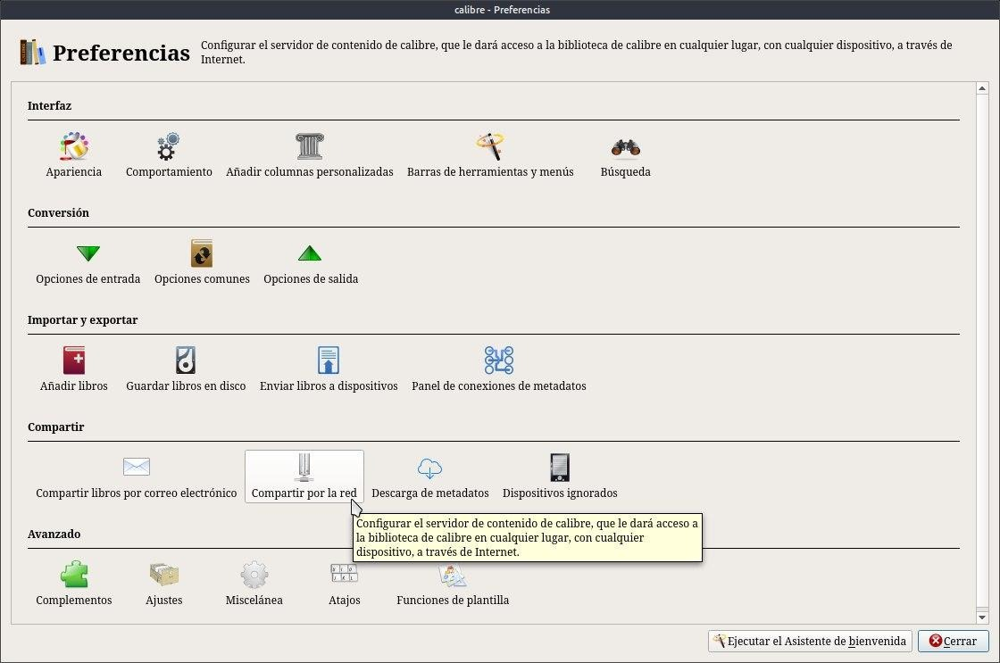
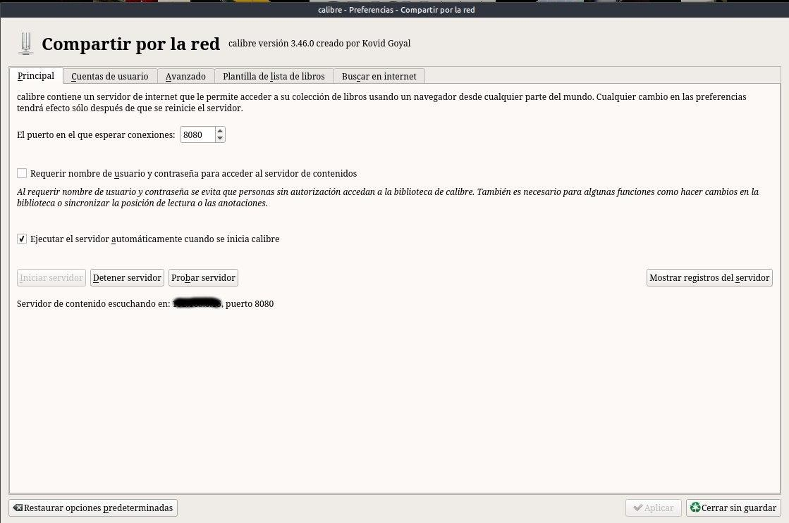
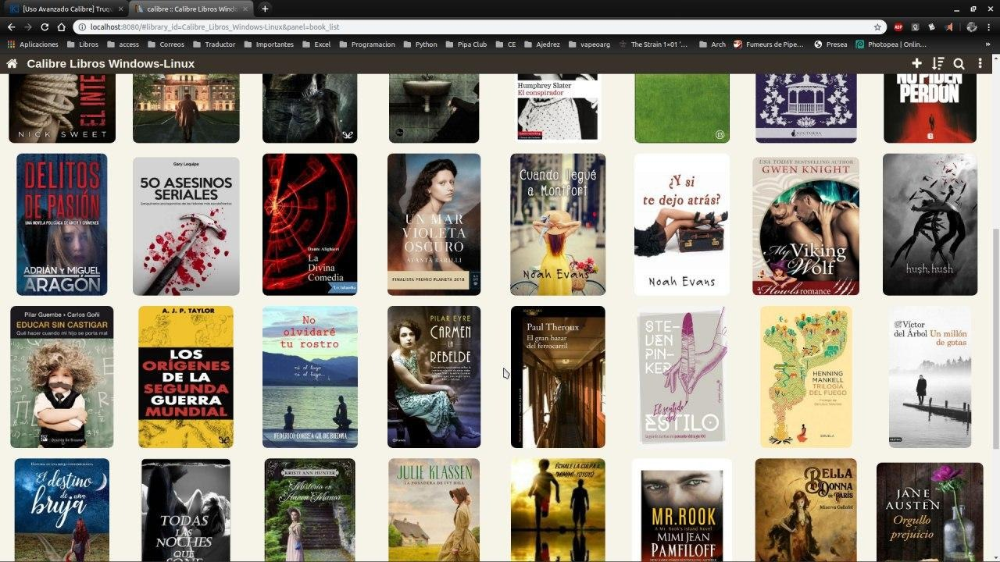

# Kindle - ver la biblioteca de Calibre en el Kindle

:material-account: [Walter](https://t.me/Dunhill69){ target=_blank } · :material-link-variant: [Ver el original en Telegraph](https://telegra.ph/Kindle---Ver-Biblioteca-de-Calibre-en-Kindle-09-20){ target=_blank }
{ .tut-datos }

---

Para ver la biblioteca Calibre desde el Kindle

Este truco me lo explico el otro día una amiga.

En primer lugar abrimos Calibre y pulsamos la pestaña de preferencias. En el apartado de compartir pulsamos en compartir por red.

Y se abrirá una ventana de opciones como esta:

Si pinchamos en iniciar servidor arrancamos el servidor de contenidos. Una vez que se ha iniciado si quieren ver si funciona pueden a probar servidor. En nuestro navegador se abrirá una ventana como la que sigue, donde, pueden ver vuestra biblioteca de Calibre:

Si queremos ver la biblioteca en el kindle sólo tendremos que introducir en el navegador de nuestro kindle la dirección IP de nuestro ordenador, seguido del puerto usado por Calibre.

Eso si debe estar Calibre andando en la maquina para que se puedan comunicar !!

Y estar con la misma red wifi.

ir al mensaje: [https://t.me/calibreconfiguraciones/187](https://t.me/calibreconfiguraciones/187)

[https://telegra.ph/Kindle---Ver-Biblioteca-de-Calibre-en-Kindle-09-20](https://telegra.ph/Kindle---Ver-Biblioteca-de-Calibre-en-Kindle-09-20)

 

## [Volver al inicio](https://telegra.ph/Indice-Calibre-en-Espa%C3%B1ol-10-03)

 

---

[:material-arrow-left: Volver al índice](../../alfabetico.md) · [:fontawesome-brands-telegram: Preguntar en el grupo](https://t.me/calibreconfiguraciones){ target=_blank }
