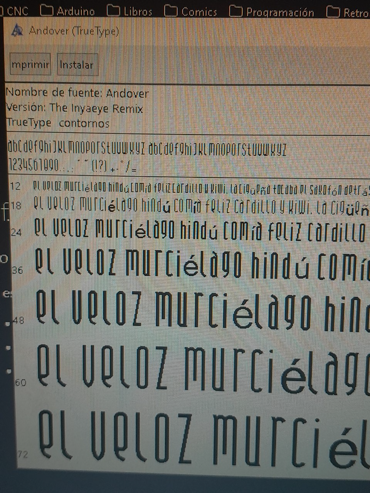
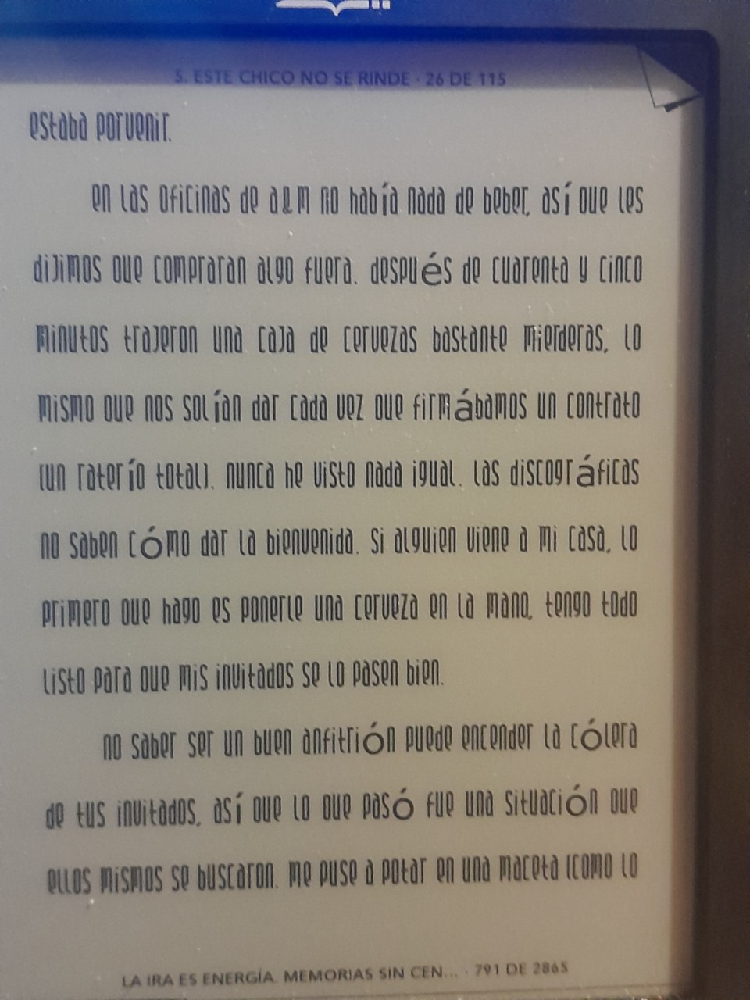

# Kobo - añadir fuentes

:material-account: [@Arduinoxino](https://t.me/Dunhill69){ target=_blank } · :material-link-variant: [Ver el original en Telegraph](https://telegra.ph/Kobo---A%C3%B1adir-fuentes-06-21){ target=_blank }
{ .tut-datos }

---

por @Arduinoxino

 

Ahora acabo de agregar fuentes en un Kobo Touch antiguo. Detallo los pasos que seguí:

Con el Kobo Touch cargado al máximo lo conecto a un puerto USB del portátil con un cable USB de datos (con uno de solo carga no funciona)

La pantalla del eReader se pone negra y me pregunta si deseo conectarlo al ordenador como unidad de almacenamiento. Le doy a Aceptar.

Abro el disco con el Explorador de Ficheros (no es necesario que muestre carpetas ocultas) y busco, en la raíz, la carpeta "fonts" (todo en minúsculas y sin las comillas)

En este caso la carpeta no existe por lo que la creo

Copio en su interior la o las fuentes que quiero agregar, sirve cualquier tipo de fuente TrueType (extensión .ttf)

Expulsamos de forma segura el eReader abrimos centro de la pantalla y nos vamos al icono de la letra (Aa) en la primer opción, 'Tipo de fuente' seleccionamos la que queramos usar, por ejemplo, la que acabamos de usar. Salimos y la página del libro se redibujará con la fuente seleccionada.

En este caso cargue una fuente decorativa, la Andover, que no tiene vocales acentuadas, eñes, y otras letras del alfabeto castellano. En la primera imagen según se ve en el administrador de fuentes y en la segunda, en una página del libro al cual la he aplicado.

 

Ir al mensaje: [https://t.me/calibreconfiguraciones/124636/166802](https://t.me/calibreconfiguraciones/124636/166802)

## [Volver al inicio](https://telegra.ph/Indice-Calibre-en-Espa%C3%B1ol-10-03)

 

---

[:material-arrow-left: Volver al índice](../../alfabetico.md) · [:fontawesome-brands-telegram: Preguntar en el grupo](https://t.me/calibreconfiguraciones){ target=_blank }
