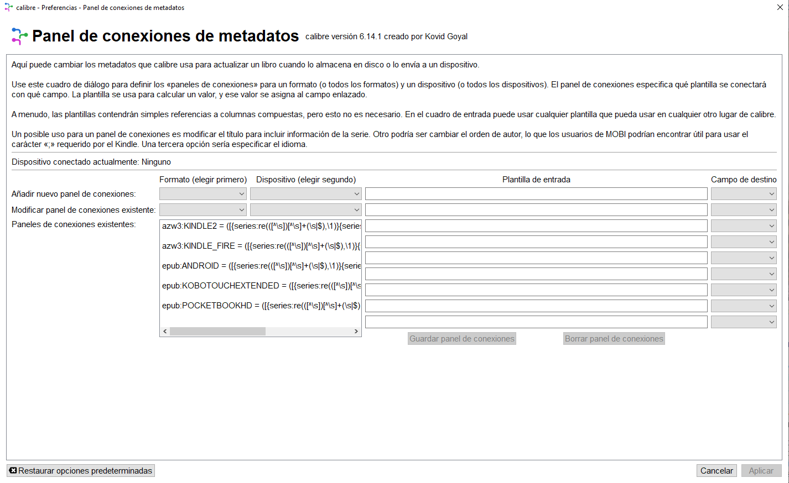
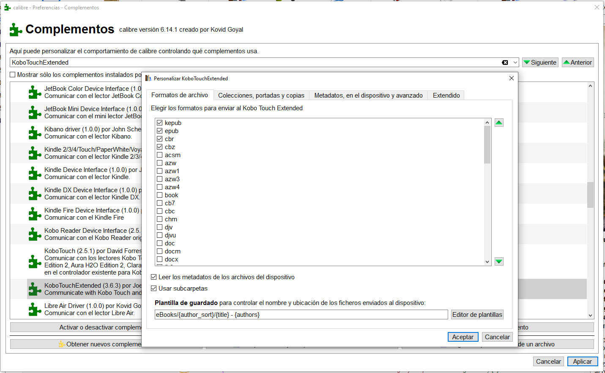
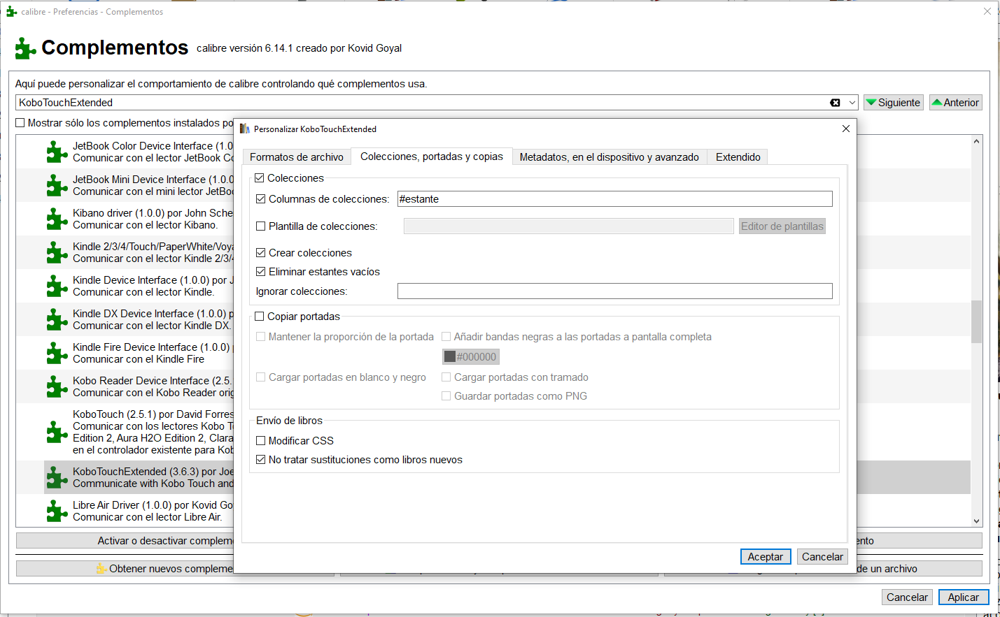
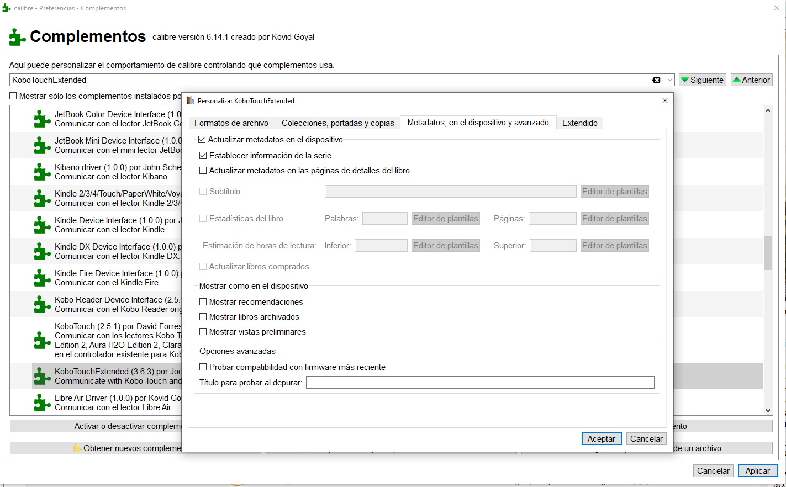
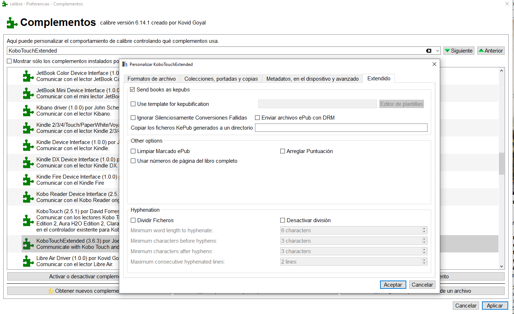
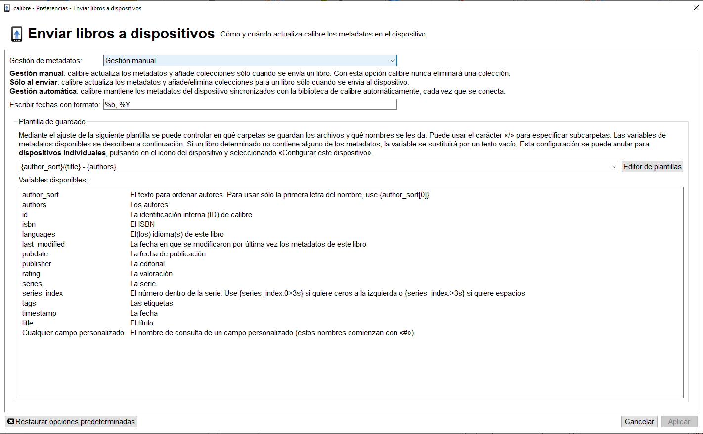
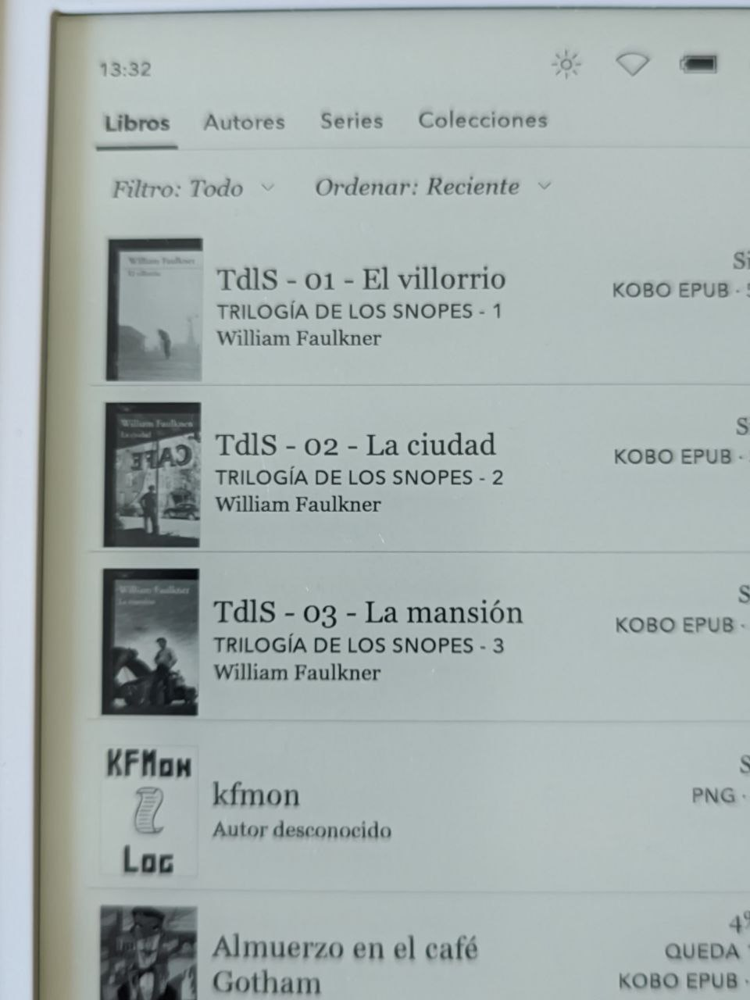

# Kobo - información de series

:material-account: [Walter Paterno](https://t.me/Dunhill69){ target=_blank } · :material-link-variant: [Ver el original en Telegraph](https://telegra.ph/Kobo---informaci%C3%B3n-de-la-serie-03-19){ target=_blank }
{ .tut-datos }

---

Explicado por @cristobal\_67

Pregunta: Buenas. Le he comprado un Libra2 a mi señora.

Hay forma en Calibre de que le indique la serie (y número dentro de la serie) a la que pertenece el libro y luego aparezca esta información en el Libra?

Gracias por adelantado.

Respuesta: Hola, si hay forma, lo primero de todo tienes que instalar el plugin kobotouchextended en calibre.

En calibre deberemos tener la columna de series.

Vamos a preferencias, panel de conexiones de metadatos.

En la casilla formato eliges epub

En dispositivo eliges KOBOTOUCHEXTENDED

En plantilla de entrada copias y pegas esta regla   {series:re((\[^\\s\])\[^\\s\]+(\\s\|$),\\1)}{series\_index:0\>2s\| - \| - }{title}

En campo de destino eliges title.

Aplicas todo aceptas y reinicias calibre para guardar modificaciones.

Ahora vamos a configurar el plugin kobotouchextended.

  
<small>Primer solapa</small>

Vete poniendo tal y como en la captura de pantalla

  
<small>Segunda solapa</small>

  
<small>Tercer solapa</small>

  
<small>Cuarta solapa</small>

Aceptas todo y reinicias calibre

En preferencias, enviar libros a dispositivos, gestión de metadatos en manual.

Tener en cuenta que no te va aparecerá la serie en la primera conexión, en la la primera trasfiere la información, pero el sistema no puede leer los metadatos hasta no realizar una segunda conexión por usb del dispositivo con calibre.

Así se verá en el kobo

Aclaración técnica de porque hay que hacer una segunda conexión por usb para que aparezcan las series. La serie se almacena en la base de datos y el driver ACTUALIZA entradas pero no CREA entradas (eso lo hace el propio Kobo al desconectarlo la primera vez, y por tanto la segunda lo puede actualizar).

Ir al mensaje: [https://t.me/calibreconfiguraciones/124636/130857](https://t.me/calibreconfiguraciones/124636/130857)

## [Volver al inicio](https://telegra.ph/Indice-Calibre-en-Espa%C3%B1ol-10-03)

 

 

 

 

 

 

 

---

[:material-arrow-left: Volver al índice](../../alfabetico.md) · [:fontawesome-brands-telegram: Preguntar en el grupo](https://t.me/calibreconfiguraciones){ target=_blank }
