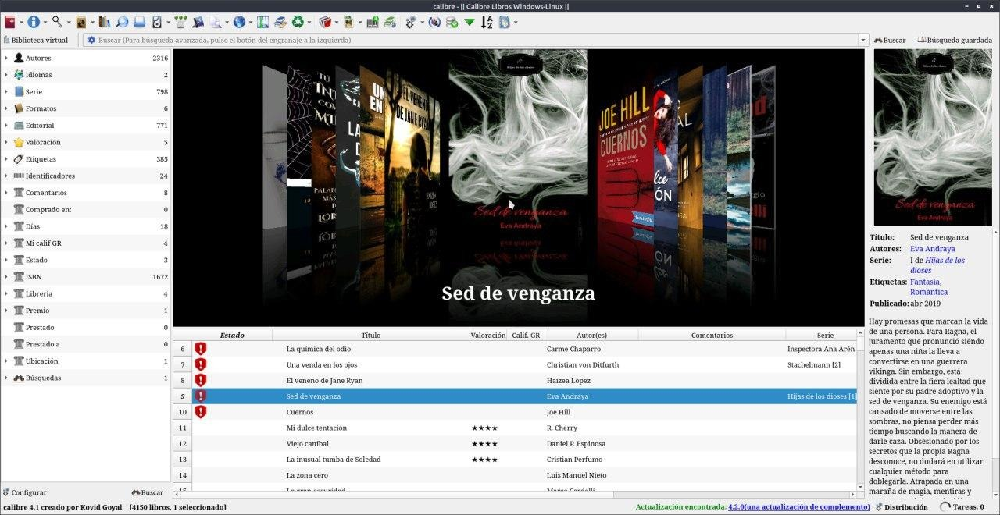
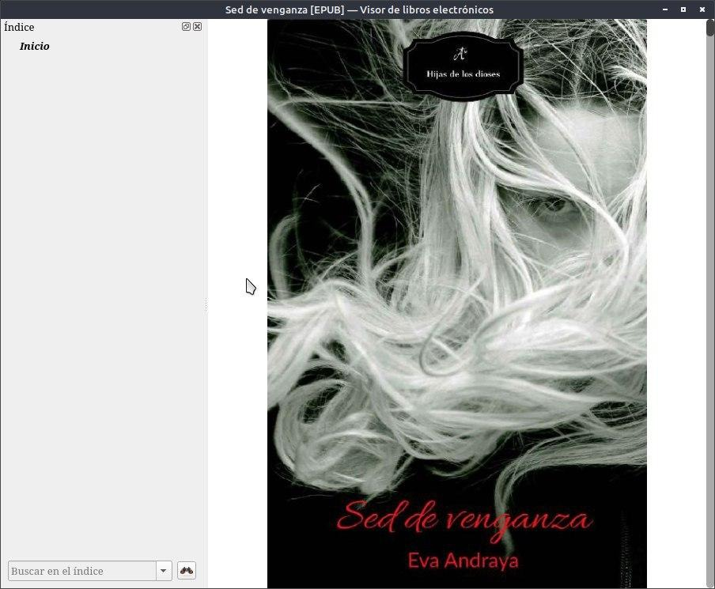
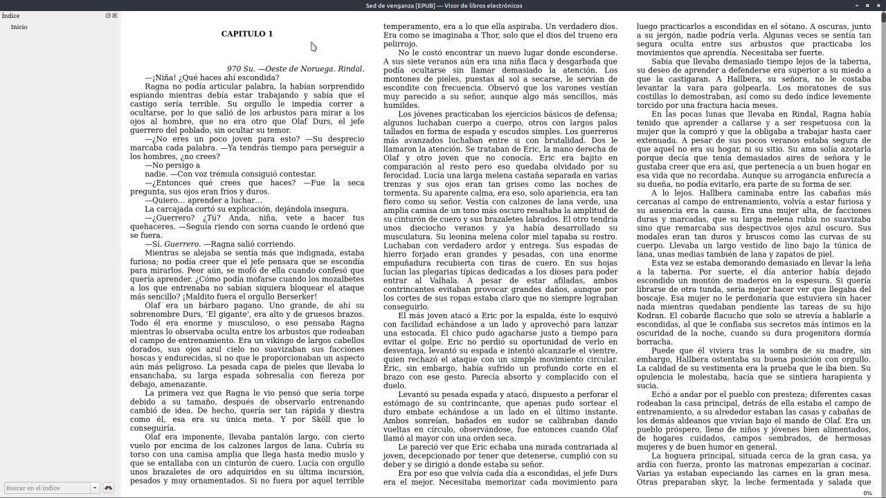

# Leer libros con Calibre

:material-account: [Walter](https://t.me/Dunhill69){ target=_blank } · :material-link-variant: [Ver el original en Telegraph](https://telegra.ph/Leer-Libros-con-Calibre-08-29){ target=_blank }
{ .tut-datos }

---

Hoy me preguntaban con que programa podía leer un libro en la computadora. Mi respuesta Calibre !! Como se hace ?? En la caratula del libro dar un click y se abre el lector de libros que viene incorporado en el propio Calibre.

Así se ve la primer hoja del libro

Y así si usamos pantalla completa o vemos estirando la pantalla.

## [Volver al inicio](https://telegra.ph/Indice-Calibre-en-Espa%C3%B1ol-10-03)

 

 

---

[:material-arrow-left: Volver al índice](../../alfabetico.md) · [:fontawesome-brands-telegram: Preguntar en el grupo](https://t.me/calibreconfiguraciones){ target=_blank }
