# Visor de libros - leer en otro idioma

:material-account: [Walter](https://t.me/Dunhill69){ target=_blank } · :material-link-variant: [Ver el original en Telegraph](https://telegra.ph/Leyendo-en-otro-idioma-con-el-visor-de-calibre-02-28){ target=_blank }
{ .tut-datos }

---

Compartido por @WalterDS

El programa [calibre](https://calibre-ebook.com/es), así con minúscula, es un gestor de libros electrónicos que permite no solo leerlos, mediante un visor ─tema de este artículo─, sino también editarlos y convertirlos de un formato a otro.

**Calibre** es un programa abierto multiplataforma imprescindible para todo buen lector digital que guste de practicar la lectura en todo tipo de terminales.

En este caso el cuento se aplica a los ordenadores personales y los portátiles que corran en Windows, donde Microsoft Edge ha eliminado (2019) el lector integrado de epub que tan útil se demostró.

Leer en dispositivos móviles libros electrónicos en formato epub es muy fácil y cómodo, mediante [FBReader](https://lectodigitantes.blogspot.com/2017/03/configuracion-de-fbreader-para-android.html), pero hacerlo en el PC es otro cantar. Afortunadamente **calibre** ha mejorado mucho el visor, que ofrece numerosas prestaciones para el lector exigente, incluida una forma comodísima de  [leer en otro idioma con un traductor instantáneo enlazado](https://www.blogger.com/u/8/blogger.g?blogID=8177152931654644103#GTraductor). De paso, si queremos leer en español con todas las garantías, podemos ponernos el [Diccionario en línea de la Lengua Española](https://www.blogger.com/u/8/blogger.g?blogID=8177152931654644103#DLE) que gestiona la Real Academia.

## Instalar y abrir calibre en el ordenador.

Desde la página oficial de C**alibre** se accede a la [última versión para descargar](https://calibre-ebook.com/es/download), bien mediante instalación en Windows u otro sistema operativo (salvo Android e iOS), o mediante la descarga de una versión portátil que no necesita instalación.

 

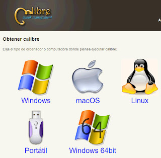

Una vez instalado, al abrir el programa se nos aparece la interfaz general con las principales opciones: añadir libros, convertirlos, leerlos (*Mostrar*) o modificarlos.

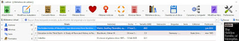

Debemos tener presente que **calibre** crea su propia biblioteca en la carpeta **Documentos/Biblioteca de calibre**, donde almacena copias de los libros que añadimos o las versiones convertidas o modificadas.

Un procedimiento habitual podría ser: primero añadir un libro y luego leerlo pulsando en *Mostrar*, mediante el visor que se abre.

## Leer de forma independiente con el visor de calibre.

Pero hay otra forma complementaria de la anterior, que consiste en abrir directamente un epub mediante el **visor de Calibre**. Incluso, se puede establecer que el formato epub sea abierto por defecto mediante el visor de calibre.

En el explorador de archivos de Windows, al pulsar en botón derecho del ratón sobre el archivo epub para la opción *Abrir con - Elegir otra aplicación - Más aplicaciones *se presentarán las tres posibilidades que ofrece C**alibre**:

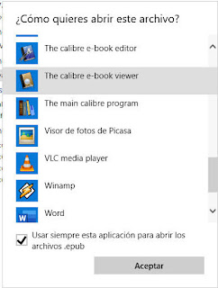

Es recomendable activar primero "Usar siempre... para abrir archivos .epub" y luego pulsar en la  **opción del visor** (*The calibre e-book viewer*) y en *Aceptar*, lo que provoca que el libro se abra en el visor, pero sin que se active el gestor principal ni se cree una copia de la obra en la Biblioteca de C**alibre**.

La lectura independiente con el visor permite comprobar la obra u ojearla sin que se incluya de momento en nuestra biblioteca.

A partir de ahora al pulsar en un epub se nos abrirá el visor de calibre. No obstante, mediante la opción de botón derecho *Abrir con - Elegir otra aplicación - Más aplicaciones *podemos abrir el epub con el **editor** (*e-book editor*) o con el **gestor de calibre **(*main program*), aunque no sea mediante el procedimiento por defecto. Esta última incluirá una copia de la obra en nuestra biblioteca de calibre.

Veamos la interfaz mejorada recientemente del visor.

## La interfaz de lectura del visor de calibre.

De entrada el visor presenta la portada de la obra en un entorno desnudo listo para leer, pero pulsando en el botón derecho de ratón se visualizan las **opciones de controles del visor.**

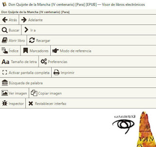

Interesa ahora pulsar en *Preferencias - Miscelánea* para modificarlas como se indica abajo y luego en *Aceptar.*

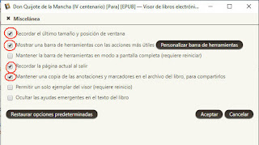

Ahora la **barra de herramientas** está a la vista en la pantalla normal y se puede rápidamente modificar el tamaño de la letra, ir al índice (tabla de contenido), buscar algo en el interior de la obra o abrir un libro distinto.

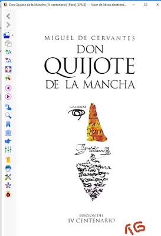

## Los marcadores.

Si queremos hacer una lectura más útil, una funcionalidad muy necesaria es la de poder seleccionar u marcar aquellas palabras, frases o párrafos que nos parezcan destacables, de forma que la siguiente vez que abramos el libro podamos recuperar esos **marcadores**, o exportarlos incluso.

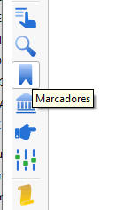

Al pulsar en el botón de *Marcadores* se abre un panel derecho que permite crear un *Nuevo* marcador a partir de un texto seleccionado. Según hemos activado antes en *Preferencias* ("Mantener una copia de las anotaciones y marcadores en el archivo del libro") el marcador permanece en el libro aunque se cierre y aparece cuando se vuelve a abrir en la aplicación **visor de calibre**. Es una lástima que los marcadores no se visualicen también como párrafos coloreados en el propio panel de texto de lectura, para que el acceso a ellos fuera más rápido y fácil.

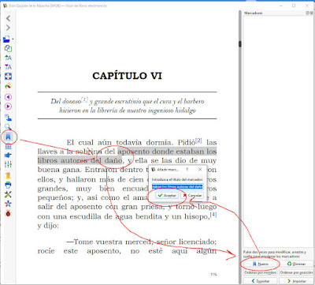

## Leer en otro idioma con traducción inmediata.

Imaginemos ahora que abrimos un libro en inglés, como este sobre la historia de las habitaciones de la casa, *At Home* de Bill Bryson, y queremos traducir una palabra o, mejor, una frase. Para ello debemos activar la opción de *Consultar*, que abrirá un nuevo panel a la derecha, encima del de *Marcadores*.

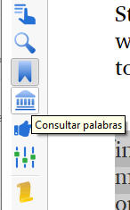

 

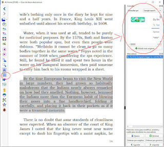

El panel de *Consultas* permite *Añadir más orígenes *a los que ya vienen por defecto con el programa*, *como por ejemplo el diccionario en línea **Reverso** o el **Google Traductor**, escribiendo con esta sintaxis exacta:

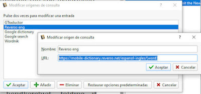

- [https://mobile-dictionary.reverso.net/espanol-ingles/{word}](https://mobile-dictionary.reverso.net/espanol-ingles/%7Bword%7D)

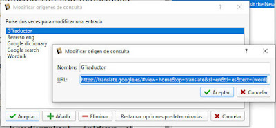

- https://translate.google.es/#view=home&op=translate&sl=en&tl=es&text={word}

Mejor todavía, se puede establecer de forma que sea el Google Traductor el que detecte automáticamente el idioma. Sustituyamos el texto anterior por este otro:

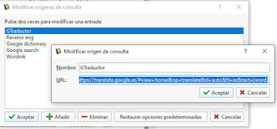

- https://translate.google.es/#view=home&op=translate&sl=auto&tl=es&text={word}

Ahora ya tenemos varias posibilidades para escoger donde *Consultar.* Seleccionemos **GTraductor.**

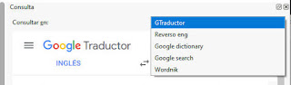

Como consecuencia, cuando seleccionamos un párrafo en el panel de lectura podemos leerlo de inmediato en la traducción de **Google Traductor**, sin necesidad de copiar y pegar.

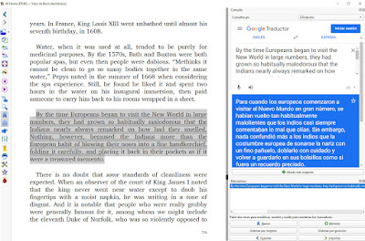

Lo mismo se puede decir para las palabras sueltas o frases, de forma que puede ser una ayuda inestimable para animarnos a leer en otro idioma. Por ejemplo, en alemán:

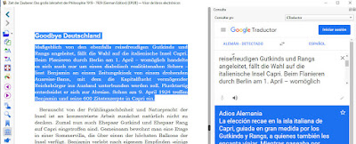

Se puede disminuir el tamaño de la letra del panel de Consultas para que quepa más texto mediante botón derecho - *Alejar.*

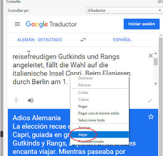

Si se quiere, se puede cambiar el elemento de consulta y seleccionar, por ejemplo, **Reverso Diccionario**.

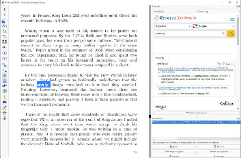

Hay unas líneas ocultas que permiten modificar el tamaño del panel de *Consultas* con respecto a *Marcadores* o al panel de texto y adaptar ambos a las exigencias de nuestra pantalla.

## Leer en español con el Diccionario en línea de la Lengua Española de la Real Academia.

Para añadir la posibilidad de consultar el significado o la etimología de una palabra en español mientras leemos con **calibre** podemos usar el panel de *Consultas.* Tras activarlo con su botón, pulsamos en *Añadir más orígenes * escribiendo con esta sintaxis exacta:

- Diccionario de la Lengua Española
- https://dle.rae.es/{word}

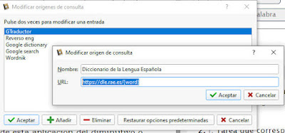

Ahora, al seleccionar una palabra del texto se activa su consulta inmediata en el Diccionario.

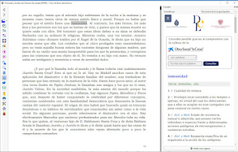

Feliz lectura.

Nota final sobre una configuración cómoda de calibre. Conviene activar algunas opciones desactivadas por defecto, como la barra de herramientas lateral.

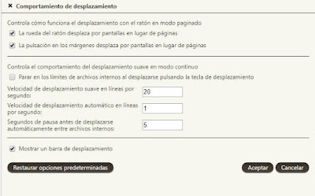

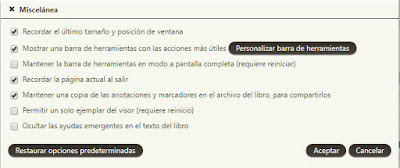

La barra de herramientas lateral se puede personalizar, moviendo las opciones más frecuentes arriba, para mejor acceso en pantallas pequeñas.

Ahora sí, del todo, feliz lectura digital.

Fuente: [https://lectodigitantes.blogspot.com/2020/03/leyendo-en-otro-idioma-con-el-visor-de.html](https://lectodigitantes.blogspot.com/2020/03/leyendo-en-otro-idioma-con-el-visor-de.html)

 

## [Volver al inicio](https://telegra.ph/Indice-Calibre-en-Espa%C3%B1ol-10-03)

 

---

[:material-arrow-left: Volver al índice](../../alfabetico.md) · [:fontawesome-brands-telegram: Preguntar en el grupo](https://t.me/calibreconfiguraciones){ target=_blank }
