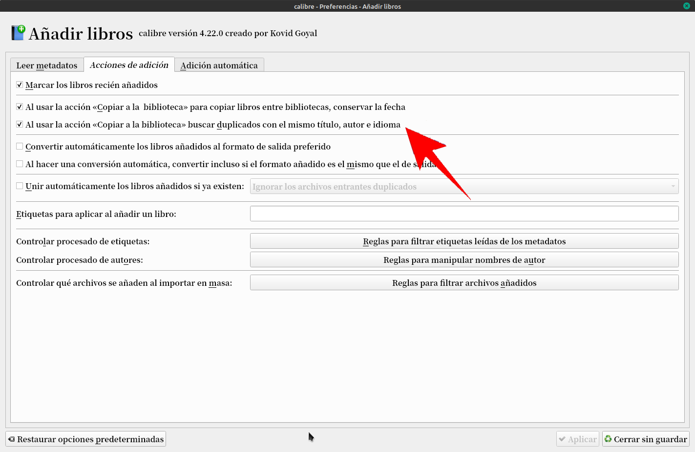
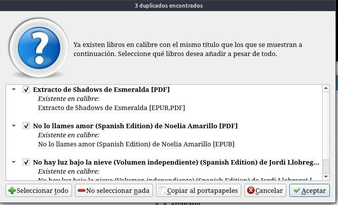
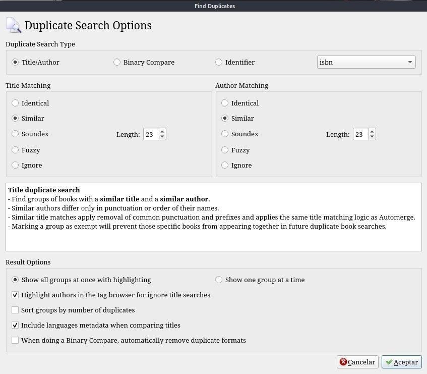
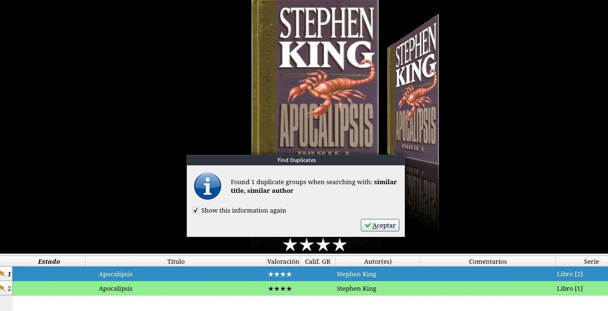

# Libros duplicados

:material-account: [Walter](https://t.me/Dunhill69){ target=_blank } · :material-link-variant: [Ver el original en Telegraph](https://telegra.ph/Libros-Duplicados-08-17){ target=_blank }
{ .tut-datos }

---

Libros Duplicados Calibre nos avisa en cada carga si el libro está ya cargado marcando esta casilla, que esta en Preferencias / Añadir libros

Nos lo muestra de esta manera, Nombre de libro y tipo de Formato Leer la imagen.

También existe este plugin que busca duplicados de diferente maneras.

Find Duplicates: [https://plugins.calibre-ebook.com/131017.zip](https://plugins.calibre-ebook.com/131017.zip)

Esta son todas las opciones que podemos ir seleccionando.

Con lo marcado en la imagen anterior Nos muestra mismo autor, mismo título, Pero como verán es el libro 1 y 2 en la series

 

## [Volver al inicio](https://telegra.ph/Indice-Calibre-en-Espa%C3%B1ol-10-03)

 

 

---

[:material-arrow-left: Volver al índice](../../alfabetico.md) · [:fontawesome-brands-telegram: Preguntar en el grupo](https://t.me/calibreconfiguraciones){ target=_blank }
