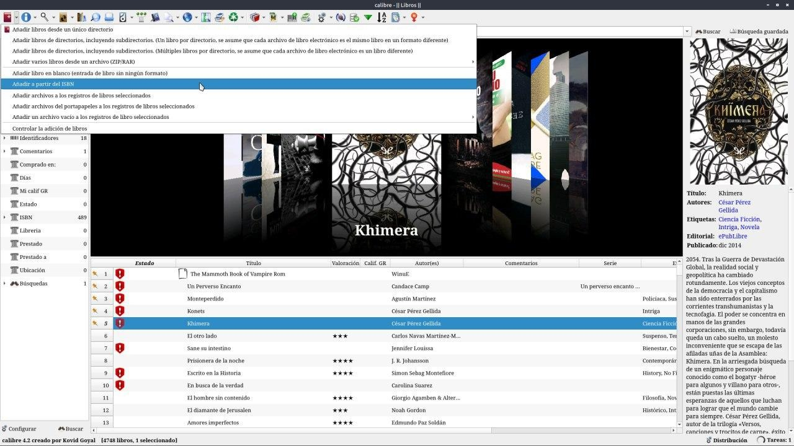
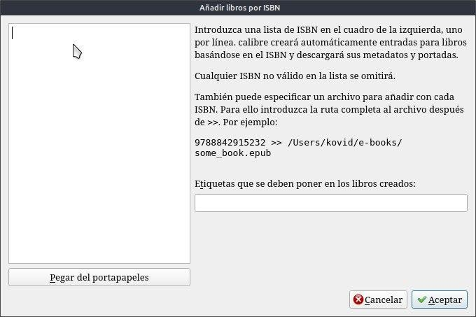
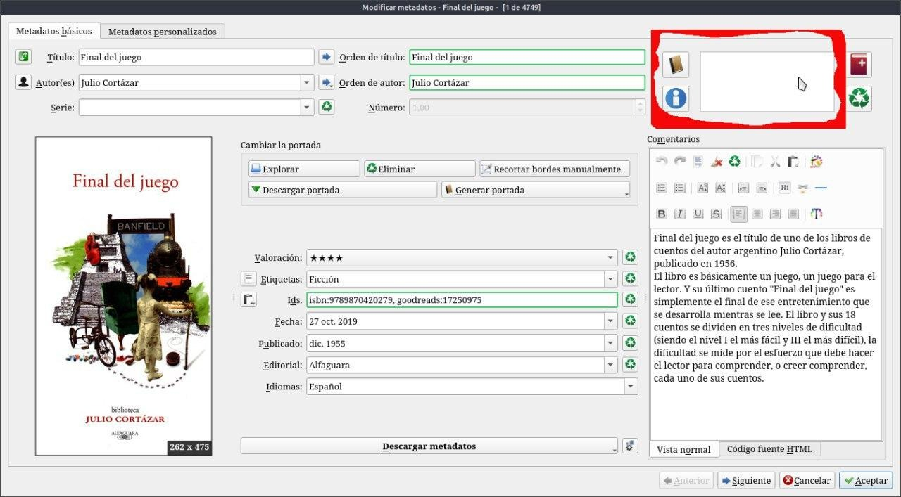
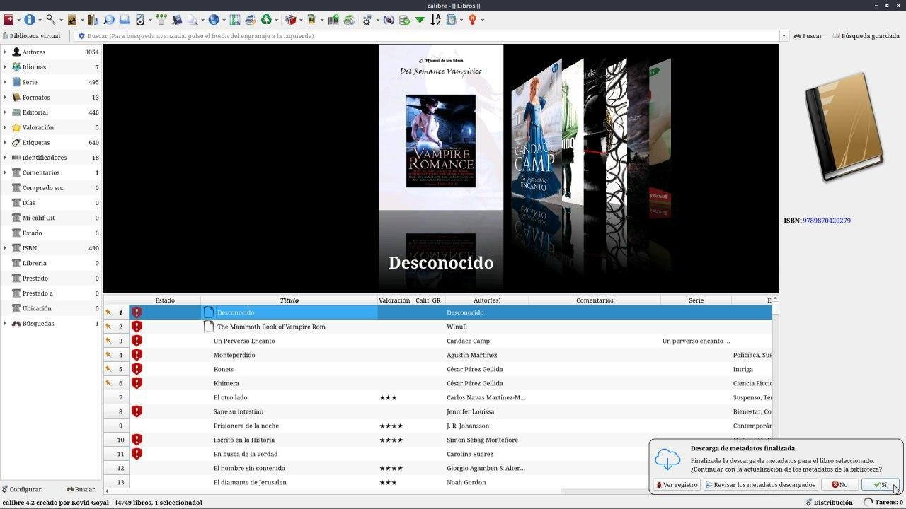
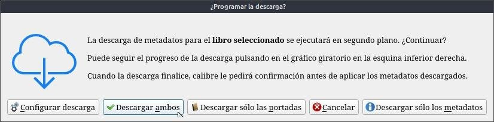
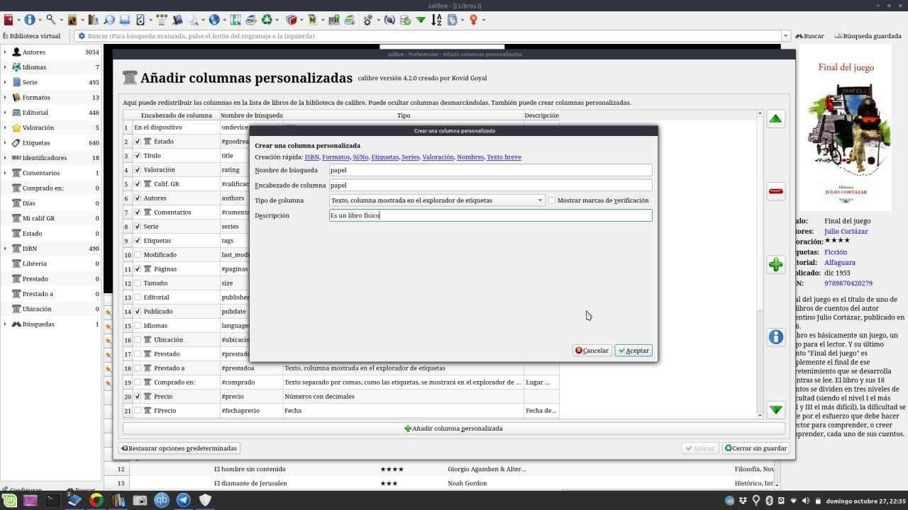
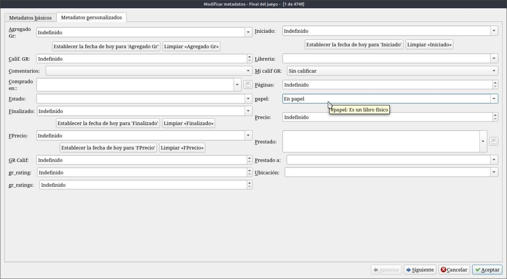
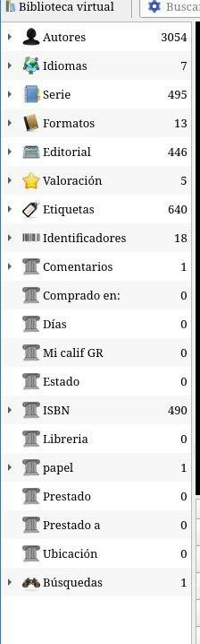

# Libros físicos

:material-account: [Walter](https://t.me/Dunhill69){ target=_blank } · :material-link-variant: [Ver el original en Telegraph](https://telegra.ph/Libros-f%C3%ADsicos-08-17){ target=_blank }
{ .tut-datos }

---

Me preguntaron si Calibre puede gestionar un biblioteca de libros de papel. Si podemos agregar libros con el ISBN de la siguiente manera. En añadir libros con la flecha de al lado seleccionamos cargar libro por ISBN

Nos aparece esta pantalla donde deberemos cargar el numero ISBN sin guiones en mi caso 9789870420279

Pero tengan en cuenta que no tendremos ningún libro cargado, solo el dato de los metadatos del libro.

Así se ve el libro cargado antes de apretar descargar ambos solo esta el numero 9789870420279

Esperamos un momento y nos sale esta notificación tocamos descargar ambos

al darle en descargar ambos no queda así el libro

Se podría hacer una columna personalizada que te figure en etiquetas y poner libro en papel o físico

Se reinicia Calibre y cuando editamos metadatos en la segunda solapa superior encontramos la columna.

Y así lo vemos en las etiquetas.

 

## [Volver al inicio](https://telegra.ph/Indice-Calibre-en-Espa%C3%B1ol-10-03)

 

 

---

[:material-arrow-left: Volver al índice](../../alfabetico.md) · [:fontawesome-brands-telegram: Preguntar en el grupo](https://t.me/calibreconfiguraciones){ target=_blank }
