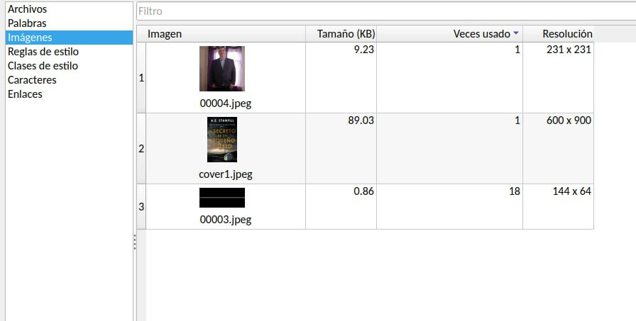
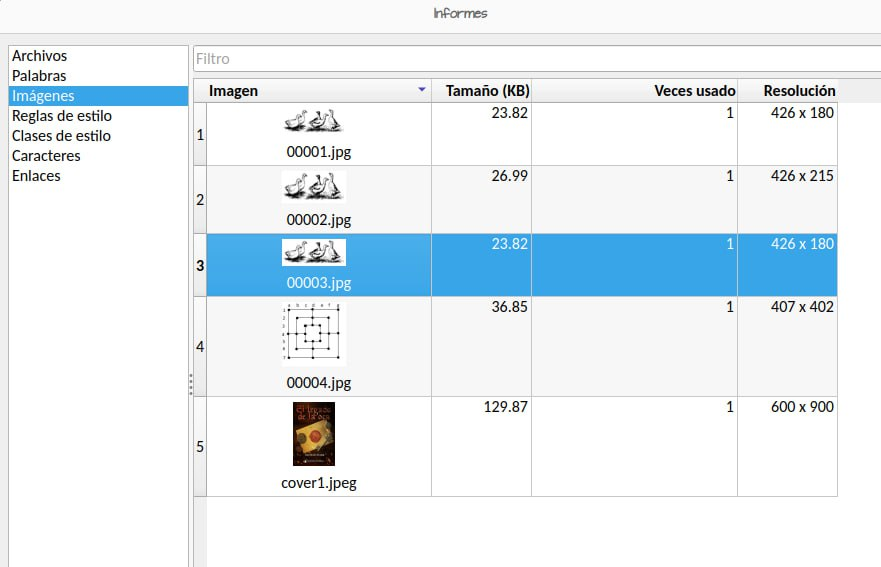
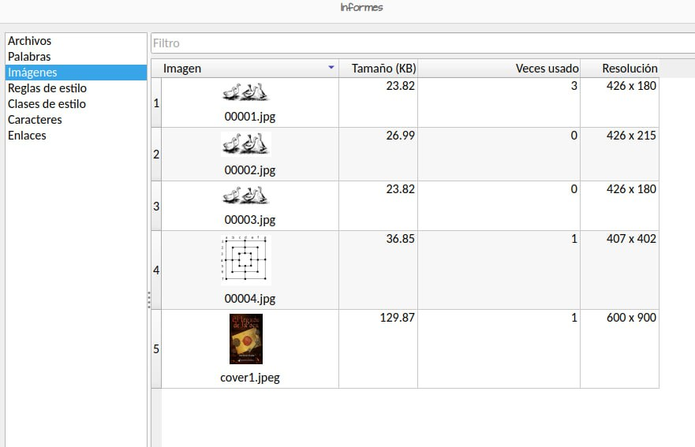
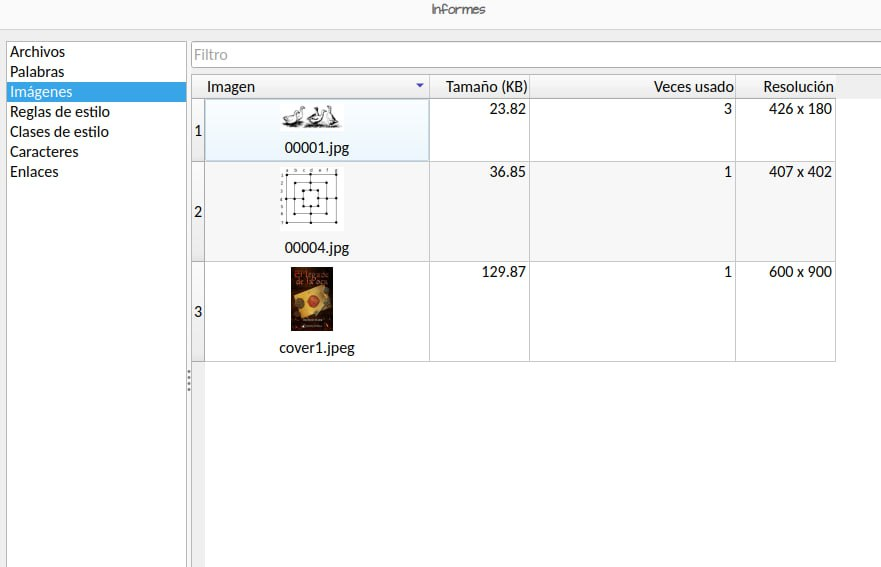
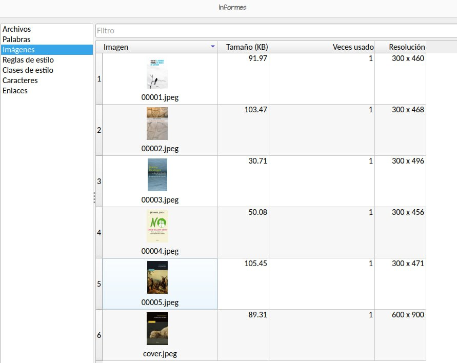
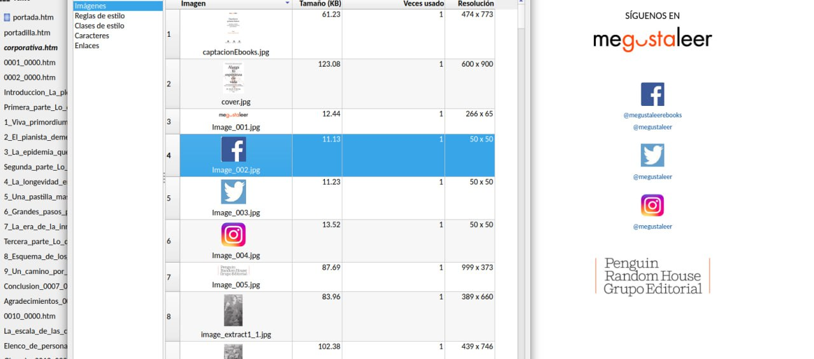
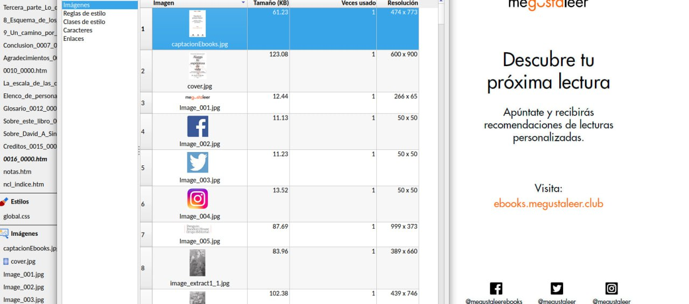

# Localizar imágenes con el editor de Calibre

:material-account: [@Lorenzo888](https://t.me/Dunhill69){ target=_blank } · :material-link-variant: [Ver el original en Telegraph](https://telegra.ph/Localizar-imagenes-con-el-editor-02-17){ target=_blank }
{ .tut-datos }

---

Explicado por @Lorenzo888

También, desde el Editor de calibre, se puede ir a Herramientas \> Informes (O también Ctrl+May+R)

Allí seleccionáis Imágenes a la izquierda y las podéis ver todas listadas en un tabla a la derecha.

Pinchando en la cabecera de cada columna (Imagen, Tamaño, Veces usado o Resolución) se puede ordenar por estas columnas.

Si hacemos doble clic en la imagen, el Editor nos lleva al lugar del libro donde se halla la imagen.

Si hemos quitado un archivo html completo que tenía imágenes, por ejemplo, podemos ordenar la tabla como Veces usado y veremos que en esas imágenes pone 0.

Con el botón derecho las podemos borrar desde aquí sin necesidad de ir al explorador de archivos del libro. Las seleccionamos y las borramos.

Si lo usamos mucho, como yo, podemos poner el icono es la Barra.

Desde Informes podemos ver de un plumazo si hay o no imágenes susceptibles de ser eliminadas y dónde están.

En este ejemplo, hay tres imágenes que son prácticamente iguales.

Podemos sustituir la 2 y la 3 por la 1 para que se repita tres veces.

Doble clic en 00002.jpg, nos lleva a la imagen y la cambiamos por 00001.jpg.

Lo mismo con 00003.jpg.

Ahora veos que la 00001.jpg se usa tres veces y las otras dos ninguna.

Las seleccionamos, botón derecho y Borrar.

Ya solo tenemos una imagen que se repite tres veces.

Nada ha cambiado en el libro, pero le hemos quitado dos imágenes que pesaban casi 24Kb cada una, o sea que ahora el libro pesa casi 50Kb menos.

Imaginaos si en lugar de hacerlo con dos imágenes, lo hacemos con veinte (Por ejemplo), una en la cabecera de cada uno de los capítulos del libro, y que cada una pesase 10Kb.

Descargamos el libro de 20 imágenes repetidas, que ocupan solo espacio, cuando podemos dejar una sola repetida 20 veces.

En este ejemplo, las cinco primeras imágenes son de portadas de libros que la editorial publicita al final del libro.

Pues, si las sumáis veréis unos 300Kb de propaganda que solo engordan el libro.

Este ejemplo es de la página corporativa de la editorial. se puede eliminar por completo el archivo corporativa.htm y luego quitar las cuatro imágenes que hay dentro.

Y lo mismo con este archivo, del mismo libro

Solo son ejemplo, pero en realidad las editoriales nos meten propaganda propia en muchos libros.

Publicidad que no necesitamos y solo engorda el libro y solo ocupa espacio.

A veces mucho espacio.

Ir al mensaje: [https://t.me/calibreconfiguraciones/144967/157372](https://t.me/calibreconfiguraciones/144967/157372)

## [Volver al inicio](https://telegra.ph/Indice-Calibre-en-Espa%C3%B1ol-10-03)

 

 

---

[:material-arrow-left: Volver al índice](../../alfabetico.md) · [:fontawesome-brands-telegram: Preguntar en el grupo](https://t.me/calibreconfiguraciones){ target=_blank }
