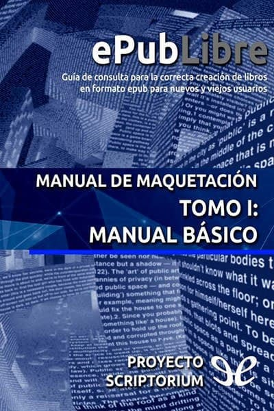
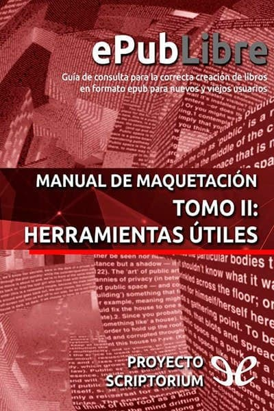
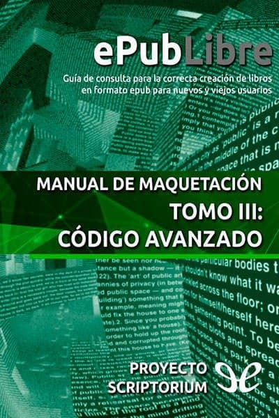
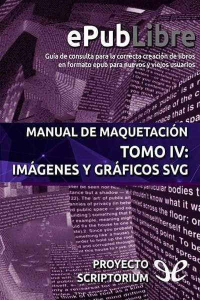
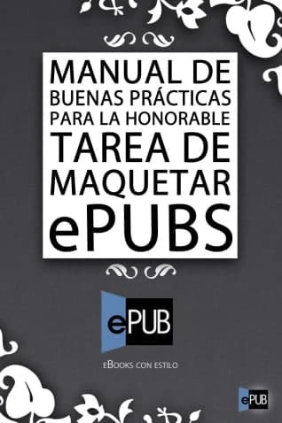
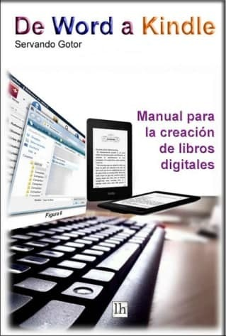

# Manuales para maquetar libros electrónicos

:material-link-variant: [Ver el original en Telegraph](https://telegra.ph/Manuales-para-maquetear-libros-electr%C3%B3nicos-12-09){ target=_blank }
{ .tut-datos }

---

Una series de libros recomendados por Susana Ines @susanaines

Ir al libro: https://t.me/calibreconfiguraciones/25999

Ir al libro: [https://t.me/calibreconfiguraciones/26002](https://t.me/calibreconfiguraciones/26002)

Ir al libro: [https://t.me/calibreconfiguraciones/26005](https://t.me/calibreconfiguraciones/26005)

Ir al libro: [https://t.me/calibreconfiguraciones/26008](https://t.me/calibreconfiguraciones/26008)

Ir al libro: [https://t.me/calibreconfiguraciones/26021](https://t.me/calibreconfiguraciones/26021)

Gracias a Jose Luis (@Otronovato) que nos lo facilitó.

Ir al libro: [https://t.me/calibreconfiguraciones/26024](https://t.me/calibreconfiguraciones/26024)

[https://telegra.ph/Manuales-para-maquetear-libros-electr%C3%B3nicos-12-09](https://telegra.ph/Manuales-para-maquetear-libros-electr%C3%B3nicos-12-09)

 

## [Volver al inicio](https://telegra.ph/Indice-Calibre-en-Espa%C3%B1ol-10-03)

 

 

---

[:material-arrow-left: Volver al índice](../../alfabetico.md) · [:fontawesome-brands-telegram: Preguntar en el grupo](https://t.me/calibreconfiguraciones){ target=_blank }
