# Marcar libros

:material-account: [Walter](https://t.me/Dunhill69){ target=_blank } · :material-link-variant: [Ver el original en Telegraph](https://telegra.ph/Marcar-libros-01-22){ target=_blank }
{ .tut-datos }

---

En el caso de no querer instalar el plugin reading list, una de las maneras que creo que seria interesante poder marcar libros para diferentes fines es crear una columna personalizada. Preferencia / añadir columna personalizada

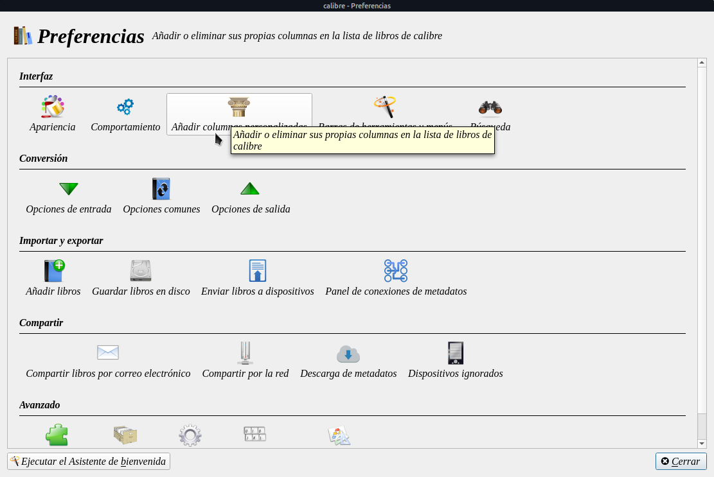

Le damos en el + para añadir una columna.

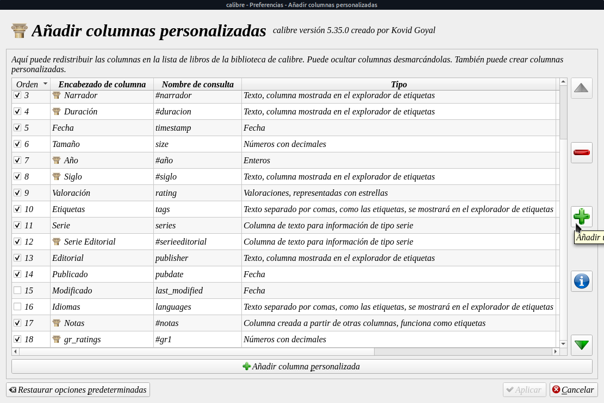

Pienso que tiene que ser de dos opciones Si/No

Yo la crearia así.

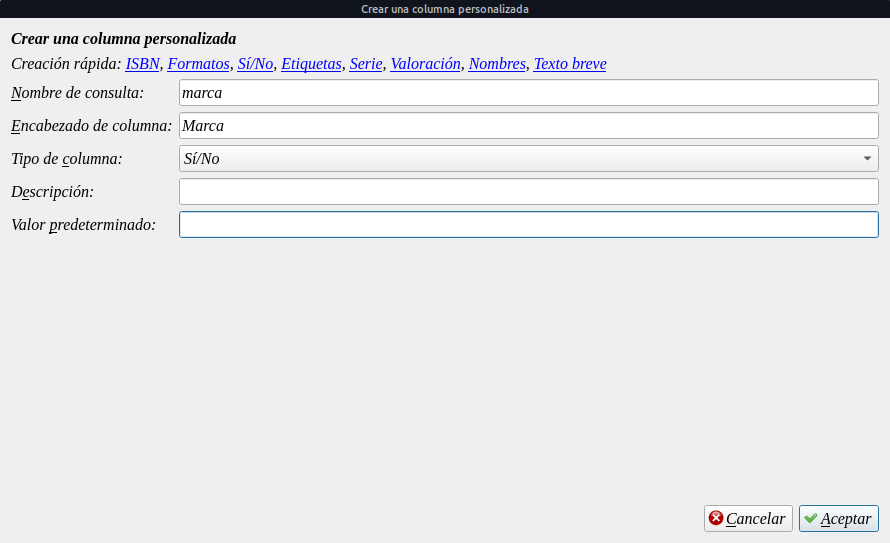

Le damos en Aceptar y Aplicar. Reiniciamos Calibre

Y nos quedaria así:

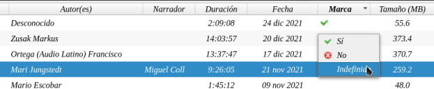

Hasta acá el paso simple. Podemos ir un poco más alla y si la columna Marca es Si que nos ponga una chincheta o pin al lado del nombre.

Para eso vamos a Preferencias/Apariencias y nos desplazamos con la flechita de arriba (1) hasta encontrar iconos en columnas (2) y le damos en añadir regla (3)

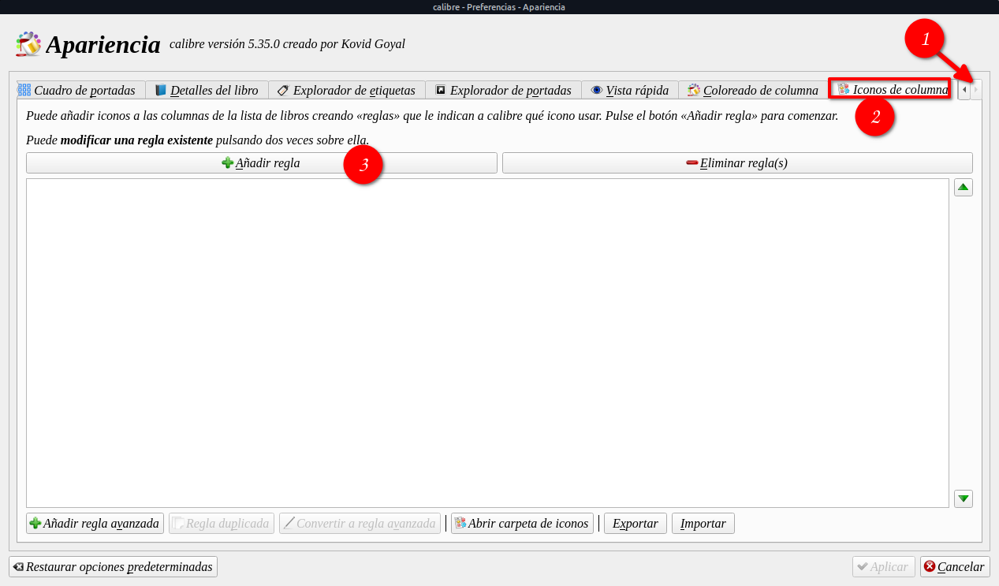

En la creación de la regla seleccionamos:

Fijar el: icon con texto

de la columna: Título (title)

en: marked.png  ( que es el icono que dejo más abajo ) que lo pueden añadir con el boton añadir icono desde cualquier lugar de su pc.

Y en las condiciones ponemos:

Si la columna Marca (#marca) o el nombre que ustedes les hayan puesto

es verdadero

Quedando así:

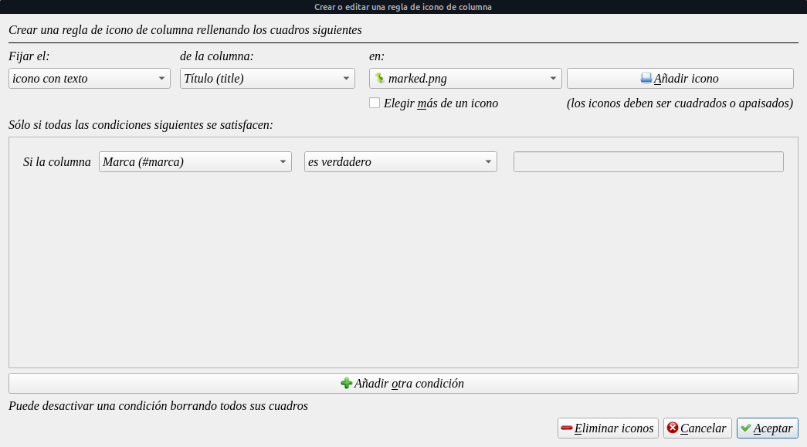

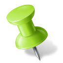

Y le damos en Aceptar.

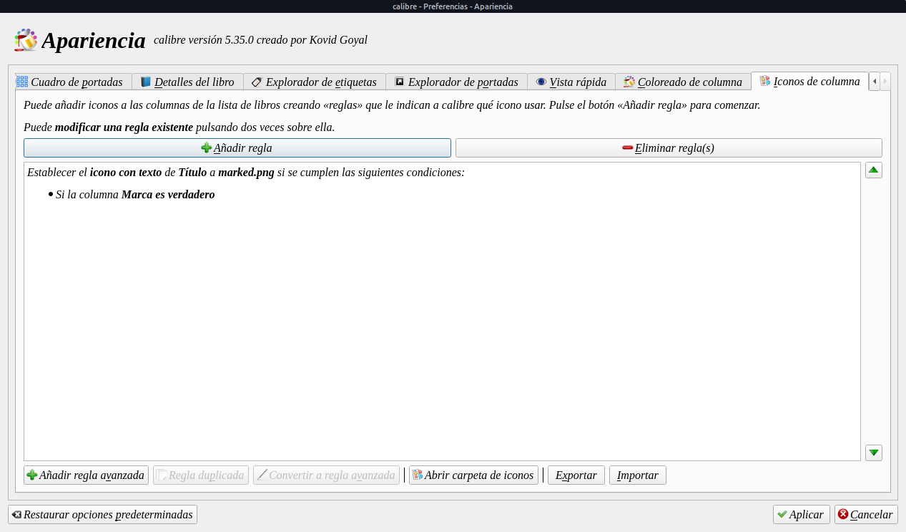

Nos queda acentada la regla, le damos en Aplicar.

Y se produce la magia de todos los libros que en la columna Marca sea verdadero se le coloca un pin o una chinchilla verde en el titulo,

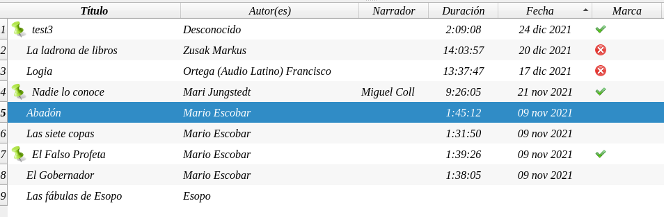

Solo visualmente para calibre, al exportar este libro no aparecera la marca en el titulo.

Pero esta marca seguirá apareciendo en los reinicios de Calibre hasta que en la columna Marcas pongan no.

Ir al mensaje: [https://t.me/calibreconfiguraciones/64146](https://t.me/calibreconfiguraciones/64146)

##  

## Explicado por Llogur

 

-Si los libros que quieres enviará a Kindle, en el nombre del autor de cada libro que quieres enviar a Kindle  le pones delante un  \* (Asterisco).

-Cuando hagas una búsqueda poniendo

en la barra de búsqueda  author:"\*"

-Te mostrará los libros que les has puesto un Asterisco delante del nombre.

-Los seleccionas todos y a enviar al Kindle.

 

-Para seleccionar todos los libros

En Windows pulsar en Control  y La letra  E

En Linux Control y la letra  A

 

No se si me explicado bien.

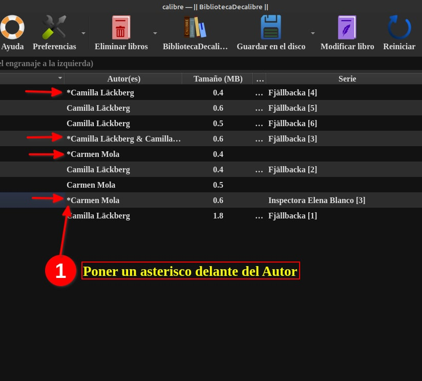

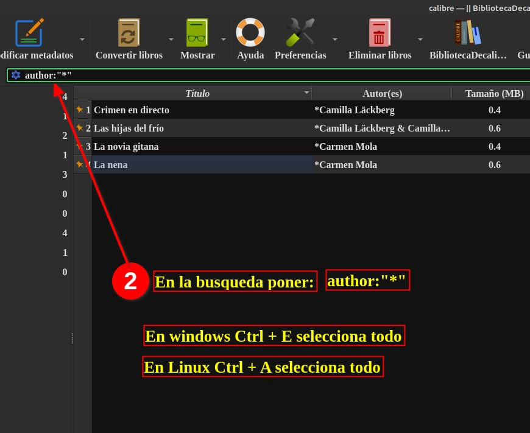

Ir al mensaje: [https://t.me/calibreconfiguraciones/64125](https://t.me/calibreconfiguraciones/64125)

 

## [Volver al inicio](https://telegra.ph/Indice-Calibre-en-Espa%C3%B1ol-10-03)

 

 

 

 

 

 

---

[:material-arrow-left: Volver al índice](../../alfabetico.md) · [:fontawesome-brands-telegram: Preguntar en el grupo](https://t.me/calibreconfiguraciones){ target=_blank }
