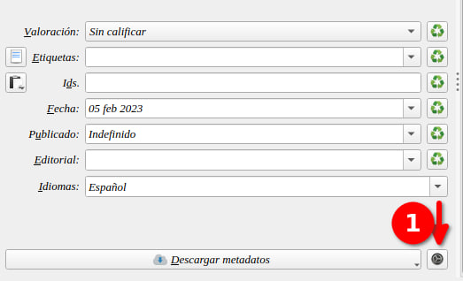
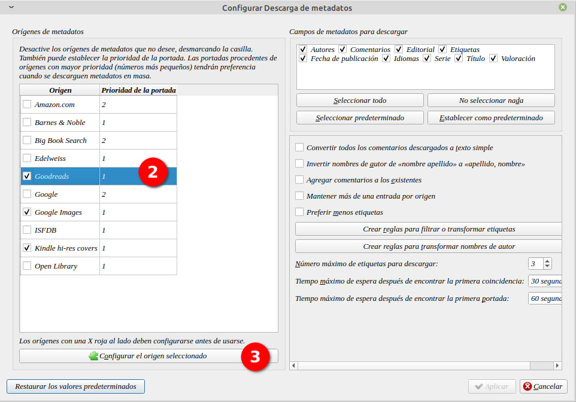
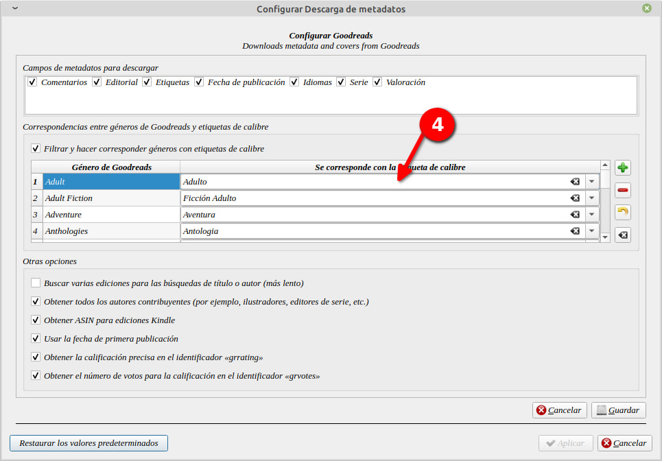

# Metadatos en español

:material-account: [Walter Paterno](https://t.me/Dunhill69){ target=_blank } · :material-link-variant: [Ver el original en Telegraph](https://telegra.ph/Metadatos-en-Espa%C3%B1ol-02-18){ target=_blank }
{ .tut-datos }

---

Para que las categorías al descargar metadatos queden en español hay que seguir estos pasos:

Al lado del botón de descargar metadatos tocar este botón (1)

Se nos abre los motores de descargas que usemos, yo uso el de goodreads. Lo seleccionamos (2) y tocamos en Configurar el origen seleccionado (3)

En la columna izquierda están las categorías en ingles y en la derecha, manualmente debemos cargar en Español y en el formato que quisiéramos. Damos en Guardar y Aplicar para que haga efecto. Y en la próxima descarga estarán a nuestro gusto.

 

Ir al mensaje: [https://t.me/calibreconfiguraciones/112333/129174](https://t.me/calibreconfiguraciones/112333/129174)

## [Volver al inicio](https://telegra.ph/Indice-Calibre-en-Espa%C3%B1ol-10-03)

 

 

 

---

[:material-arrow-left: Volver al índice](../../alfabetico.md) · [:fontawesome-brands-telegram: Preguntar en el grupo](https://t.me/calibreconfiguraciones){ target=_blank }
