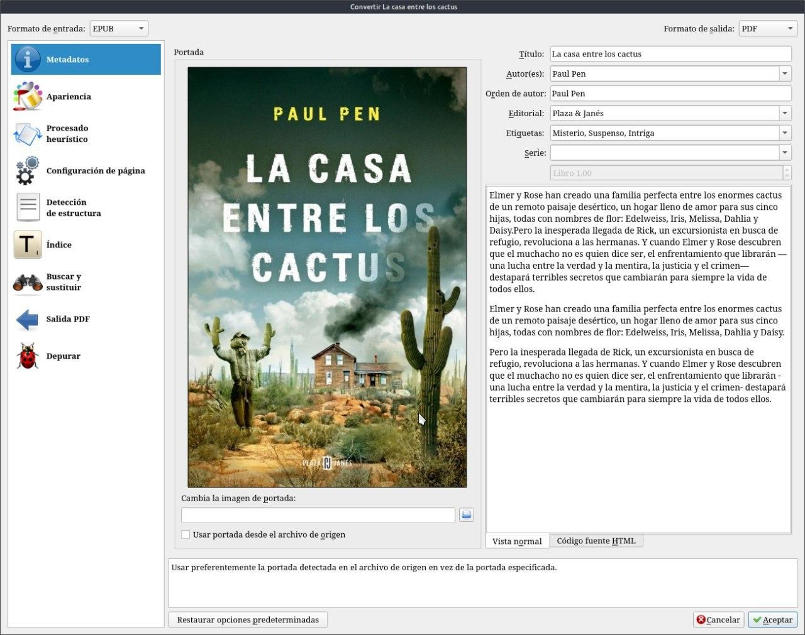
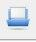
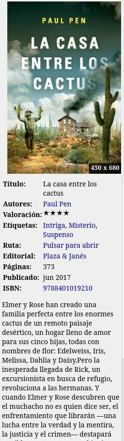
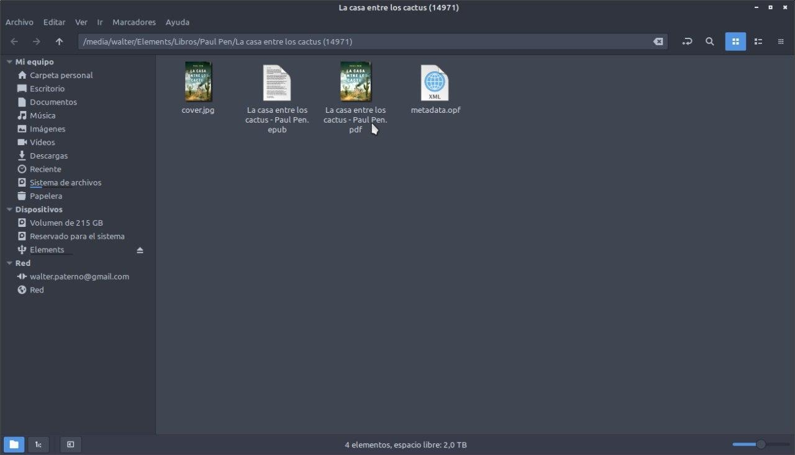

# Modificar formato de libro

:material-account: [Walter](https://t.me/Dunhill69){ target=_blank } · :material-link-variant: [Ver el original en Telegraph](https://telegra.ph/Modificar-formato-de-libro-09-05){ target=_blank }
{ .tut-datos }

---

Al tocar el icono de convertir libro, sale esta pantalla Arriba a la izquierda está el formato de entrada y arriba a la derecha el formato de Salida. Tocamos aceptar. Aparece una flecha que nos muestra la tarea que se esta ejecutando y convierte el libro al formato elegido.

Donde encontramos este libro convertido...

hay dos opciones o el icono de abrir carpeta del libro actual.

O tener activada la ruta en el detalle del libro. Tocamos donde dice Pulsar para abrir.

 

Y vemos la carpeta que contiene, tanto el original como la conversión.

 

## [Volver al inicio](https://telegra.ph/Indice-Calibre-en-Espa%C3%B1ol-10-03)

---

[:material-arrow-left: Volver al índice](../../alfabetico.md) · [:fontawesome-brands-telegram: Preguntar en el grupo](https://t.me/calibreconfiguraciones){ target=_blank }
