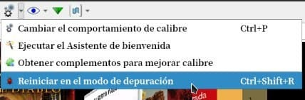
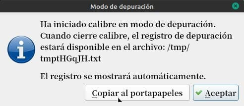

# Modo depuración

:material-account: [Walter](https://t.me/Dunhill69){ target=_blank } · :material-link-variant: [Ver el original en Telegraph](https://telegra.ph/Modo-depuraci%C3%B3n-11-03){ target=_blank }
{ .tut-datos }

---

De la flecha al costado del icono de Preferencias elegimos la última opción.

Este proceso se usa cuando vemos que calibre se comporta de una manera que no es la que esperamos para poder ver que estaría causando el error.

Se reinicia Calibre y nos sale este cartel indicando que se ha iniciado en modo depuración y la ruta donde se aloja el archivo, que se nos abrirá al poner aceptar.

Ese archivo o bien lo envían al grupo de Calibre o al foro de Calibre en  [https://www.mobileread.com/](https://www.mobileread.com/) para que se analice.

Ir al mensaje: [https://t.me/calibreconfiguraciones/22502](https://t.me/calibreconfiguraciones/22502)

[https://telegra.ph/Modo-depuraci%C3%B3n-11-03](https://telegra.ph/Modo-depuraci%C3%B3n-11-03)

 

## [Volver al inicio](https://telegra.ph/Indice-Calibre-en-Espa%C3%B1ol-10-03)

 

 

 

---

[:material-arrow-left: Volver al índice](../../alfabetico.md) · [:fontawesome-brands-telegram: Preguntar en el grupo](https://t.me/calibreconfiguraciones){ target=_blank }
