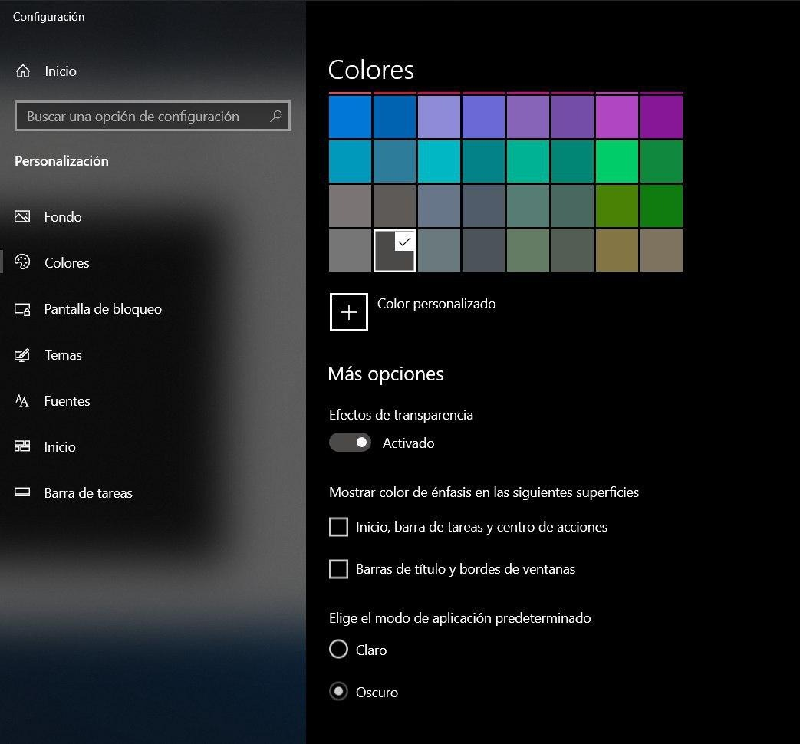
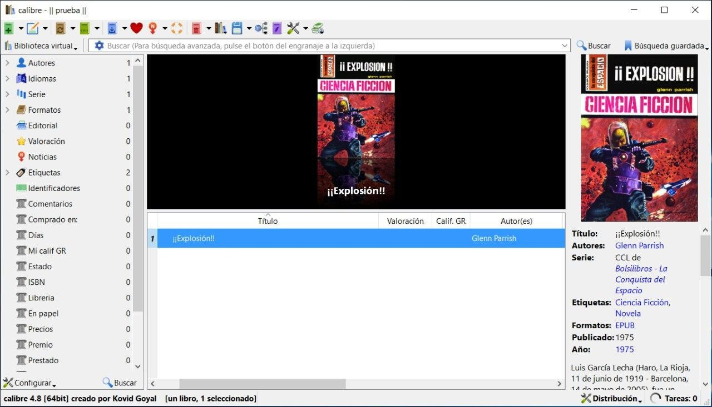
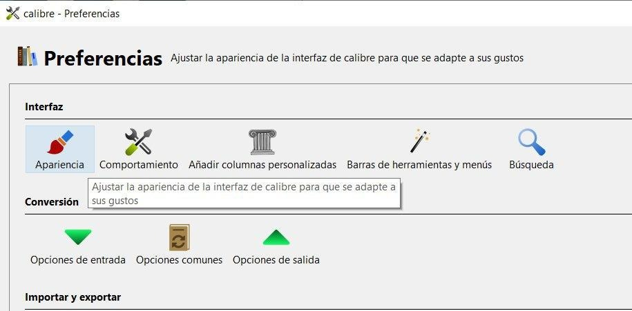
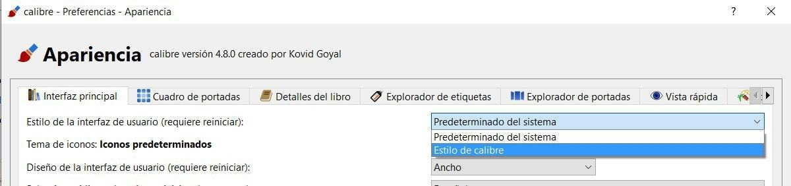
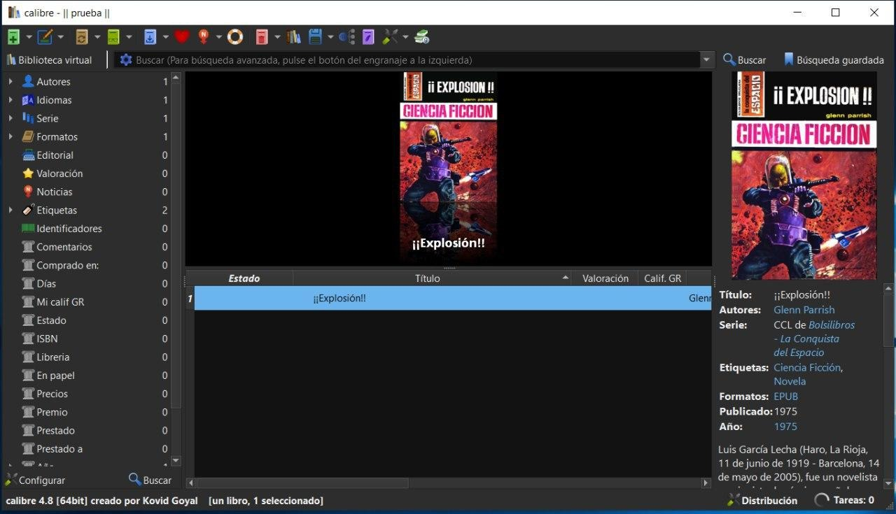
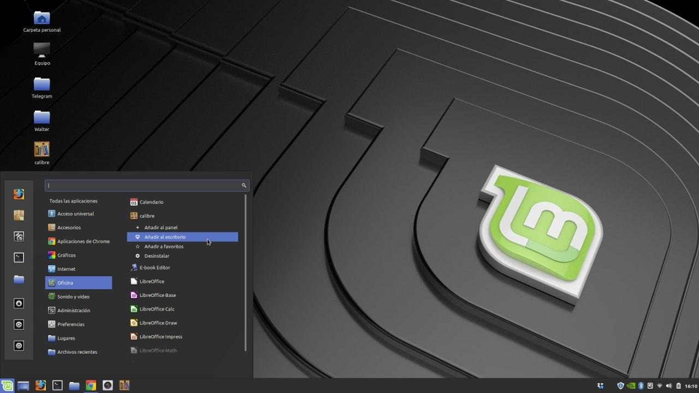
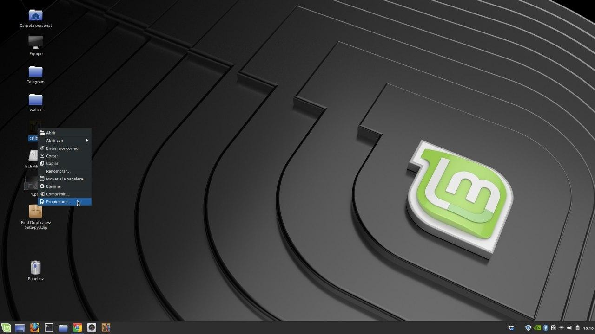
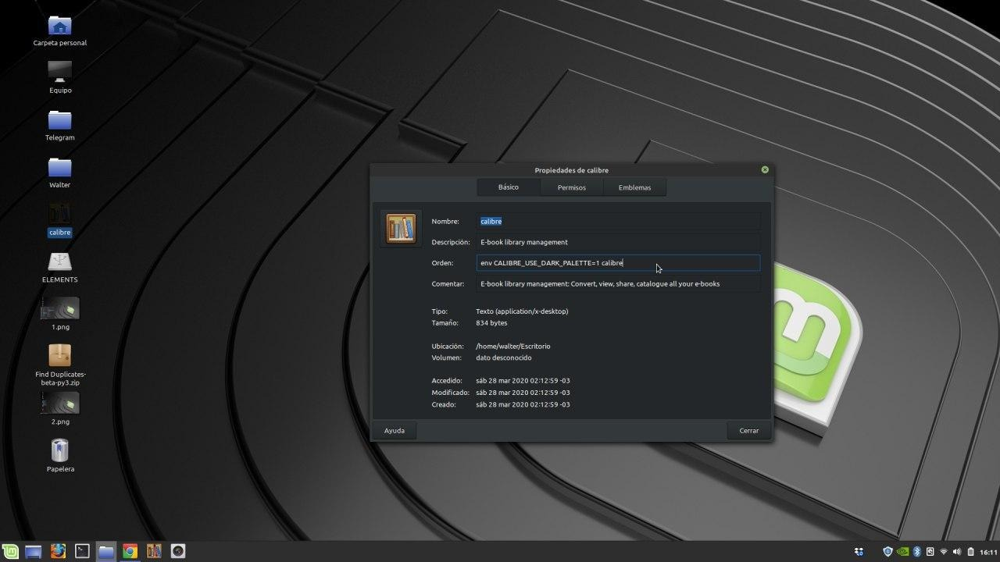
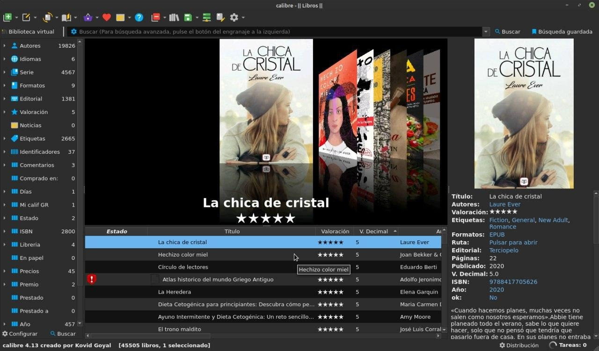
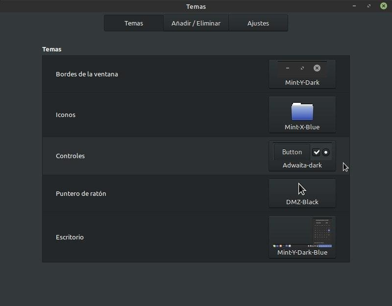

# Modo oscuro de Calibre (dark mode)

:material-account: [Walter](https://t.me/Dunhill69){ target=_blank } · :material-link-variant: [Ver el original en Telegraph](https://telegra.ph/Modo-oscuro---Dark-mode-08-17){ target=_blank }
{ .tut-datos }

---

Como poner nuestro Calibre en modo oscuro ?

**En Windows**: Vamos a la configuración de Windows 10 y seleccionamos el modo oscuro.

Abrimos Calibre ( a partir de la versión 4 ) y como ven esta en el formato normal vamos a Preferencias / Apariencia.

En Apariencia vamos a estilo de la interfaces de usuario lo tenemos en predeterminado por el sistema lo cambiamos a Estilo de Calibre tocamos Aplicar y nos va a decir que calibre se va a reiniciar

Y una vez iniciado, no apto cara racistas, Calibre en dark mode.

**En Linux**: Bueno acá estoy de nuevo con mi Linux mint y les mostrare lo del tema oscuro para Calibre.

Del menú principal hacemos click Derecho del mouse en donde esta Calibre y ponemos fijar en el escritorio

Se nos crea algo como un acceso directo y en ese icono click derecho del mouse preferencias.

Un el renglón de Orden escribimos: env CALIBRE\_USE\_DARK\_PALETTE=1 calibre

De damos doble click en este icono y si tenemos un tema negro en el sistema se nos pone en modo oscuro

Acá se ve el tema negro seleccionado

 

## [Volver al inicio](https://telegra.ph/Indice-Calibre-en-Espa%C3%B1ol-10-03)

 

---

[:material-arrow-left: Volver al índice](../../alfabetico.md) · [:fontawesome-brands-telegram: Preguntar en el grupo](https://t.me/calibreconfiguraciones){ target=_blank }
