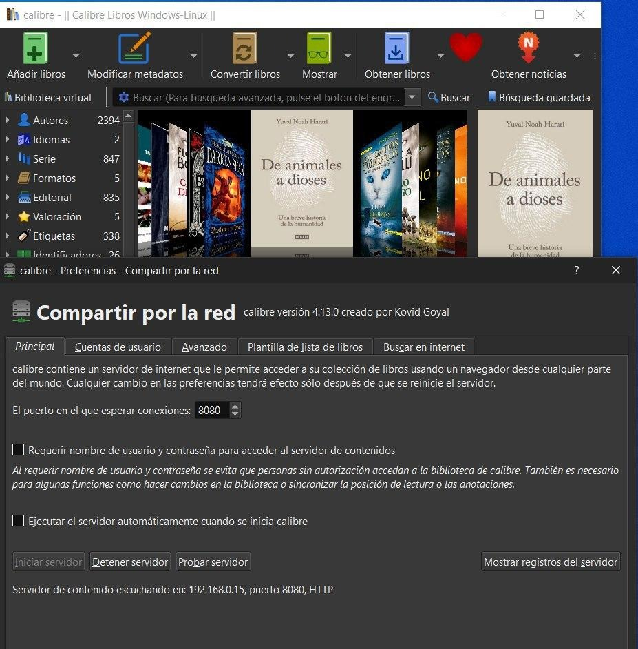
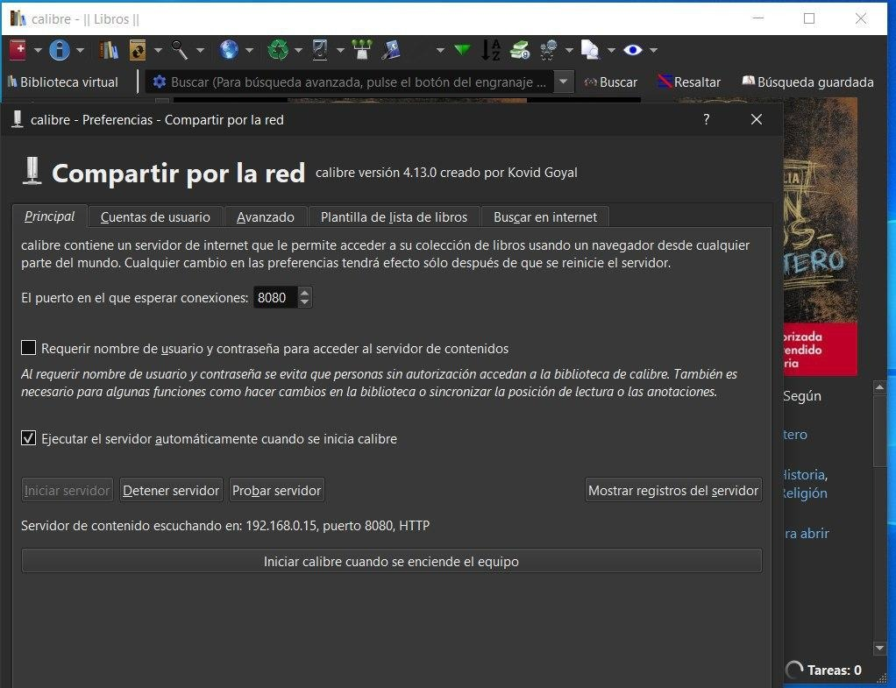
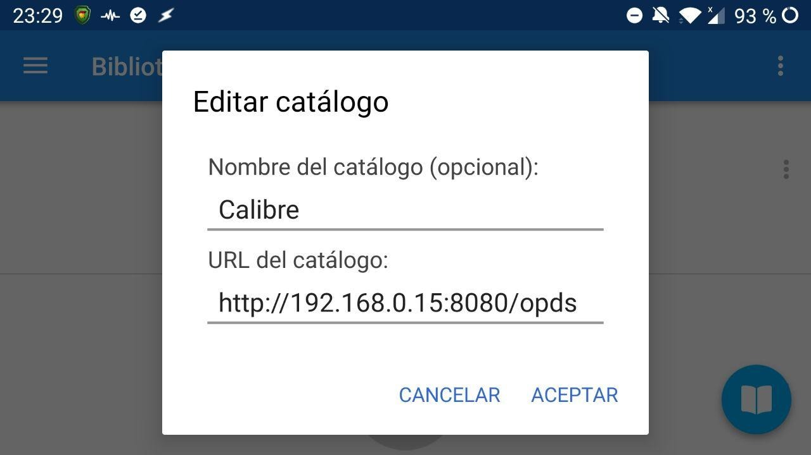
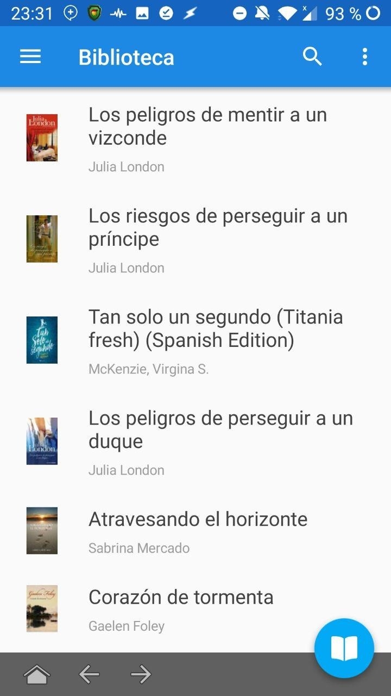
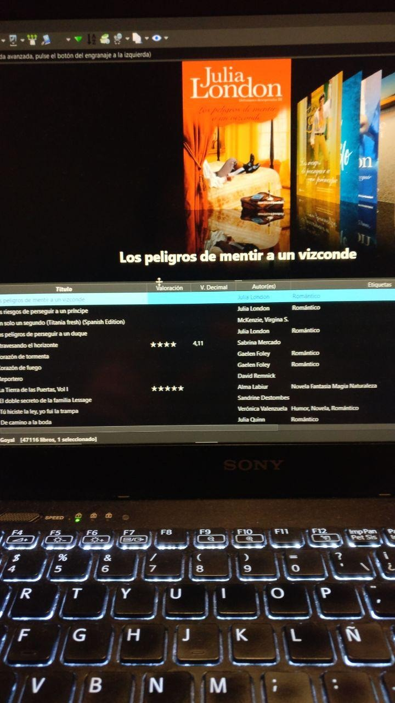
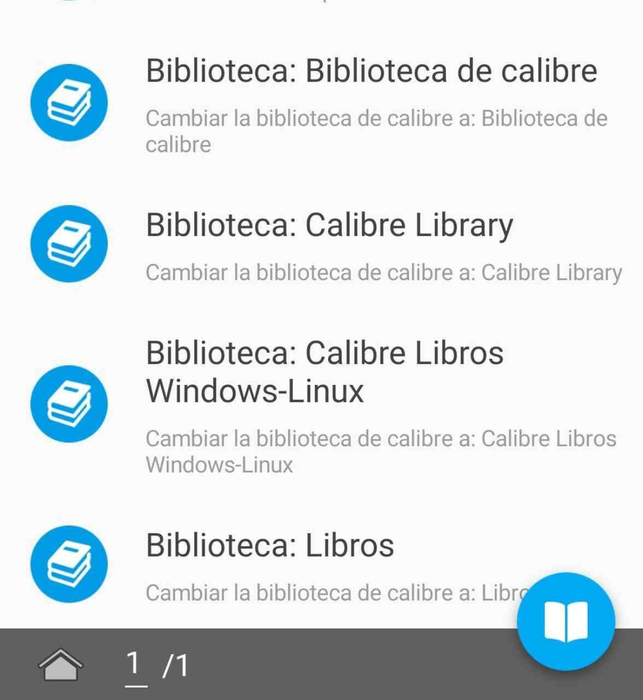

# Moon+ Reader y Calibre - ver la biblioteca

:material-account: [Walter](https://t.me/Dunhill69){ target=_blank } · :material-link-variant: [Ver el original en Telegraph](https://telegra.ph/Moon-reader-y-Calibre---Ver-biblioteca-09-05){ target=_blank }
{ .tut-datos }

---

Así esta configurada la versión portable ( debes marcar ejecutar servidor al iniciar Calibre)

Así la de escritorio, tienen las dos la misma dirección, que es lógico porque es la de la máquina.

En bibliotecas del moon reader debes poner así

Así se ve la biblioteca en el moon reader

Así en la PC

Y te muestra las bibliotecas que tengas, todas.

Ir al mensaje: [https://t.me/calibreconfiguraciones/10376](https://t.me/calibreconfiguraciones/10376)

 

## [Volver al inicio](https://telegra.ph/Indice-Calibre-en-Espa%C3%B1ol-10-03)

 

---

[:material-arrow-left: Volver al índice](../../alfabetico.md) · [:fontawesome-brands-telegram: Preguntar en el grupo](https://t.me/calibreconfiguraciones){ target=_blank }
