# Mostrar emblemas al lado de las portadas (leído, foto del autor, premio)

:material-account: [Walter](https://t.me/Dunhill69){ target=_blank } · :material-link-variant: [Ver el original en Telegraph](https://telegra.ph/Mostrar-emblemas-al-lado-de-las-portadas-12-13){ target=_blank }
{ .tut-datos }

---

Aportes de @jane\_morris, @metus54 @Mikelgood, @dunhill69

Para ver un icono en el cuadro de portadas, que puede ser puesta a nuestra elección.

 

Se ingresan estas reglas

En este caso debemos crear la columna Comprados

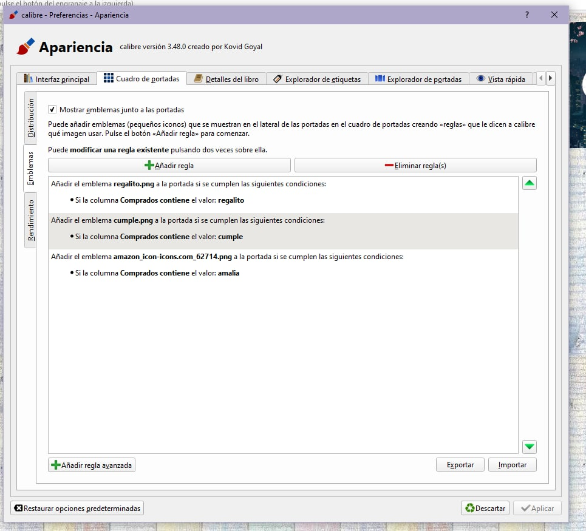

 

Acá algunas imagenes aportadas

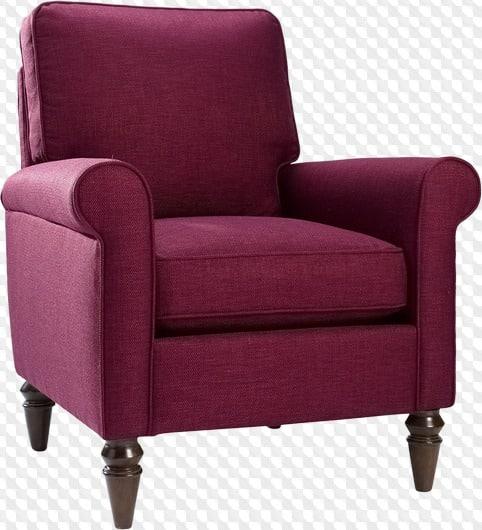

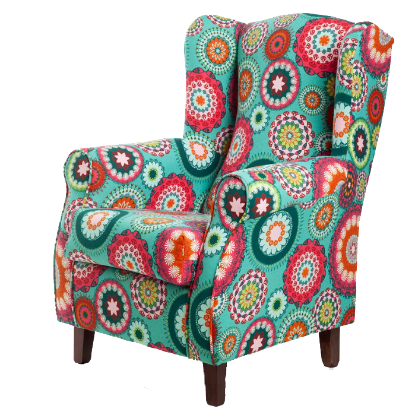

 

Y si queremos solo una marca en leído

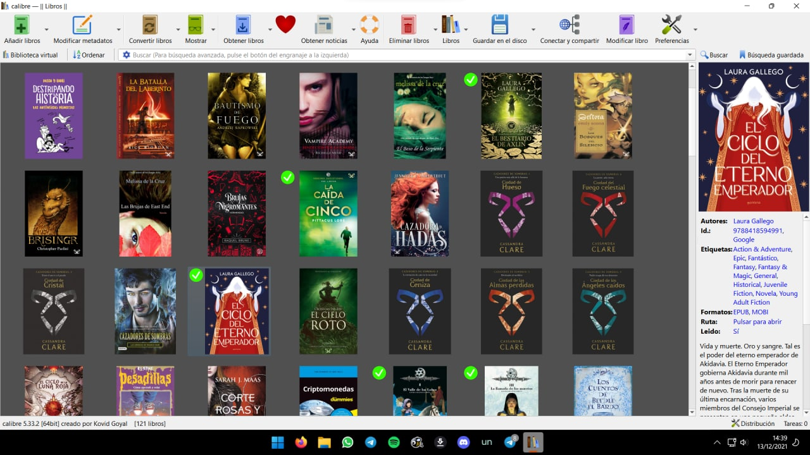

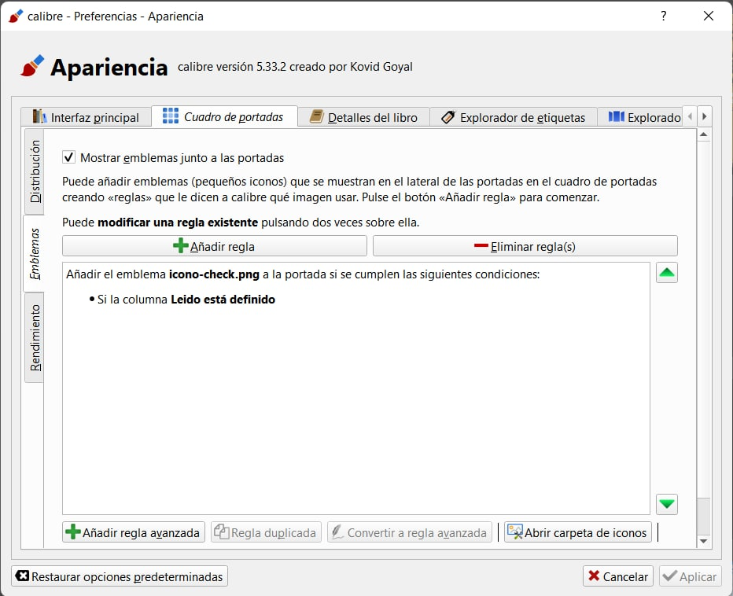

Poner foto de autor como emblema

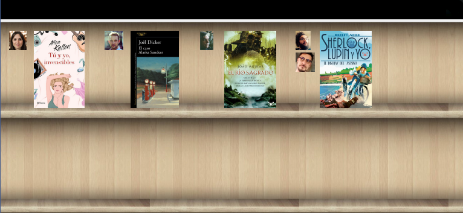

Hacia tiempo que queria la foto del autor al lado de la portada como emblema

Antes era imposible gestionarlo porque seria una regla por autor, hasta que un compañero compartio este código.

En Preferencia emblemas donde dice Abrir carpeta de iconos vamos poniendo las fotos de los autores como la tenenos en Calibre Nombre apellido o Apellido nombre y en reglas avanzadas copiamos este código que soporta hasta 6 autores.

Código:

program: rslt=''; authors = $authors;

rslt = list\_item(authors, 0, '&') & '.png';

for i in range(1, list\_count(authors, '&')):

if i == 6 then break fi;

rslt = rslt & ':' & list\_item(authors, i, '&') & '.png'

rof;

return rslt

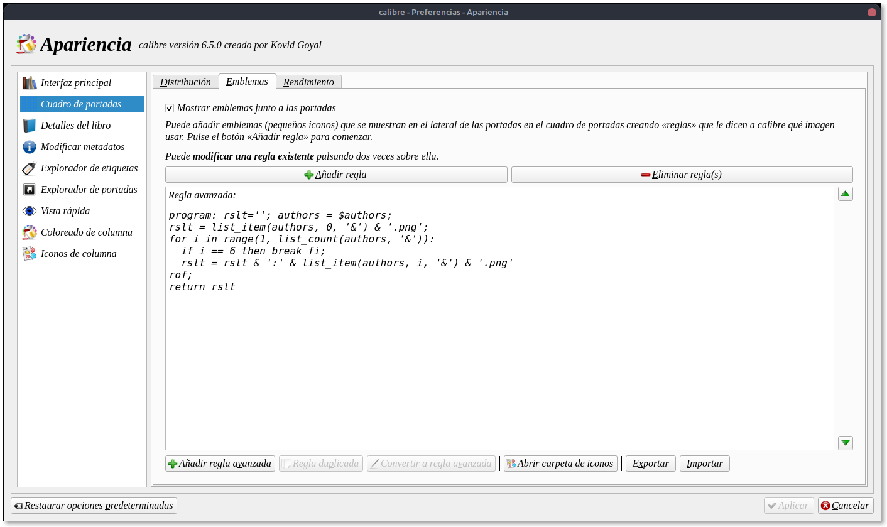

La carpeta donde hay que cargar las fotos en png se abre donde dice Abrir carpeta de iconos

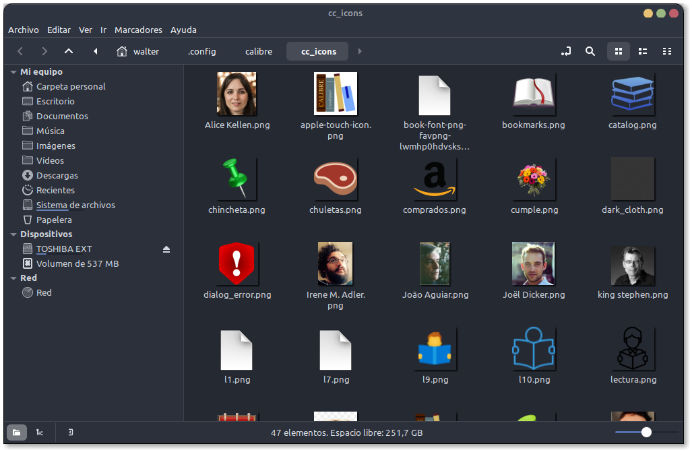

Ir a mensaje: [https://t.me/calibreconfiguraciones/101108](https://t.me/calibreconfiguraciones/101108)

 

El mismo procedimiento vamos a hacer para ponerle el logo de los premios literarios.

Volvemos a entrar en Preferencias/Apariencia/Cuadro de portadas/Emblemas y en reglas avanzadas ponemos este código:

program: rslt='';

premio = field('#premio');

rslt = list\_item(premio, 0, '&') & '.png';

for i in range(1, list\_count(premio, '&')):

if i == 6 then break fi;

rslt = rslt & ':' & list\_item(premio, i, '&') & '.png'

rof;

return rslt

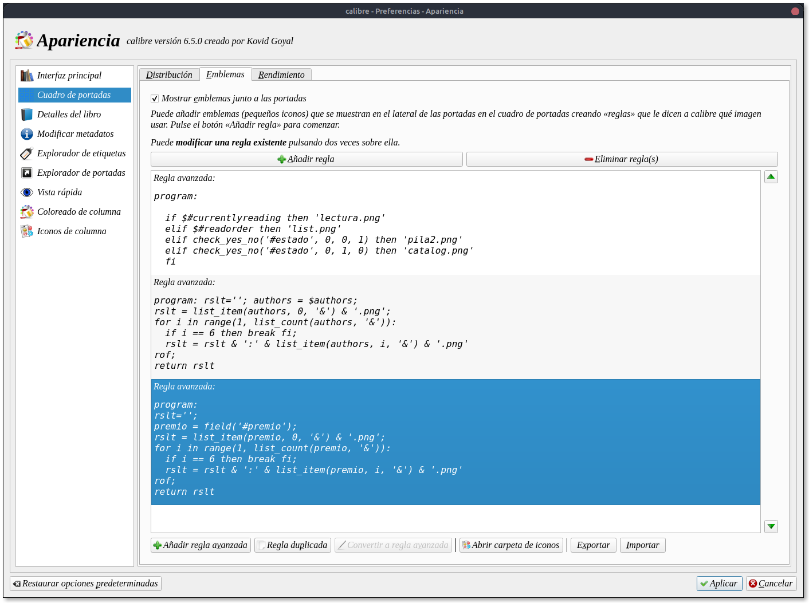

Despues deberiamos crear una columna personalizada para poner los premios.

Así se ve el resultado

11/22/63 tiene el logo de los premios goodreads y el instituto el icono de los premios Nobel ( como muestra)

En el caso de tener más premios en la columna premio hay que separar los premios con &

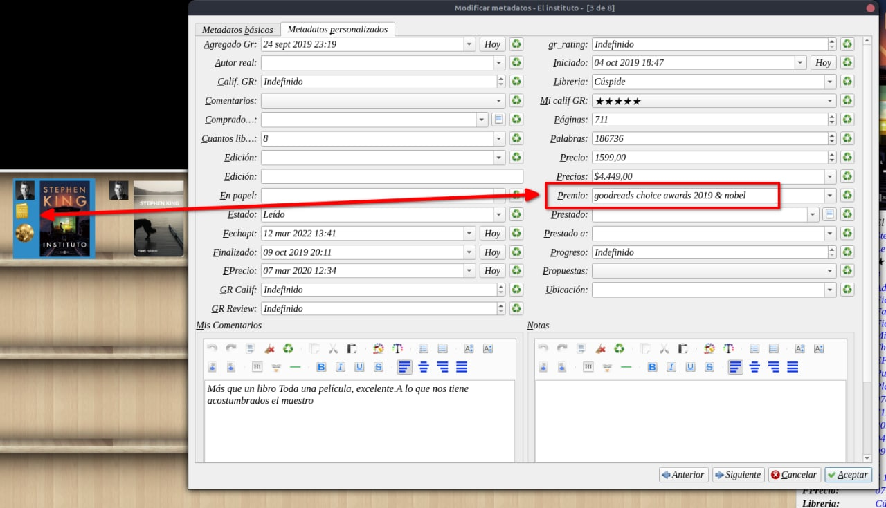

Ir al mensaje: [https://t.me/calibreconfiguraciones/101344](https://t.me/calibreconfiguraciones/101344)

Si queremos que aparezca el genero del libro: (@metus54)

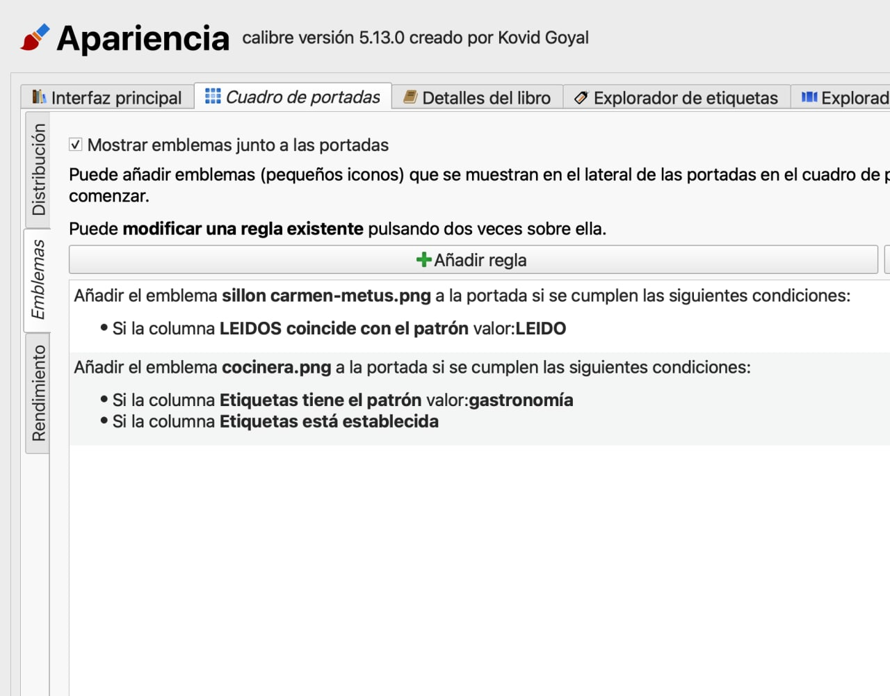

Mi segunda regla equivaldría a tu cuchillo, solo que yo solo lo tengo aquí, en etiquetas de momento no

Quedaría así:

 

 

 

---

[:material-arrow-left: Volver al índice](../../alfabetico.md) · [:fontawesome-brands-telegram: Preguntar en el grupo](https://t.me/calibreconfiguraciones){ target=_blank }
