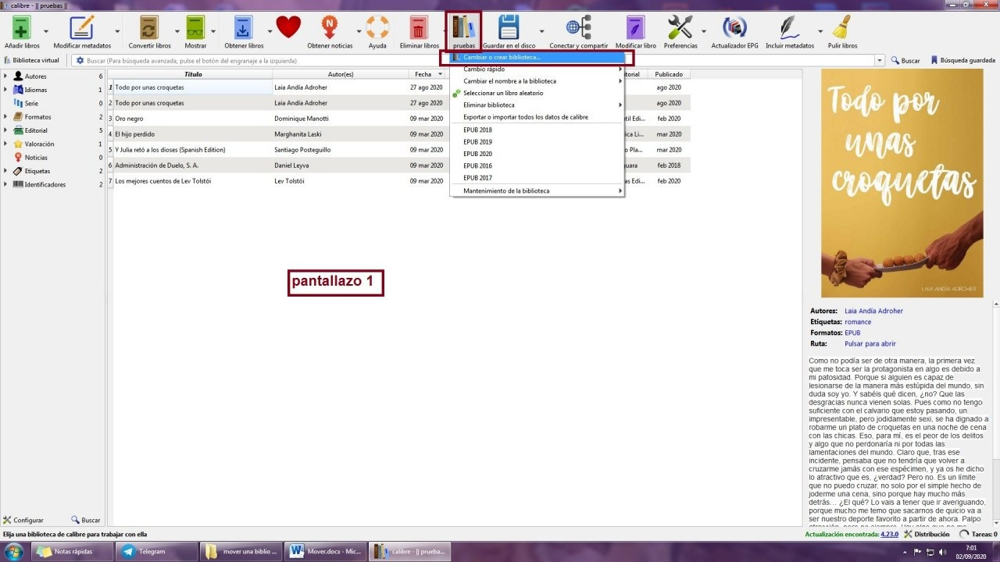
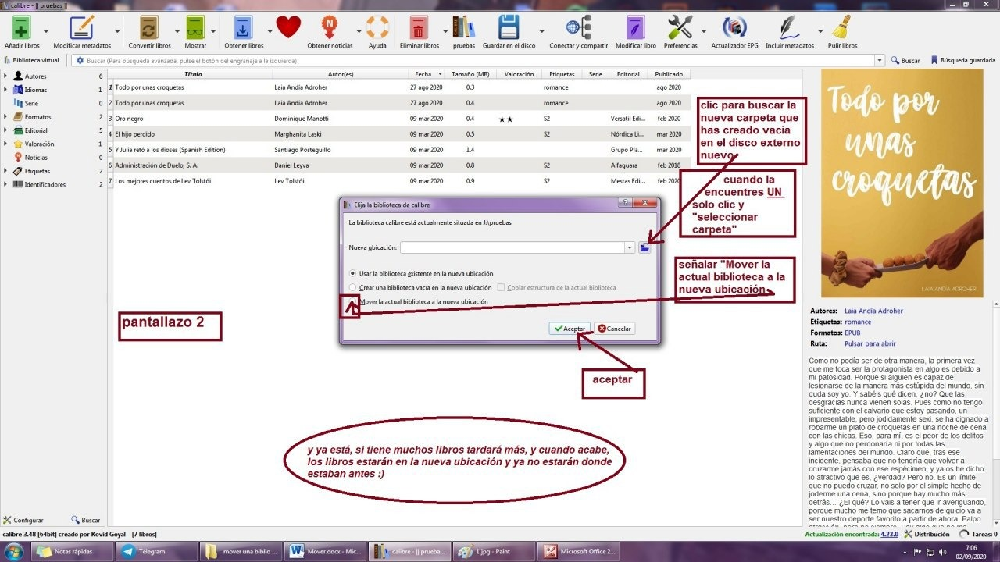

# Mover la biblioteca a otra ubicación

:material-account: [Walter](https://t.me/Dunhill69){ target=_blank } · :material-link-variant: [Ver el original en Telegraph](https://telegra.ph/Mover-biblioteca-a-una-ubicaci%C3%B3n-09-02){ target=_blank }
{ .tut-datos }

---

Tuto en pantallazos de como mover una biblio ya existente a una nueva ubicación:

1.- En el disco duro externo nuevo creas una carpeta que se llame como quieras tú, en este caso  "pruebas" y la dejas vacia.

situada en la biblio del calibre que quieres mover de sitio, clic en el icono de los libros verticales🡪cambiar o crear biblioteca (pantallazo 1)

## [Volver al inicio](https://telegra.ph/Indice-Calibre-en-Espa%C3%B1ol-10-03)

 

 

---

[:material-arrow-left: Volver al índice](../../alfabetico.md) · [:fontawesome-brands-telegram: Preguntar en el grupo](https://t.me/calibreconfiguraciones){ target=_blank }
