# Mover la biblioteca a otra ubicación (método de Calibre)

:material-account: [Walter](https://t.me/Dunhill69){ target=_blank } · :material-link-variant: [Ver el original en Telegraph](https://telegra.ph/Mover-una-biblioteca-a-cualquier-lugar-11-08){ target=_blank }
{ .tut-datos }

---

Método Calibre

Para mover una biblioteca a otro lugar con Calibre.

Tocamos el icono de Bibliotecas de Calibre y tocamos en Cambiar o crear biblioteca.

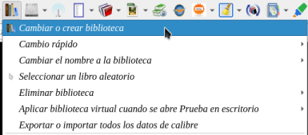

Elegimos la tercera opción.

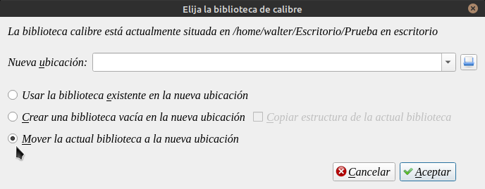

Tocamos el disquette al lado de la barra de Nueva ubicación.

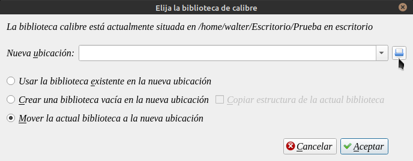

Eso nos llevara a crear una nueva carpeta en el lugar elegido para poner nuestra biblioteca. Vean el número 1 ( Dice Elija una ubicación para la biblioteca de calibre)

El número 2 (En nuestro caso lo vamos a poner en el escritorio )

El número 3 (Crear nueva carpeta)

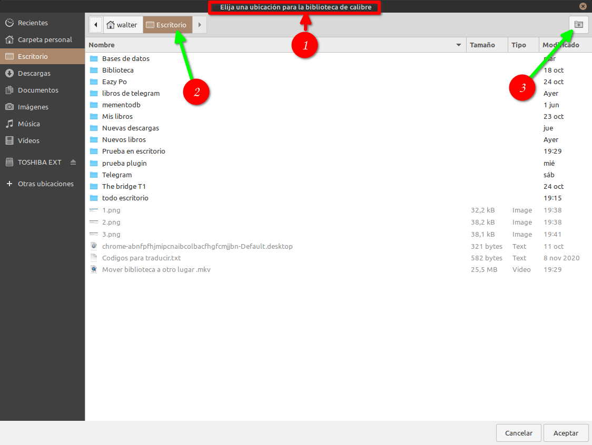

Ponemos el nombre de la biblioteca y ponemos Aceptar.

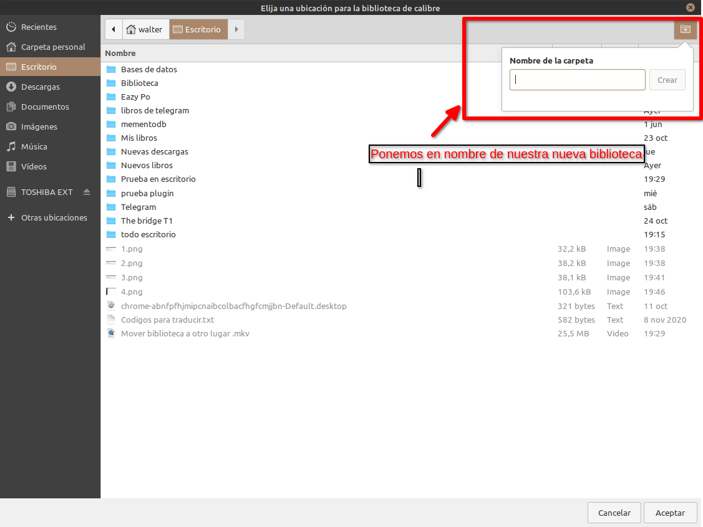

Y en el recuadro se nos completa la ruta de destino de la biblioteca.

Como podemos ver en el número 1 y en el número 2 vemos desde donde esta la biblioteca.

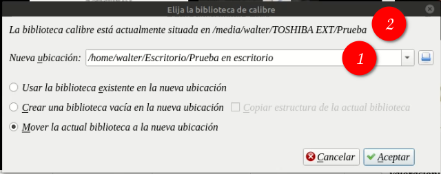

Tocamos Aceptar. Y empieza el movimiento, esto puede tardar dependiendo del tamaño de nuestra biblioteca, hasta que no termine no hacer nada, así venga la noche.

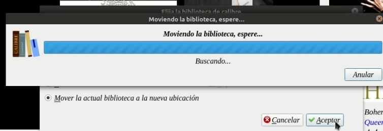

Y ya estamos trabajando en la nueva ubicación de la biiblioteca.

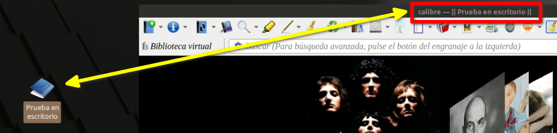

Script de Wiso

ir al script [https://t.me/calibreconfiguraciones/52623](https://t.me/calibreconfiguraciones/52623)

Ale os dejo un script que acabo de hacer en Powershell, para que funcione le tenéis que cambiar la extensión a .ps1

Tiene entorno gráfico:

Una primera ventana que se abre para seleccionar carpeta origen y

una segunda ventana que se abre para seleccionar carpeta destino.

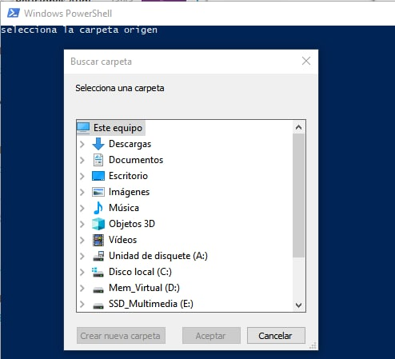

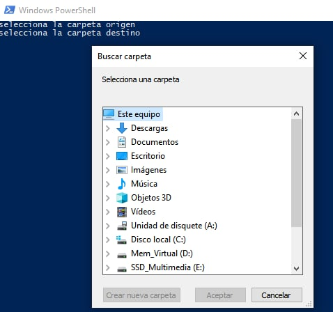

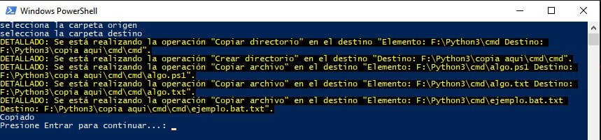

##  

Explicación Jose Antonio:

La más rápida de todas es mediante CMD

El comando que es necesario en la copia de archivos a través del CMD es el XCOPY.

Para utilizarlo debemos abrir la consola (\[inicio\] + \[ejecutar\] + \[Cmd\] en Xp o \[inicio\] y escribir "cmd" en Windows 7).

Una vez en la consola escribimos:

XCopy C:\\Carpeta1 D:\\Carpeta2 /s /e

Respetando los espacios.

Los discos C: y D: son origen destino.

La forma es la más rápida.

El modificador /s le indica que copie incluyendo los subdirectorios.

Y el modificador /e que copie incluso las carpetas vacías.

 

## [Volver al inicio](https://telegra.ph/Indice-Calibre-en-Espa%C3%B1ol-10-03)

 

---

[:material-arrow-left: Volver al índice](../../alfabetico.md) · [:fontawesome-brands-telegram: Preguntar en el grupo](https://t.me/calibreconfiguraciones){ target=_blank }
