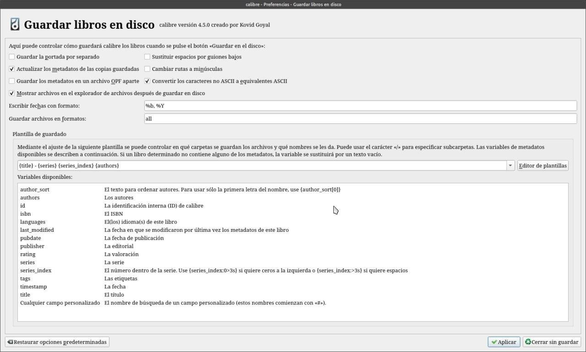
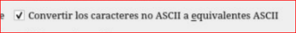
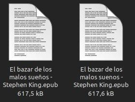

# Ñ en el título

:material-account: [Walter](https://t.me/Dunhill69){ target=_blank } · :material-link-variant: [Ver el original en Telegraph](https://telegra.ph/%C3%91-en-el-t%C3%ADtulo-09-06){ target=_blank }
{ .tut-datos }

---

Recién guardando un libro en disco, osea exportando un libro de calibre al escritorio, me doy cuenta que el titulo del libro tiene ñ y no me la reconocía en la exportación. Esto es una configuración de guardar libro en disco entonces me fui a Preferencias/Guardar libros en disco.

Lo que me llamo la atención es que estuviera marcada la casilla convertir los caracteres no Ascii

Si la desmarcamos ya tendremos bien exportado el libro.

ir al mensaje: [https://t.me/calibreconfiguraciones/2989](https://t.me/calibreconfiguraciones/2989)

 

## [Volver al inicio](https://telegra.ph/Indice-Calibre-en-Espa%C3%B1ol-10-03)

 

 

---

[:material-arrow-left: Volver al índice](../../alfabetico.md) · [:fontawesome-brands-telegram: Preguntar en el grupo](https://t.me/calibreconfiguraciones){ target=_blank }
