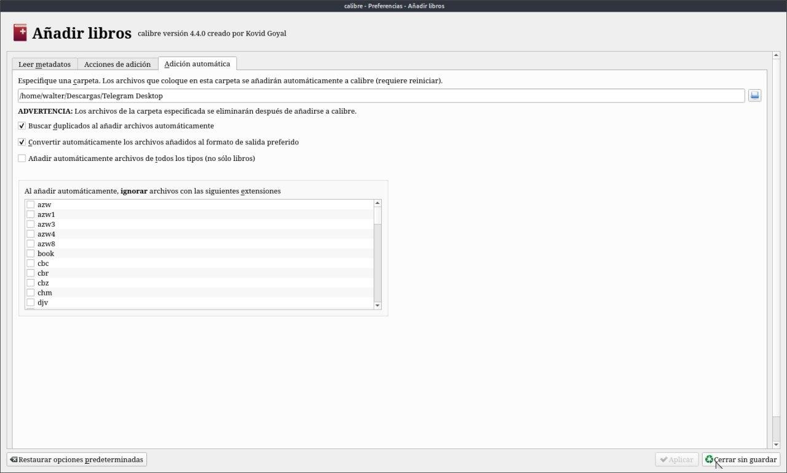
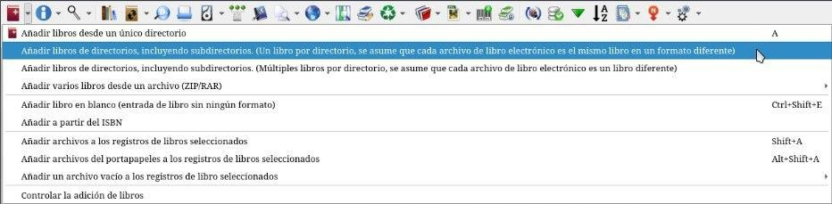

# Que no borre los libros de la carpeta de origen

:material-link-variant: [Ver el original en Telegraph](https://telegra.ph/No-borre-libros-de-la-carpeta-de-origen-09-06){ target=_blank }
{ .tut-datos }

---

Estuve haciendo pruebas, para que calibre no borre los libros de una carpeta original hay que desmarcar la opción de añadir automáticamente en Preferencias/Añadir libros/ Adicción automática eliminamos la carpeta que este en el recuadro de ruta.

Y para añadirlo desde el icono de añadir seleccionamos la opción que más nos convenga.

Confirmado:

Calibre solo elimina libros EXTERNOS si esa carpeta está configurada como la carpeta Agregar automáticamente.

Se espera que USTED deje caer una COPIA allí si usa esa ruta para agregar, de lo contrario, solo debe usar uno de los procesos de adición normales

## [Volver al inicio](https://telegra.ph/Indice-Calibre-en-Espa%C3%B1ol-10-03)

 

 

---

[:material-arrow-left: Volver al índice](../../alfabetico.md) · [:fontawesome-brands-telegram: Preguntar en el grupo](https://t.me/calibreconfiguraciones){ target=_blank }
