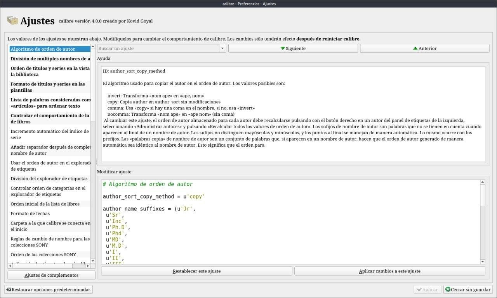
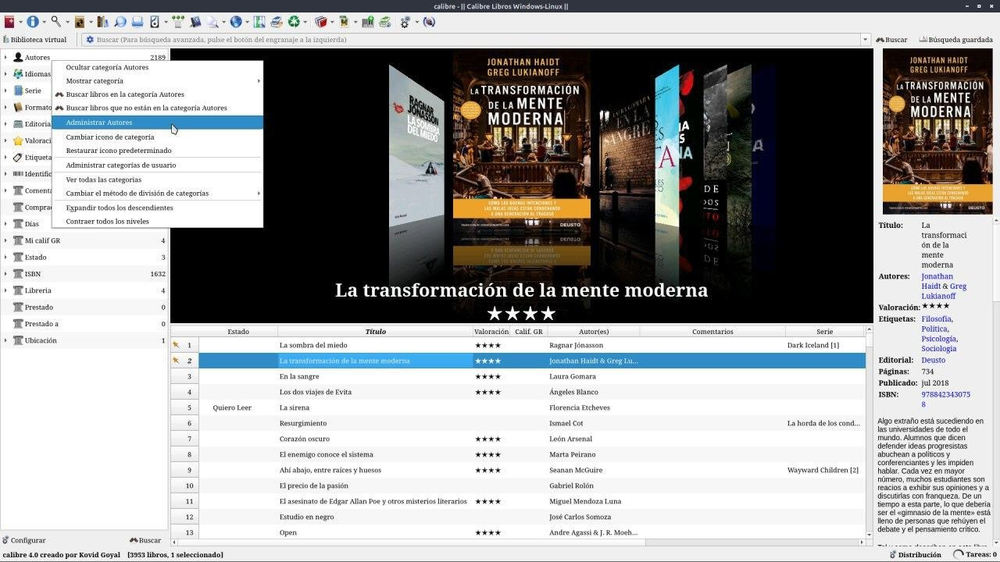
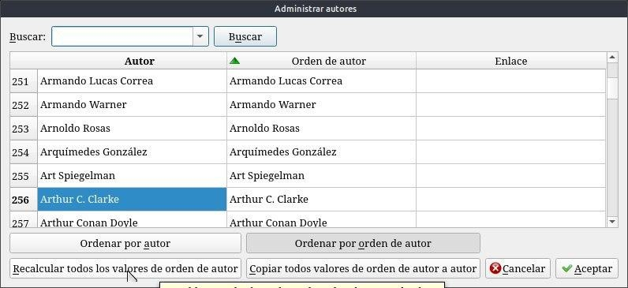

# Nombre de autor

:material-account: [Walter](https://t.me/Dunhill69){ target=_blank } · :material-link-variant: [Ver el original en Telegraph](https://telegra.ph/Nombre-de-Autor-09-06){ target=_blank }
{ .tut-datos }

---

Lo primero que podemos modificar es como calibre va a colocar el nombre de pila y el apellido.

-invert: invierte el orden de "nombre apellido" en "apellido, nombre" (incluyendo la coma intermedia)

-copy: deja el nombre de autor sin modificaciones.

-comma: usa copy si hay una coma y si no lo hay usa invert (osea coloca "apellido, nombre"). Es decir fuerza el uso de la coma siempre.

-nocomma: "nombre apellido" lo convierte en "apellido nombre" sin coma entre medio.

El programa viene pre-establecido en comma.

Sigo. Como a mi los nombres con coma no me gustan he elegido cambiar la configuracion pre-establecida por copy que se adapta a mis necesidades. Es decir deja el nombre tal cual sin comas si no las trae. Y así lo he configurado.

Botón derecho del mouse en los autores de la ventana principal de Calibre Administrar Autores.

Al cambiar la configuración del orden de autor debemos forzosamente recalcular los nombres para que los cambios se apliquen. Para ello, debemos pasar a la pantalla principal del programa pero antes terminamos de validar cambios dando en aceptar, y tras realizar el reinicio necesario pasamos al panel de etiquetas:

Como se ve solo hay que pulsar botón derecho y elegir "Administrar Autores". Y veremos:

Aquí hay que pulsar para recalcular todos los ordenes de autor que pasarán a igualarse ambas columnas. Con esto calibre reconoce el nuevo sistema que hemos elegido de clasificar los nombres de autor.

ir al mensaje:[https://t.me/calibreconfiguraciones/1169](https://t.me/calibreconfiguraciones/1169)

 

## [Volver al inicio](https://telegra.ph/Indice-Calibre-en-Espa%C3%B1ol-10-03)

 

---

[:material-arrow-left: Volver al índice](../../alfabetico.md) · [:fontawesome-brands-telegram: Preguntar en el grupo](https://t.me/calibreconfiguraciones){ target=_blank }
